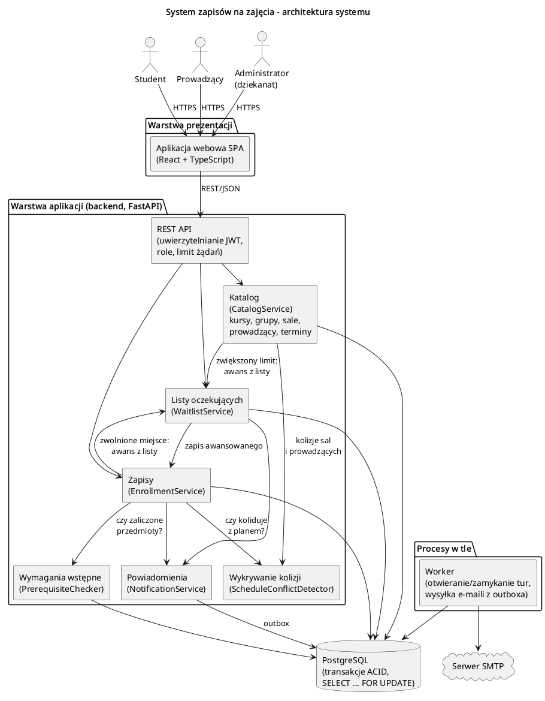
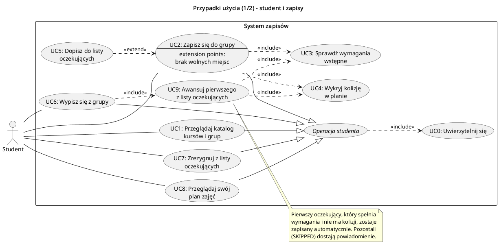
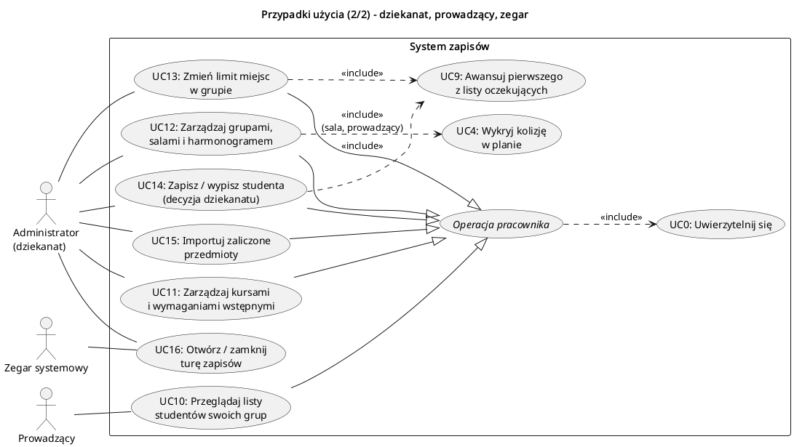
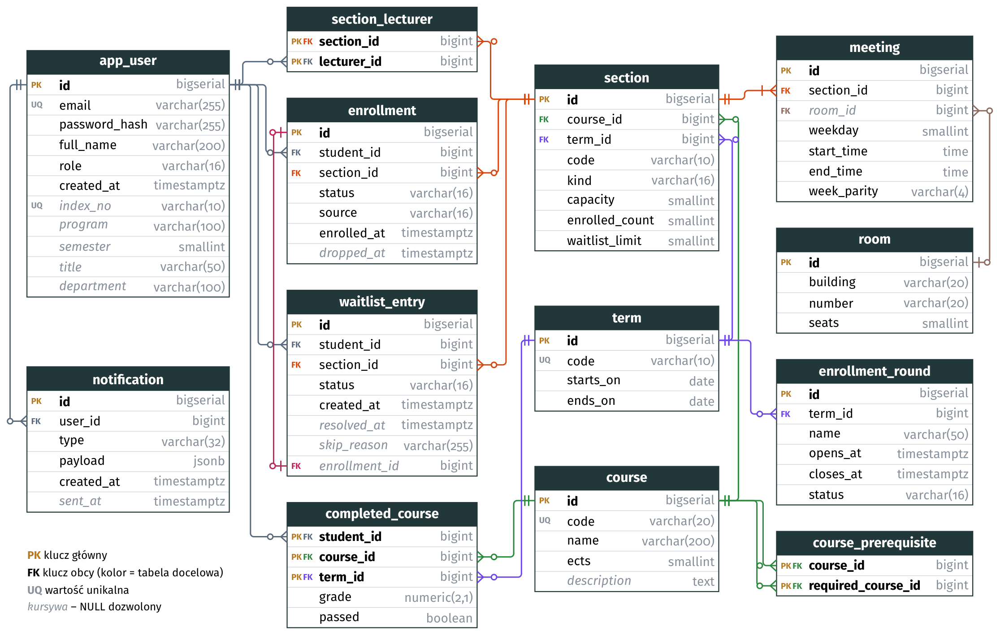
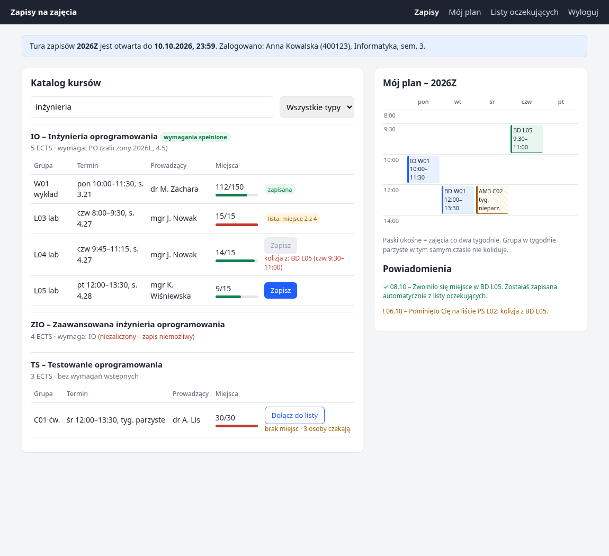

# System zapisów na zajęcia – Krok 2: architektura, prototypy i struktury danych

Termin: **21.X** (prezentacja). Ocena z etapu: **30%** oceny z projektu.

Wymagania etapu (z opisu zadania):

> Zespół przedstawia proponowaną **architekturę** rozwiązania. Należy przygotować pierwsze
> **prototypy** dla obszarów, które potencjalnie mogą być najbardziej problematyczne
> (albo mock-upy UI). Należy opisać główne **przypadki użycia**. Kolejnym elementem jest
> **projekt struktury danych** (diagram ER: tabele, kolumny, typy, klucze).

Temat 2, *System zapisu na zajęcia*:

> Studenci zapisują się na zajęcia z ograniczoną liczbą miejsc, przedmiotów wstępnych
> i potencjalnie kolidujących harmonogramów. Obsługa katalogu: kursów, sekcji, wykładowców
> i harmonogramów. Wsparcie dla: różnych rozmiarów grup, wymagań wstępnych (zaliczonych
> przedmiotów), wykrywanie konfliktów w harmonogramie. Listy oczekujących z automatycznym
> zapisywaniem, gdy zwolni się miejsce.

### Gdzie które wymaganie jest pokryte

| Wymaganie z tematu | Przypadek użycia | Tabele (ER) | Prototyp |
|---|---|---|---|
| ograniczona liczba miejsc | UC2, UC13 | `section.capacity`, `enrolled_count`, `waitlist_limit` | scenariusz 1, 5 |
| katalog: kursy, sekcje, wykładowcy, harmonogramy | UC1, UC11, UC12 | `course`, `section`, `section_lecturer`, `meeting`, `room`, `term`, `enrollment_round` | scenariusz 6 (tura) |
| różne rozmiary grup | UC12, UC13 | `section.capacity` per grupa, `section.kind`, `room.seats` | scenariusz 1, 4, 5 |
| wymagania wstępne (zaliczone przedmioty) | UC3, UC11, UC15 | `course_prerequisite`, `completed_course` | scenariusz 2, 6 |
| wykrywanie konfliktów w harmonogramie | UC4, UC12 | `meeting` (dzień, godziny, parzystość tygodni) | scenariusz 3 |
| listy oczekujących z automatycznym zapisem | UC5, UC7, UC9, UC18 | `waitlist_entry`, `notification` | scenariusz 4, 5, 6 |

## Zawartość folderu

| Plik | Co to jest |
|---|---|
| `diagramy/architektura.puml` / `.png` | Diagram architektury (moduły i połączenia) |
| `diagramy/przypadki_uzycia_student.puml` / `.png` | Przypadki użycia 1/2: student i zapisy |
| `diagramy/przypadki_uzycia_administracja.puml` / `.png` | Przypadki użycia 2/2: dziekanat, prowadzący, zegar |
| `diagramy/er.py` → `er.tex` / `.pdf` / `.png` | Diagram ER bazy danych (TikZ, generowany skryptem) |
| `schemat.sql` | Schemat bazy dla PostgreSQL 16 (tabele, ograniczenia, funkcja wykrywania kolizji) |
| `prototyp/prototyp_zapisow.py` | Działający prototyp najbardziej ryzykownych mechanizmów |
| `mockup/mockup.html` / `.png` | Mock-up ekranu zapisów studenta |
| `prezentacja/prezentacja.tex` / `.pdf` | Slajdy na prezentację (Beamer, XeLaTeX). Kompilacja: `prezentacja/build.sh` (sam pobiera tectonic do `.tools/`) |
| `prezentacja/prezentacja_krotka.tex` / `.pdf` | Skrócona wersja slajdów (maks. 10 minut) |

Pliki `.puml` to źródła w PlantUML, a `.png` to wersje gotowe do slajdów (instrukcja regeneracji
na końcu).

---

## 1. Architektura



System to aplikacja webowa w trzech warstwach plus osobny proces w tle:

- **Warstwa prezentacji** – aplikacja SPA (React + TypeScript) dla trzech ról: student,
  prowadzący, administrator (dziekanat).
- **Backend (FastAPI)** – REST API oraz moduły:
  - `CatalogService` – kursy, wymagania wstępne, grupy, sale, prowadzący, terminy zajęć,
    tury zapisów,
  - `EnrollmentService` – zapisy i wypisy. Jedyny moduł, który zmienia liczbę zajętych miejsc,
  - `PrerequisiteChecker` – sprawdza, czy student zaliczył wymagane przedmioty,
  - `ScheduleConflictDetector` – kolizje w planie studenta, a przy układaniu harmonogramu
    także kolizje sal i prowadzących,
  - `WaitlistService` – kolejka oczekujących i automatyczny zapis po zwolnieniu miejsca,
  - `NotificationService` – zapisuje powiadomienia do tabeli-outboxa,
  - `UserService` – konta, role, logowanie (UC0),
  - `StudentRecordsService` – import zaliczonych przedmiotów (UC15).
- **Worker w tle** – otwiera i zamyka tury zapisów o zadanych godzinach (przy zamknięciu
  wygasza listy oczekujących), okresowo sprawdza niezmienniki (widok
  `section_invariant_violations`) oraz wysyła e-maile z outboxa przez serwer SMTP. Wysyłka jest poza transakcją zapisu, więc wolny serwer pocztowy
  nie blokuje zapisów.
- **PostgreSQL** – jedno źródło prawdy. O liczbie miejsc i kolejności na liście decydują
  transakcje i blokada wiersza grupy (`SELECT ... FOR UPDATE`).

**Główne wyzwanie architektoniczne** to szczyt obciążenia w chwili otwarcia tury: setki
studentów jednocześnie próbują zająć te same miejsca. Dlatego zapis do jednej grupy jest
serializowany blokadą jej wiersza, a zapisy jednego studenta blokadą wiersza studenta
(zawsze najpierw student, potem grupa). Zapisy różnych studentów do różnych grup idą
równolegle. Awans z listy potrzebuje blokad w odwrotnej kolejności (grupa, potem awansowany
student), więc studenta blokuje z `NOWAIT`, a w razie konfliktu cała transakcja jest
wycofywana i ponawiana (szczegóły w sekcji 4). API ma limit żądań na użytkownika.

### Stos technologiczny (wstępny)

| Element | Technologia | Uzasadnienie |
|---|---|---|
| Frontend | React + TypeScript | Popularny, typowany, łatwo zbudować katalog, formularze i siatkę planu |
| Backend | Python 3.12 + FastAPI + SQLAlchemy | Szybkie prototypowanie, automatyczna dokumentacja OpenAPI, walidacja przez Pydantic, obsługa wielu równoczesnych żądań (async) |
| Baza danych | PostgreSQL 16 | Transakcje ACID, blokady wierszy, indeksy częściowe (`UNIQUE ... WHERE`), typy `TIME` i `JSONB` |
| Zadania w tle | Własny worker (APScheduler) | Outbox i tury zapisów są w bazie, więc osobny broker (Redis/RabbitMQ) nie jest potrzebny |
| Uwierzytelnianie | JWT; docelowo SSO uczelni | Bezstanowe API, łatwe rozdzielenie ról |
| Wdrożenie | Docker Compose (frontend, api, worker, db) | Jednakowe środowisko dla całego zespołu |

---

## 2. Przypadki użycia

Diagram podzielono na dwa, żeby był czytelny.





**Aktorzy:** Student, Prowadzący, Administrator (dziekanat), Zegar systemowy. Zegar ma osobny
przypadek (UC17), bo w odróżnieniu od dziekanatu (UC16) się nie uwierzytelnia.

Notacja jest wzorowana na przykładzie bankomatu z
[uml-diagrams.org](https://www.uml-diagrams.org/bank-atm-uml-use-case-diagram-example.html):

- asocjacja aktor–przypadek to zwykła linia, bez strzałki,
- *Operacja studenta* i *Operacja pracownika* (kursywa) to **abstrakcyjne** przypadki użycia.
  Konkretne operacje je uogólniają (strzałka z pustym grotem), a każda z nich przez
  `<<include>>` wymaga **UC0: Uwierzytelnij się**,
- `<<include>>` – zachowanie zawsze wykonywane (zapis zawsze sprawdza wymagania i kolizje),
- `<<extend>>` – zachowanie warunkowe w nazwanym punkcie rozszerzenia: UC5 (lista
  oczekujących) rozszerza UC2 w punkcie „brak wolnych miejsc”, a UC9 (awans z listy)
  rozszerza UC13 („wolne miejsce po zmianie”) i UC14 („wypis w otwartej turze”).
  UC6 → UC9 to `<<include>>`, bo wypis studenta zawsze zwalnia miejsce w otwartej turze.

### Główne scenariusze

**UC2 – Zapisz się do grupy** (Student)
- Warunki wstępne: student jest zalogowany, tura zapisów jest otwarta.
- Przebieg:
  1. Student wybiera grupę z katalogu (UC1).
  2. System blokuje wiersz studenta, a potem wiersz grupy (żeby inne zapisy tego studenta
     i inne zapisy do tej grupy czekały).
  3. System sprawdza wymagania wstępne (UC3): wszystkie przedmioty wymagane przez kurs muszą być zaliczone.
  4. System sprawdza kolizje (UC4) z grupami, do których student jest już zapisany.
  5. Jeśli są wolne miejsca, system zapisuje studenta i zwiększa licznik zajętych miejsc.
     Wpisy studenta na listach innych grup tego samego przedmiotu i typu dostają status
     CANCELLED (z powiadomieniem): po zapisie i tak zostałyby pominięte, a zajmują miejsca na
     liście (`waitlist_limit`) innym.
  6. Student widzi grupę w swoim planie (UC8).
- Scenariusze alternatywne:
  - brak zaliczenia albo kolizja → odmowa z podaniem przyczyny (który przedmiot, z jaką grupą);
  - student jest już zapisany do innej grupy **tego samego przedmiotu i typu** (np. drugie
    laboratorium z IO) → odmowa. Wykład i laboratorium z jednego przedmiotu są dozwolone;
  - brak miejsc → **UC5**: student zostaje dopisany na koniec listy oczekujących (o ile lista
    nie przekroczyła `waitlist_limit`) i widzi swoją pozycję;
  - student jest już zapisany do tej grupy lub już na nią czeka → odmowa (jawne sprawdzenie
    w regułach zapisu; indeksy `UNIQUE ... WHERE` są tylko ostatnią linią obrony, bo każdy
    pilnuje jednej tabeli);
  - tura zamknięta → odmowa.
  - Zamiana grupy (np. z L05 na L03 bez utraty L05) nie jest obsługiwana: student z grupą
    danego typu nie może czekać na inną grupę tego typu. To kandydat na kolejny etap.

**UC6 – Wypisz się z grupy** (Student) – obejmuje **UC9**
- W jednej transakcji: zapis zmienia status na DROPPED, licznik miejsc maleje i od razu
  uruchamia się UC9.

**UC9 – Awansuj pierwszego z listy oczekujących** (system)
- Wywoływany po zwolnieniu miejsca (UC6, UC14) albo zwiększeniu limitu (UC13).
- Działa tylko, **dopóki jest wolne miejsce**. Bez miejsca nikogo nie pomija: oczekujący może
  jeszcze usunąć kolizję, zanim miejsce się zwolni.
- System bierze oczekujących w kolejności dopisania i dla każdego **ponownie** sprawdza
  wymagania, kolizje i regułę „jedna grupa danego typu na przedmiot”. Od chwili dopisania do listy student mógł zapisać się na zajęcia
  w tym samym terminie.
  - spełnia warunki → zostaje zapisany (`source = WAITLIST`) i dostaje powiadomienie, a jego
    wpisy na listach innych grup tego przedmiotu i typu dostają CANCELLED;
  - nie spełnia → wpis dostaje status SKIPPED z powodem, student dostaje powiadomienie,
    system bierze następną osobę.
- Kończy się, gdy zabraknie miejsc albo lista się wyczerpie. Niezmiennik: **nikt nie czeka
  na liście, gdy w grupie są wolne miejsca.**

**UC7 – Zrezygnuj z listy oczekujących** (Student) – wpis dostaje status CANCELLED, a kolejni
przesuwają się w górę.

**UC10 – Przeglądaj listy studentów swoich grup** (Prowadzący) – lista zapisanych i oczekujących.

**UC11 / UC12 – Katalog i harmonogram** (Administrator)
- Kursy z wymaganiami wstępnymi. Grupy różnego typu i rozmiaru (wykład 150, ćwiczenia 30,
  laboratorium 15), przypisanie prowadzących, terminy (dzień, godziny, tygodnie
  parzyste/nieparzyste) i sale.
- Przy dodawaniu terminu system wykrywa kolizje sal i prowadzących (UC4), a limit grupy nie
  może przekraczać liczby miejsc w sali.

**UC13 – Zmień limit miejsc** (Administrator) – gdy po zmianie jest wolne miejsce, od razu
uruchamia się UC9 (`<<extend>>`). Zmniejszyć limit można najwyżej do liczby zapisanych osób
(pilnuje tego `CHECK`), a zwiększyć najwyżej do liczby miejsc w sali.

**UC14 – Zapisz / wypisz studenta** (Administrator) – decyzja dziekanatu (`source = ADMIN`),
np. wpis warunkowy albo powtarzanie przedmiotu.
- Dziekanat może pominąć wymagania wstępne i działać poza turą. Kolizje i regułę „jedna
  grupa danego typu na przedmiot” system sprawdza zawsze.
- Zapis do pełnej grupy zwiększa jej limit o 1 w tej samej transakcji (nie ponad liczbę miejsc
  w sali). `CHECK (enrolled_count <= capacity)` nadal obowiązuje, a kolejka na liście nie traci
  miejsca.
- Wypis w otwartej turze uruchamia UC9 (`<<extend>>`). Po turze listy są wygaszone, więc nikt
  nie awansuje.

**UC15 – Importuj zaliczone przedmioty** (Administrator) – oceny z poprzednich semestrów
(np. eksport z systemu ocen), na których opiera się UC3.

**UC16 / UC17 – Otwórz / zamknij turę zapisów** (Administrator ręcznie / Zegar systemowy
o godzinie z `enrollment_round`) – zapisy i wypisy studentów są możliwe tylko w otwartej turze.
W semestrze może być kilka tur, ale otwarta najwyżej jedna naraz.

**UC18 – Wygaś listy oczekujących** (część zamknięcia tury) – wszystkie wpisy WAITING dostają
status EXPIRED, a studenci powiadomienie. Inaczej wypis przez dziekanat po turze zapisałby
kogoś automatycznie bez jego wiedzy.

---

## 3. Struktury danych (diagram ER)



Pełna definicja tabel, typów, kluczy i ograniczeń: [`schemat.sql`](schemat.sql) (sprawdzone
na PostgreSQL 16).

### Najważniejsze decyzje projektowe

1. **Kurs ≠ grupa.** `course` to przedmiot w katalogu (kod, ECTS, wymagania). `section` to
   konkretna grupa w danym semestrze (`term`): typ, własny limit miejsc, prowadzący.
   Dzięki temu jeden kurs może mieć wykład na 150 osób i kilka laboratoriów po 15.
2. **Harmonogram jako osobna tabela `meeting`.** Grupa może mieć kilka terminów w tygodniu.
   Termin to dzień tygodnia, godziny od–do, parzystość tygodni (`ALL | ODD | EVEN`) i sala.
   Parzystość dotyczy tygodni semestru: tydzień 1 (nieparzysty) to tydzień, w którym wypada
   `term.starts_on`.
3. **Reguła kolizji.** Dwa terminy kolidują, gdy są tego samego dnia, godziny się przecinają
   (`start1 < end2 AND start2 < end1`, więc zajęcia 8:00–9:30 i 9:30–11:00 **nie** kolidują),
   a tygodnie się pokrywają (ALL koliduje ze wszystkim, ODD tylko z ODD, EVEN tylko z EVEN).
   W schemacie jest gotowa funkcja SQL `schedule_conflicts(student, grupa)`.
   Reguła „jedna grupa danego typu na przedmiot” to funkcja `same_course_kind_section`.
   Obie biorą pod uwagę **tylko semestr nowej grupy**: zapisy mają status ENROLLED także po
   końcu semestru, a nie mogą blokować powtarzania przedmiotu.
4. **Wymagania wstępne** to tabela łącznikowa kurs → kurs wymagany. Trigger blokuje cykle
   (A wymaga B, B wymaga A), których `CHECK` nie wykrywa. Zaliczenia są w `completed_course`
   (z oceną i semestrem, bo przedmiot można powtarzać). `passed` jest kolumną wyliczaną
   (`grade >= 3.0`), więc nie da się zapisać „2.0 i zaliczone”.
5. **`section.enrolled_count` jako licznik.** Dałoby się go liczyć z `enrollment`, ale
   trzymamy go w grupie, żeby sprawdzenie limitu i zajęcie miejsca było jednym warunkowym
   `UPDATE`. `CHECK (enrolled_count <= capacity)` chroni sam licznik (np. przed zmniejszeniem
   limitu poniżej liczby zapisanych), ale **nie** chroni przed błędem, który zapisze studenta
   bez zwiększenia licznika. Prototyp to pokazuje (scenariusz 1: 30 zapisanych, licznik 1).
   Taki błąd wykrywa widok `section_invariant_violations`, który worker sprawdza okresowo.
6. **Historia zamiast kasowania.** Wypis zmienia status na `DROPPED`, a wpis na liście
   status na `PROMOTED / SKIPPED / CANCELLED / EXPIRED`. Indeksy częściowe
   (`UNIQUE (student, grupa) WHERE status = 'ENROLLED'` / `'WAITING'`) pozwalają na wiele
   historycznych wpisów, ale tylko jeden aktywny.
7. **Kolejność na liście oczekujących** wyznacza `id`, bez osobnej kolumny „pozycja”.
   Rezygnacja nie wymaga więc przenumerowania pozostałych. `id` pochodzi z sekwencji przy
   `INSERT`, czyli pod blokadą grupy, więc odpowiada kolejności dopisywania. `created_at`
   służy tylko do wyświetlania (domyślne `now()` to początek transakcji, więc mogłoby zmienić
   już pokazaną studentowi pozycję).
8. **Outbox powiadomień.** `notification` zapisuje się w tej samej transakcji co awans
   z listy, a worker wysyła e-maile później. Powiadomienie nie zginie i nie zostanie wysłane
   dla awansu, który się wycofał.
9. **Tury zapisów** to osobna tabela `enrollment_round` (kilka tur w semestrze). `opens_at`
   i `closes_at` to harmonogram dla workera, a o możliwości zapisu decyduje `status`, bo
   dziekanat może turę otworzyć lub przedłużyć ręcznie. Indeks częściowy pozwala na najwyżej
   jedną otwartą turę w semestrze.

---

## 4. Prototypy obszarów problematycznych

Za najbardziej ryzykowne uznaliśmy:

1. **Wyścig o ostatnie miejsca** w chwili otwarcia zapisów. To klasyczny błąd *check-then-act*:
   wielu studentów odczytuje „zostało 1 miejsce” i wszyscy się zapisują.
2. **Wymagania wstępne.**
3. **Wykrywanie kolizji** – łatwo pomylić się przy zajęciach stykających się końcem
   i początkiem oraz przy tygodniach parzystych i nieparzystych.
4. **Automatyczny zapis z listy oczekujących:**
   - każde zwolnione miejsce zajęte dokładnie raz, także przy równoczesnych wypisach,
   - zachowana kolejność listy,
   - pominięcie osób, które w międzyczasie przestały spełniać warunki.

Prototyp [`prototyp/prototyp_zapisow.py`](prototyp/prototyp_zapisow.py) sprawdza wszystkie
cztery obszary (oraz decyzje dziekanatu i zamknięcie tury) na równoległych wątkach i bazie SQLite (tylko biblioteka standardowa Pythona,
nic nie trzeba instalować):

```bash
cd prototyp
python3 prototyp_zapisow.py
```

Wynik:

```
== 1. Otwarcie zapisów: 30 studentów jednocześnie, grupa na 10 miejsc ==
[naiwny ] zapisanych: 30 / 10 miejsc, licznik w grupie: 1
    -> wersja naiwna zapisała więcej osób niż jest miejsc (overbooking),
       a CHECK na liczniku tego nie wykrył - licznik jest zaniżony
[bezpieczny] zapisanych: 10 / 10 miejsc, licznik w grupie: 10
    -> 10 zapisanych, 20 na liście oczekujących, niezmienniki OK

== 2. Wymagania wstępne ==
    Ania (AM1 na 4.5):         ENROLLED
    Bartek (AM1 na 2.0):       odrzucono - brak zaliczenia: AM1

== 3. Wykrywanie kolizji w planie ==
    plan studenta: pon 10:00-11:30, śr 12:00-13:30 (tyg. nieparzyste)
    pon 11:00-12:30 (nachodzi)             -> KOLIZJA
    pon 11:30-13:00 (styka się końcem)     -> ok
    wt  10:00-11:30 (inny dzień)           -> ok
    śr  12:00-13:30 tyg. parzyste          -> ok
    śr  13:00-14:30 co tydzień             -> KOLIZJA

== 4. Lista oczekujących ==
    grupa L01 pełna (2/2), oczekują kolejno: 3, 4, 5, 6
    student 3 zapisał się tymczasem na BD L05 (kolizja z L01)
    dziekanat zapisuje limit bez zmian (2) -> []
    -> brak wolnego miejsca, więc student 3 nie został pominięty (nadal czeka)
    student 1 wypisuje się -> [(3, 'SKIPPED (kolizja z: L05)'), (4, 'PROMOTED')]
    dziekanat zwiększa limit do 3 -> [(5, 'PROMOTED')]
    dwóch zapisanych wypisuje się w tej samej chwili:
    -> awansowani: [6, 7] (pierwsi dwaj z listy: [6, 7])
    -> każde zwolnione miejsce zajęte dokładnie raz, kolejność listy zachowana
    powiadomienia (outbox):
      3: SKIPPED  Nie zapisano z listy oczekujących: kolizja z: L05
      4: PROMOTED Zwolniło się miejsce - zostałeś zapisany.
      5: PROMOTED Zwolniło się miejsce - zostałeś zapisany.
      6: PROMOTED Zwolniło się miejsce - zostałeś zapisany.
      7: PROMOTED Zwolniło się miejsce - zostałeś zapisany.

== 5. Jedna grupa danego typu na przedmiot, limit listy, ponowny zapis ==
    Ola ponownie do L03:          odrzucono - już zapisany do tej grupy
    Piotr do pełnej L03:          WAITLISTED
    Piotr ponownie do L03:        odrzucono - już czeka na liście tej grupy
    Kuba do pełnej L03:           odrzucono - grupa 2: brak miejsc i pełna lista oczekujących
    Piotr na wykład W01:          ENROLLED  (inny typ zajęć - wolno)
    Piotr do L05 (czeka na L03):  ENROLLED
    -> wpis Piotra na liście L03: CANCELLED (zwolnił miejsce na liście)
    Piotr ponownie do L03:        odrzucono - już zapisany do grupy L05 tego przedmiotu
    Kuba do pełnej L03:           WAITLISTED
    Ola wypisuje się z L03 ->     [(3, 'PROMOTED')]
    -> Piotr ma jedno laboratorium z IO, miejsce w L03 dostał Kuba

== 6. Decyzje dziekanatu i zamknięcie tury ==
    L07 pełna (2/2), Kuba:        WAITLISTED
    dziekanat zapisuje Ewę bez PO, ponad limit: ENROLLED
    -> L07: 3/3 (limit +1), Kuba nadal: WAITING
    zamknięcie tury -> wygasłe wpisy studentów: [3]
    Ola wypisuje się po turze:    odrzucono - tura zapisów jest zamknięta
    dziekanat wypisuje Olę ->     []  (nikt nie awansuje po turze)

Wszystkie niezmienniki spełnione.
```

Dokładne liczby w wersji naiwnej zależą od kolejności wątków i mogą się różnić między
uruchomieniami. Wersja bezpieczna zawsze daje ten sam wynik.

### Wnioski z prototypu

- Sprawdzenie limitu i zajęcie miejsca muszą być **jedną atomową operacją**:
  `UPDATE section SET enrolled_count = enrolled_count + 1 WHERE id = ? AND enrolled_count < capacity`.
  Gdy zmieni się 0 wierszy, nie ma miejsc i student trafia na listę oczekujących.
- Awans z listy musi się dziać **w tej samej transakcji** co zwolnienie miejsca. Inaczej
  w chwili między wypisem a awansem ktoś spoza listy może „przeskoczyć kolejkę”.
- Przy awansie trzeba **ponownie** sprawdzić wymagania i kolizje, bo od dopisania do listy
  plan studenta mógł się zmienić. Pominiętych oznaczamy (SKIPPED) i informujemy, zamiast
  ich po cichu usuwać.
- **Blokada studenta, nie tylko grupy.** Reguły kolizji i „jednej grupy danego typu” dotyczą
  całego planu studenta. Jeśli student naraz wyśle zapisy do dwóch różnych grup (np. dwie
  karty przeglądarki), blokada samego wiersza grupy nie wystarczy: obie transakcje sprawdzą
  plan, zanim którakolwiek go zmieni. W PostgreSQL zapis blokuje więc **najpierw wiersz
  studenta, potem wiersz grupy**. W prototypie SQLite problem nie występuje, bo
  `BEGIN IMMEDIATE` blokuje całą bazę.
- **Awans z listy odwraca kolejność blokad.** Wypis trzyma już blokadę grupy, a musi
  zablokować awansowanego studenta B. Gdyby B w tej chwili zapisywał się do tej samej grupy
  (blokada B, czeka na grupę), powstałoby zakleszczenie. Sprawdziliśmy to na PostgreSQL 16
  (dwie sesje): zwykłe `FOR UPDATE` kończy się `deadlock detected`. Dlatego awans blokuje B
  przez `FOR UPDATE NOWAIT`. Jeśli B jest zablokowany, transakcja od razu dostaje błąd 55P03,
  jest wycofywana i ponawiana. B nie jest pomijany, bo straciłby kolejkę. Tak samo
  (wycofanie i ponowienie) obsługujemy 40P01 i 40001.
- Funkcja `check_invariants` przyda się później jako test regresyjny i okresowy audyt:
  - licznik w grupie = liczba zapisanych,
  - limit nieprzekroczony,
  - nikt nie czeka, gdy są wolne miejsca,
  - nikt nie jest jednocześnie zapisany i oczekujący,
  - nikt nie czeka na grupę przedmiotu, z którego ma już grupę tego samego typu.
- **Ograniczenie prototypu:** `BEGIN IMMEDIATE` w SQLite blokuje całą bazę, a nie jeden wiersz
  grupy. Prototyp potwierdza zasadę działania, ale nie wydajność ani blokowanie per grupa
  w PostgreSQL. To sprawdzimy w kolejnym etapie. Sam `schemat.sql` jest sprawdzony na
  PostgreSQL 16:
  - `CHECK` blokuje overbooking,
  - indeks częściowy blokuje podwójny zapis,
  - `schedule_conflicts` poprawnie odróżnia kolizję od zajęć stykających się końcem,
  - zapis z poprzedniego semestru nie blokuje (`same_course_kind_section`, `schedule_conflicts`),
  - trigger odrzuca cykl wymagań, `passed` wylicza się z oceny,
  - nie da się otworzyć dwóch tur naraz,
  - `section_invariant_violations` wykrywa zapis bez zwiększenia licznika.

---

## 5. Mock-up interfejsu



[`mockup/mockup.html`](mockup/mockup.html) – statyczny prototyp ekranu zapisów studenta
(wystarczy otworzyć w przeglądarce). Pokazuje:
- katalog kursów z grupami i zajętością miejsc,
- informację o wymaganiach wstępnych (kurs ZIO zablokowany, bo IO niezaliczone),
- przycisk zapisu zablokowany przez kolizję z podaniem, z którą grupą,
- pozycję na liście oczekujących z przyciskiem „Zrezygnuj” (UC7) i przycisk „Dołącz do listy”
  dla pełnej grupy,
- przycisk „Wypisz” przy zapisanej grupie (UC6),
- ostrzeżenie, że zapis na L05 usunie studentkę z listy L03 (ten sam przedmiot i typ),
- tygodniową siatkę planu z zajęciami co dwa tygodnie,
- powiadomienia o automatycznym zapisie i o pominięciu na liście.

---

## Regeneracja diagramów

```bash
# jednorazowo: pobranie PlantUML (wymaga Javy)
curl -L -o plantuml.jar https://repo1.maven.org/maven2/net/sourceforge/plantuml/plantuml/1.2025.4/plantuml-1.2025.4.jar
java -jar plantuml.jar -tpng diagramy/*.puml
```

Diagramy używają `!pragma layout smetana`, więc Graphviz nie jest potrzebny. Pliki `.puml`
można też wkleić na https://www.plantuml.com/plantuml.

## Co zostaje na krok 3 (projekt wstępny, 28.X)

- diagramy sekwencji (zapis do grupy, wypis z awansem z listy, otwarcie tury),
- diagram klas/komponentów z metodami, parametrami i zwracanymi wartościami,
- przypadki użycia rozpisane dla wszystkich wymagań, w tym uprawnienia ról i obsługa błędów.
