# System zapisu na zajęcia – Etap 5: projekt końcowy

**Rozwinięcie projektu otrzymanego od innej grupy** („System zapisu na zajęcia”, projekt wstępny – etap 3,
autorzy: M. Gwardyś, P. Kuzera, K. Gąsiorowski). Termin: **18.XI**, ocena z etapu: **40%**.

> **Opis zadania:** należy przedstawić kompletny projekt (diagramy UML, ER, projekt klas itp.) dla
> nowego zakresu funkcjonalnego. Jeśli to konieczne, należy też dokonać zmian w otrzymanym projekcie.
>
> **Testy:** weryfikacja braku kolizji zajęć dla studenta w różnych scenariuszach zapisu do grup
> i zmiany harmonogramu w trakcie zapisów, szczególnie w kontekście przydzielania zajęć z kolejki.
> Typowy test: 1) przygotowanie, 2) wołanie metod testowanego oprogramowania z konkretnymi
> parametrami, 3) weryfikacja rezultatu.
>
> **Nowa funkcjonalność:** zapisy oparte nie na kolejce (kto pierwszy, ten lepszy), ale na systemie
> preferencji – student przypisuje przedmiotom wagi, a system optymalizuje przydział tak, aby uzyskać
> jak najlepsze dopasowanie. Student może modyfikować wagi w trakcie zapisów.

## Zawartość

| Plik | Co to jest |
|---|---|
| **`README.md`** (ten plik) | Analiza otrzymanego projektu, **historia zmian każdego schematu (przed → po)**, kompletny projekt nowego zakresu: przypadki użycia z metryczkami, sekwencje, ER, klasy z metodami, API, algorytm, obsługa błędów |
| **`TESTY.md`** | **Scenariusze testowe** w formie algorytmów (przygotowanie → wywołania metod z konkretnymi parametrami → weryfikacja): K1–K14 kolizje, P1–P12 preferencje, A1–A8 prototyp |
| `przejete/*.png` | Diagramy z otrzymanego projektu – stan **przed** naszymi zmianami |
| `diagramy/*` | Diagramy **po** zmianach: źródła (`.puml`, `.tex`) i obrazy (`.png`). Nowe elementy na zielono, zmienione na żółto (przerywana ramka); w sekwencjach zmienione kroki na zielono z notatką „ZMIANA” |
| `prototyp/` | Prototyp algorytmu przydziału (`PreferenceAllocator`, czysty Python) i jego testy – źródło liczb o jakości i czasie (sekcja 8) |
| `prezentacja/prezentacja.pdf` | Slajdy na 18.XI (w stylu otrzymanego projektu) |

---

## 1. Otrzymany projekt

**Architektura** (`przejete/architektura.png`, `komponenty.png`): przeglądarka (React) → DNS → load
balancer (Nginx) → bezstanowe serwery aplikacji (FastAPI) z logowaniem przez SSO uczelni (OIDC, JWT);
PostgreSQL jako źródło prawdy, Redis jako cache liczby wolnych miejsc i czarna lista tokenów;
Celery + Redis jako kolejka zdarzeń `SEAT_FREED` obsługiwanych przez workery (awans z listy oczekujących).

**Serwisy:** `SSOAuthService`, `CatalogService`, `EnrollmentService`, `WaitingListService`,
`EnrollmentRuleEngine` (reguły: duplikat kursu, wymagania wstępne, kolizje – `ScheduleSlot.overlaps_with`),
`AuditLogService` (nienadpisywalny dziennik). **Dane:** 11 tabel (`users`, `roles`, `terms`, `courses`,
`course_prerequisites`, `lecturers`, `sections`, `schedules`, `enrollments`, `waiting_lists`, `audit_logs`).
**Przypadki użycia:** UC1 zapis (+ lista oczekujących), UC2 awans z kolejki, UC3 wypis, UC4 wypis
z kolejki, UC5 katalog i harmonogram, UC6 logowanie SSO – z metryczkami i 10 diagramami sekwencji.

**Ocena.** Projekt jest spójny i dobrze opisany. Zostawiamy jego architekturę, nazewnictwo, podział na serwisy
i format dokumentacji – rozszerzenie ma wyglądać jak naturalna kontynuacja. Dobre decyzje, na których
budujemy: decyzja o miejscu w bazie pod `SELECT … FOR UPDATE`, asynchroniczny awans przez Celery
z ponawianiem, `EnrollmentRuleEngine` jako jedno miejsce reguł, dziennik audytu z `ip="SYSTEM"` dla zadań w tle.

## 2. Analiza względem nowych wymagań – co trzeba było zmienić

Przygotowując scenariusze testowe kolizji, przeszliśmy po każdym diagramie sekwencji i szukaliśmy
przepleceń transakcji, w których student mógłby dostać kolidujące zajęcia. Znaleźliśmy cztery luki
i dwa niedoprecyzowania:

| # | Gdzie (otrzymany diagram) | Problem | Scenariusz, w którym powstaje kolizja | Zmiana |
|---|---|---|---|---|
| Z1 | UC1a, kroki 7–11 | `check_rules` jest wołane **przed** `BEGIN` i bez blokady studenta; blokowana jest tylko sekcja | Student w dwóch kartach zapisuje się naraz na S1 i S2 o tej samej porze. Różne sekcje to różne blokady, oba `check_rules` widzą pusty plan, oba zapisy przechodzą | Transakcja od początku; **blokada studenta** (`users … FOR UPDATE`), potem blokada sekcji, a `check_rules` **wewnątrz** transakcji |
| Z2 | UC2, krok 8 | `promote_next` blokuje sekcję, ale nie kandydata | Kandydat jest awansowany do A, a w tej samej chwili sam zapisuje się (UC1) na B kolidującą z A – obie transakcje widzą stary plan | Blokada kandydata `FOR UPDATE NOWAIT` (odwrotna kolejność blokad: sekcja → student, więc bez czekania); zajęty kandydat → `ROLLBACK` i istniejący mechanizm **Celery retry** |
| Z3 | `CatalogService.create_or_update_section` | Zmiana terminów sekcji sprawdza tylko kolizję sali | Dziekanat w trakcie zapisów przenosi zajęcia na porę, w której zapisany student ma inne zajęcia – kolizja powstaje „po cichu” | Nowy przypadek **UC11**: blokada sekcji i jej zapisanych studentów, `EnrollmentRuleEngine.find_schedule_conflicts`, odmowa `STUDENT_CONFLICT` z listą studentów |
| Z4 | UC1a / UC11 razem | Zapis czyta terminy sekcji bez jej blokady | Zmiana terminu i zapis na tę sekcję jednocześnie – zapis sprawdza kolizje na starych terminach | W UC1a blokada sekcji jest brana **przed** `check_rules` (zmiana terminu bierze tę samą blokadę) |
| Z5 | `ScheduleSlot.overlaps_with` | Nie określono, czy styk (9:30 / 9:30) to kolizja | Różne implementacje dałyby różne wyniki testów | Doprecyzowanie: przedziały `[start, end)` – styk nie jest kolizją |
| Z6 | – | Brak sposobu na sprawdzenie, że w bazie nie ma kolizji | Testy nie mają wyroczni niezależnej od testowanego kodu | Zapytanie kontrolne `kolizje_w_planach(term_id)` (SQL, niezależne od `EnrollmentRuleEngine`) – w testach i jako okresowe zadanie Celery |

Nowa funkcjonalność wymaga natomiast:
- **trybu zapisów** – w otrzymanym projekcie okno zapisów jest na poziomie semestru
  (`terms.enrollment_start/end`, `is_enrollment_open()`), więc tam dodajemy `enrollment_mode` (FCFS / PREFERENCES) i pulę punktów,
- **przechowywania preferencji** (wagi kursów, kolejność sekcji) i wyników przydziału,
- **optymalizatora** oraz miejsca, gdzie się uruchamia – wykorzystujemy istniejącą infrastrukturę
  Celery, dokładając **Celery Beat** (harmonogram zadań okresowych).

## 3. Historia zmian schematów (przed → po)

Każdy podpunkt: diagram z otrzymanego projektu, nasza wersja, co zmieniliśmy i dlaczego.
Oznaczenia na diagramach „po”: **zielone** – nowe, **żółte z przerywaną ramką** – zmienione.

### 3.1. Architektura

| Przed (otrzymany) | Po (etap 5) |
|---|---|
| 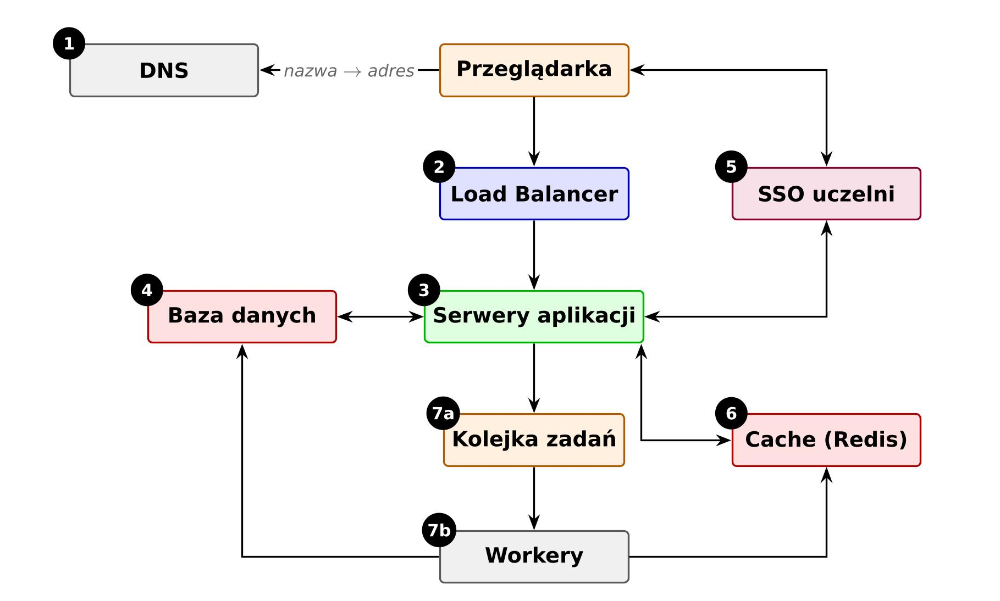 | 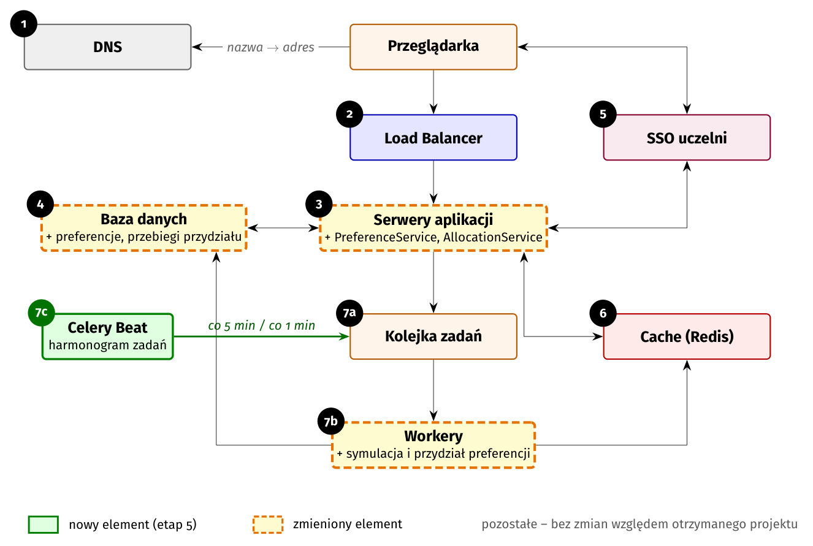 |

- **7c Celery Beat (nowy)** – harmonogram zadań okresowych: co 5 min symulacja przydziału
  (UC10), co minutę sprawdzenie, czy któryś semestr w trybie preferencji zakończył okno zapisów
  (UC9). Celery już było w projekcie, Beat jest jego standardowym składnikiem – nie dochodzi nowa technologia.
- **3 Serwery aplikacji (zmienione)** – nowe serwisy `PreferenceService`, `AllocationService`.
- **7b Workery (zmienione)** – oprócz `on_seat_freed` wykonują zadania przydziału.
- **4 Baza danych (zmieniona)** – nowe tabele preferencji i przebiegów przydziału (3.4).
- Bez zmian: DNS, load balancer, SSO, Redis (cache wolnych miejsc jest unieważniany także po przydziale).

### 3.2. Komponenty

| Przed (otrzymany) | Po (etap 5) |
|---|---|
| 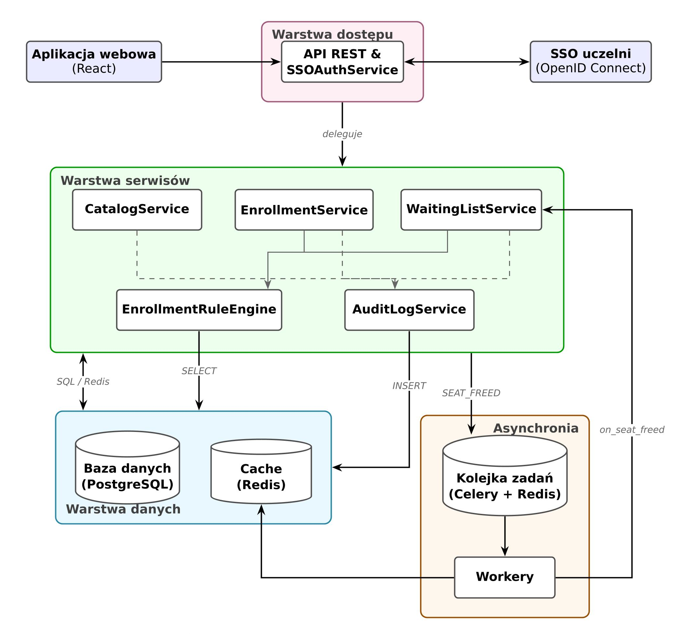 | 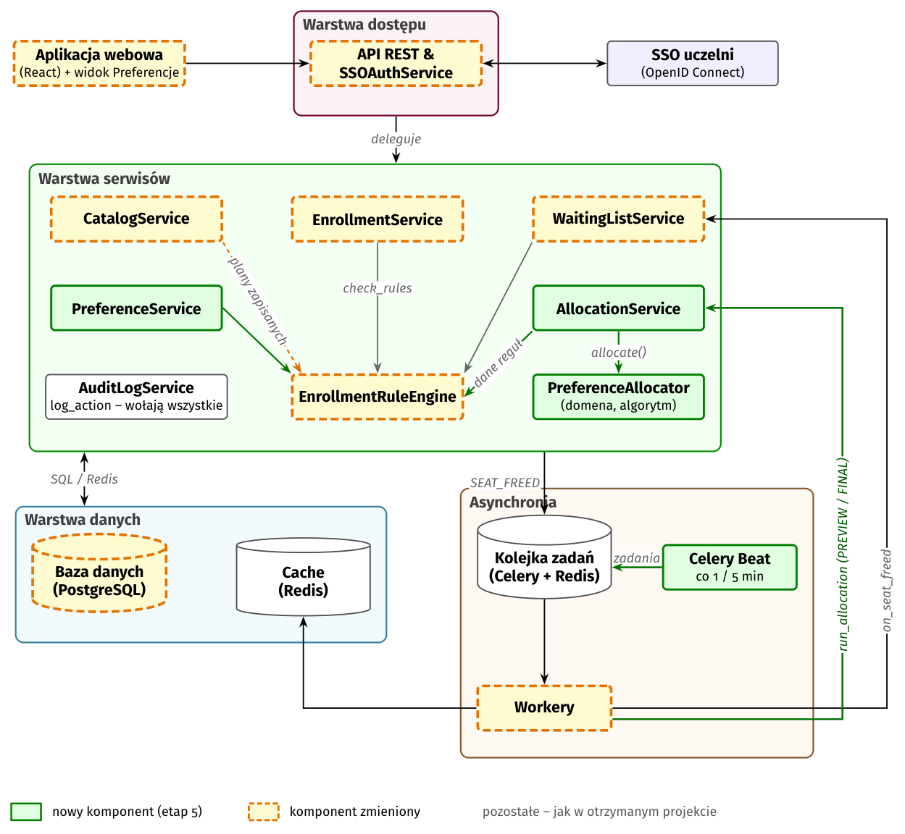 |

- **Nowe:** `PreferenceService` (zgłoszenia studenta), `AllocationService` (przebiegi przydziału,
  zapis wyników), `PreferenceAllocator` (czysty algorytm, bez bazy – testowalny osobno, sekcja 8),
  `Celery Beat`.
- **Zmienione:** `EnrollmentService` i `WaitingListService` (blokady – Z1, Z2), `CatalogService`
  (zmiana terminów – Z3), `EnrollmentRuleEngine` (nowa metoda `find_schedule_conflicts` dla planów
  zapisanych), API (nowe endpointy), aplikacja React (widok „Preferencje”), baza.
- `PreferenceService` korzysta z `EnrollmentRuleEngine` (ostrzeżenia przy zapisie zgłoszenia), a `AllocationService` –
  z tych samych danych reguł (wymagania, plany, terminy). Reguły zapisu są nadal w jednym miejscu.

### 3.3. Przypadki użycia

| Przed (otrzymany) | Po (etap 5) |
|---|---|
| 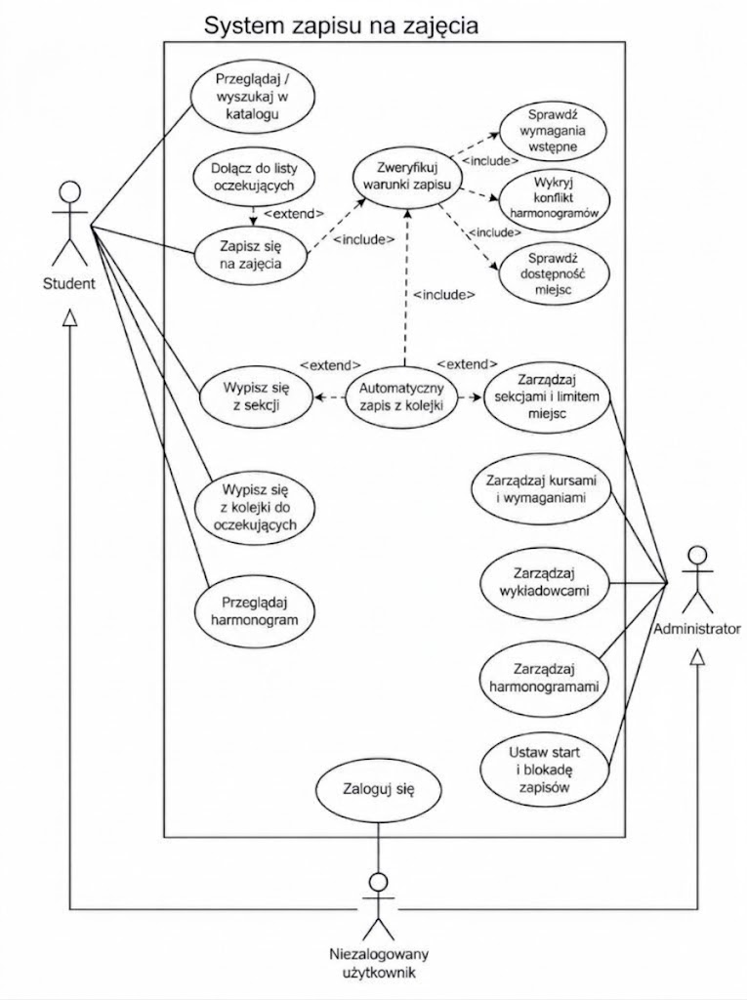 | 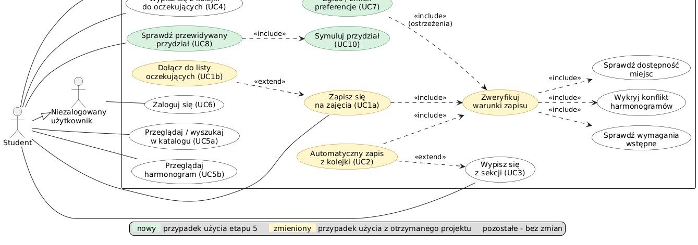 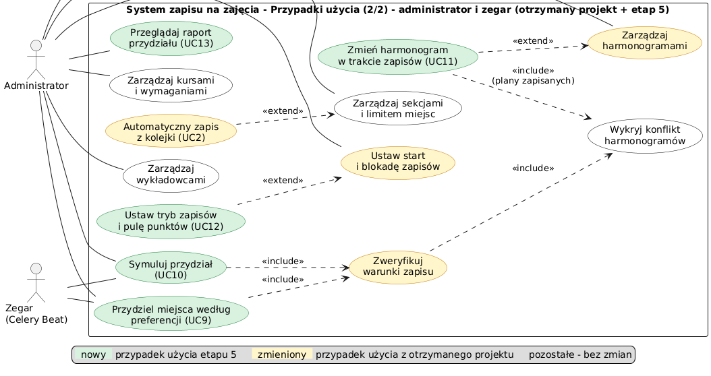 |

Diagram rozdzieliliśmy na dwa (student; administrator i zegar), bo po dodaniu 7 przypadków jeden
przestał być czytelny. Numeracja UC1–UC6 pozostaje z otrzymanego projektu.
- **Nowe:** UC7 Zgłoś / zmień preferencje, UC8 Sprawdź przewidywany przydział, UC9 Przydziel miejsca
  według preferencji, UC10 Symuluj przydział, UC11 Zmień harmonogram w trakcie zapisów,
  UC12 Ustaw tryb zapisów i pulę punktów, UC13 Przeglądaj raport przydziału.
- **Nowy aktor:** *Zegar (Celery Beat)* – uruchamia UC9 i UC10.
- **Zmienione:** UC1a, UC1b, UC2 (blokady, tryb zapisów), „Zweryfikuj warunki zapisu” (wykonywane
  w transakcji), „Zarządzaj harmonogramami” (rozszerzone przez UC11), „Ustaw start i blokadę zapisów”
  (rozszerzone przez UC12).

### 3.4. Model danych (ER)

| Przed (otrzymany) | Po (etap 5) |
|---|---|
| 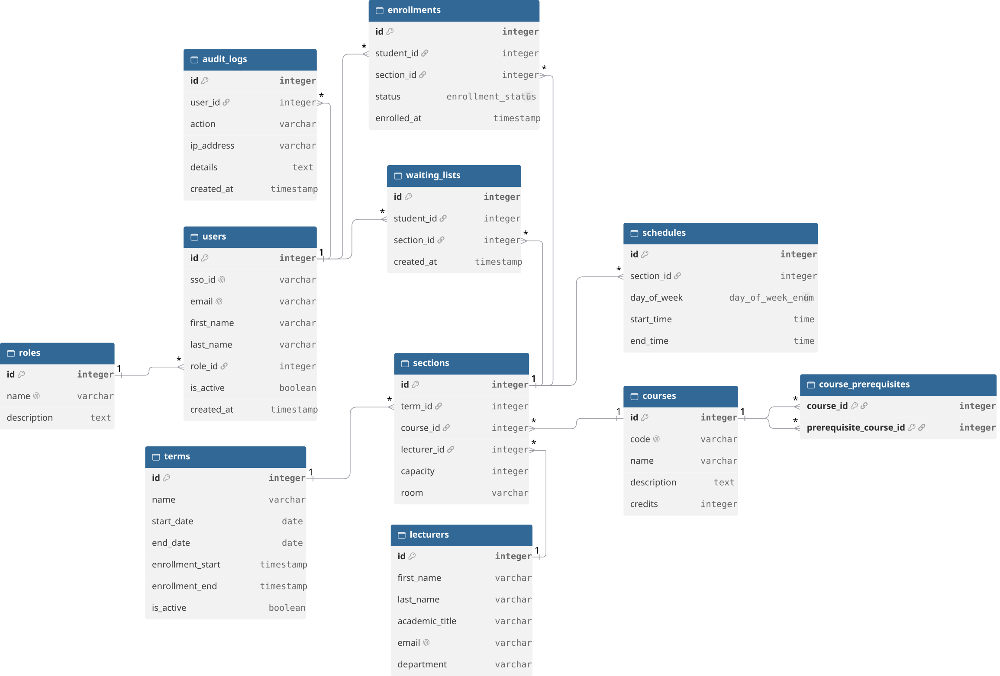 | 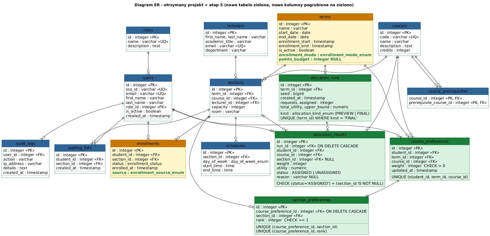 |

| Zmiana | Dlaczego |
|---|---|
| `terms.enrollment_mode` (`FCFS` \| `PREFERENCES`), `terms.points_budget` | okno zapisów jest w otrzymanym projekcie per semestr – tryb i pula punktów też |
| `enrollments.source` (`DIRECT` \| `WAITLIST` \| `ALLOCATION`) | wiadomo, skąd student ma sekcję (reklamacje, raport) |
| **`course_preferences`** (student, semestr, kurs, waga) | waga kursu; `UNIQUE (student_id, term_id, course_id)` – jedno zgłoszenie kursu |
| **`section_preferences`** (zgłoszenie, sekcja, ranga) | kolejność akceptowanych sekcji; `ON DELETE CASCADE` – zmiana zgłoszenia zastępuje je w całości; `UNIQUE` na sekcję i na rangę |
| **`allocation_runs`** (semestr, PREVIEW/FINAL, ziarno, statystyki) | każdy przebieg przydziału; częściowy `UNIQUE (term_id) WHERE kind='FINAL'` – **przydział końcowy najwyżej raz** |
| **`allocation_results`** (przebieg, student, kurs, sekcja, status, powód) | wynik dla każdego zgłoszonego kursu; `CHECK` – przydzielony ma sekcję, nieprzydzielony ma powód |

Suma wag ≤ pula semestru dotyczy wielu wierszy, więc nie da się jej wyrazić `CHECK` – pilnuje jej
`PreferenceService.validate` pod blokadą studenta. Migracja (DDL) – sekcja 7.

### 3.5. Projekt klas

Otrzymany projekt opisywał klasy tabelami metod na slajdach (bez diagramu klas). Dodaliśmy diagramy
klas z zaznaczonymi zmianami, a tabele metod nowych i zmienionych klas są w sekcji 6.

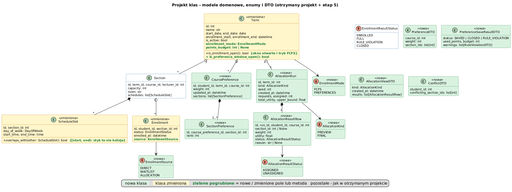

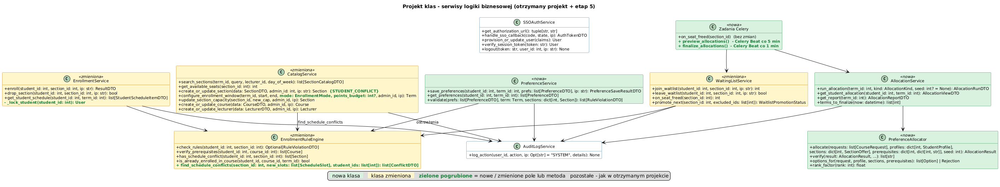

### 3.6. Diagramy sekwencji

| Diagram | Stan | Co zmieniliśmy i dlaczego |
|---|---|---|
| **UC1a** zapis | **zmieniony** | blokada studenta na początku transakcji (Z1); blokada sekcji przed `check_rules` (Z4); `check_rules` w transakcji; `is_enrollment_open()` = okno otwarte **i** tryb FCFS; `source='DIRECT'` |
| **UC1b** lista oczekujących | **zmieniony** | blokada studenta, reguły w transakcji; w trybie preferencji brak kolejki; doprecyzowanie `overlaps_with` (Z5) |
| **UC2** awans z kolejki | **zmieniony** | blokada kandydata `NOWAIT` + Celery retry (Z2); `source='WAITLIST'` |
| UC3 wypis, UC4 wypis z kolejki, UC5a/b katalog i plan, UC6a/b SSO | bez zmian | przebieg ten sam; UC3 korzysta z nowego znaczenia `is_enrollment_open()` (w trybie preferencji wypis niedostępny – miejscami zarządza przydział) |
| **UC7/UC8** preferencje | **nowy** | sekcja 5 |
| **UC9/UC10** przydział i symulacja | **nowy** | sekcja 5 |
| **UC11** zmiana harmonogramu | **nowy** | sekcja 5 |

| UC1a przed | UC1a po |
|---|---|
| 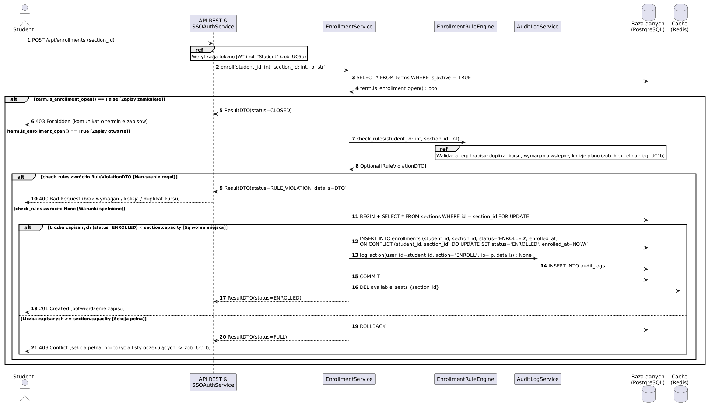 | 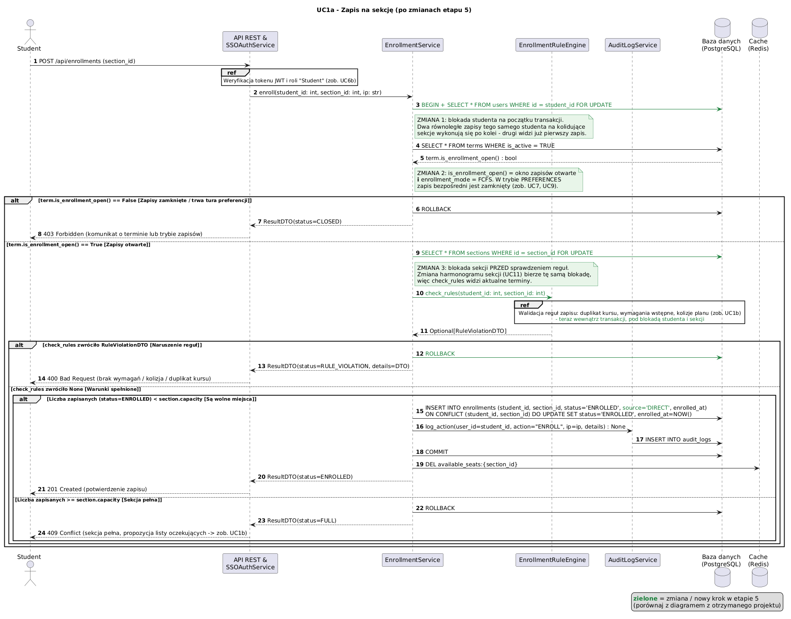 |

| UC1b przed | UC1b po |
|---|---|
| 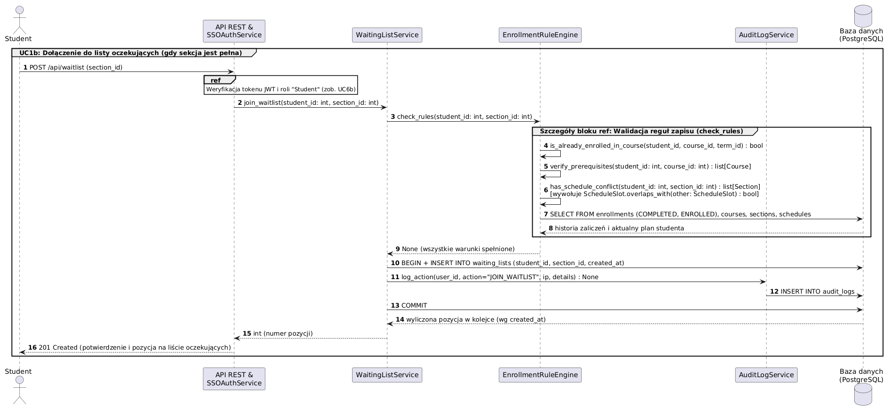 | 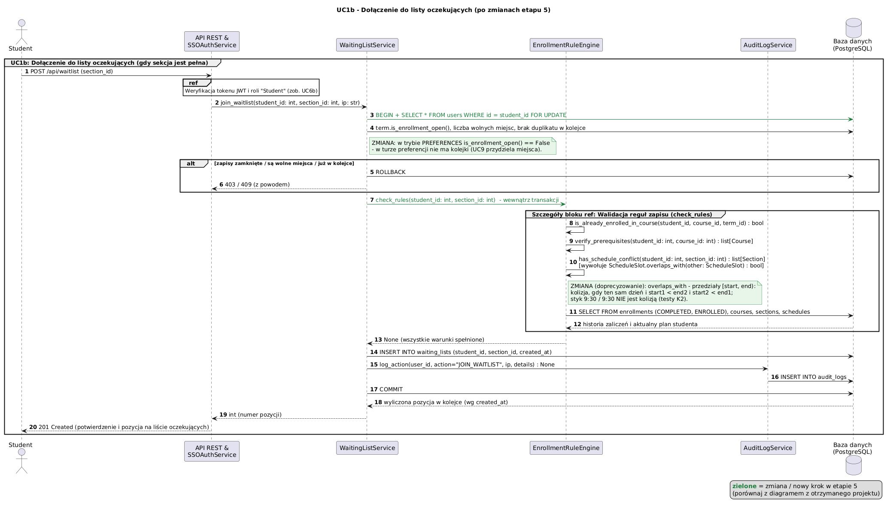 |

| UC2 przed | UC2 po |
|---|---|
| 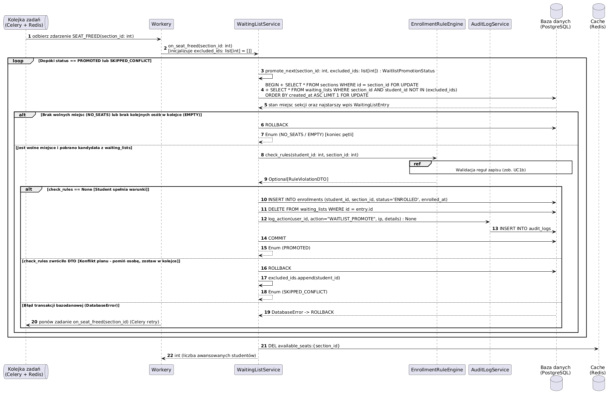 | 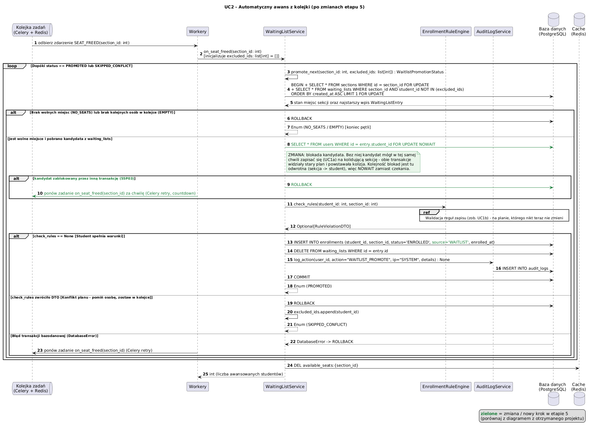 |

**Kolejność blokad po zmianach** (jedna zasada dla całego systemu): *student → sekcja*
(UC1a, UC1b, UC9, UC7: semestr → student). Miejsca, gdzie kolejność jest odwrotna (*sekcja → student*:
awans UC2, zmiana terminu UC11), blokują studenta z `NOWAIT` – zajęty wiersz to szybki błąd
i ponowienie, a nie zakleszczenie.

---

## 4. Nowa funkcjonalność: zapisy według preferencji

1. **Dziekanat ustawia semestr w trybie `PREFERENCES`** z oknem zapisów i **pulą punktów**
   (domyślnie 100) – UC12, `CatalogService.configure_enrollment_window`.
2. **W oknie zapisów student zgłasza preferencje** (UC7): kursy z **wagą** (punkty z puli,
   suma ≤ pula) i **akceptowane sekcje każdego kursu w kolejności**. Może je **zmieniać dowolnie
   często** do końca okna – nowe zgłoszenie zastępuje stare w całości. Od razu dostaje ostrzeżenia
   (brak wymagań, kolizja z planem).
3. **Co 5 minut Celery Beat uruchamia symulację** (UC10, `PREVIEW`). Student widzi **przewidywany przydział**
   z powodami odmów (UC8) i może zareagować, np. podnieść wagę kursu, którego by nie dostał.
4. **Po `enrollment_end` worker raz wykonuje przydział końcowy** (UC9, `FINAL`) – wynik trafia
   do `enrollments` (`source='ALLOCATION'`).
5. Dziekanat może potem przełączyć semestr na `FCFS` z nowym oknem (**zapisy uzupełniające**):
   wolne miejsca, listy oczekujących i wypisy działają jak w otrzymanym projekcie.

**Decyzje projektowe:**
- **Wspólna pula punktów zamiast dowolnych wag** – gdyby każdy mógł dać każdemu kursowi maksimum,
  wagi nic by nie znaczyły. Pula wymusza wybór tego, co „najcenniejsze”, i daje wszystkim równe szanse.
- **Przydział dopiero po końcu okna, a w trakcie symulacja** – decyzja w chwili zgłoszenia byłaby
  znowu kolejką „kto pierwszy”. Symulacja sprawia, że zmiana wag w trakcie zapisów ma sens.
- **Remisy rozstrzyga losowanie z zapisanym ziarnem** (`allocation_runs.seed`) – nie decyduje id
  ani godzina zgłoszenia, a wynik da się odtworzyć przy reklamacji.
- **Te same reguły co przy zapisie** – limit miejsc, kolizje (`overlaps_with`), wymagania, jedna sekcja
  kursu; przydział nie może dać tego, czego nie dałby zwykły zapis.
- **Tryb na semestrze, nie nowa encja „tura”** – najmniejsza zmiana otrzymanego modelu, który ma
  jedno okno zapisów na semestr.

## 5. Przypadki użycia – metryczki nowych i zmienionych

Format jak w otrzymanym projekcie.

### UC7: Zgłoś / zmień preferencje (+ UC8 podgląd przydziału)

| Pole | Opis |
|---|---|
| Aktorzy | Student, System |
| Zakres | System zapisu na zajęcia |
| Udziałowcy i ich cele | **Student:** chce dostać kursy najważniejsze dla siebie, w preferowanych sekcjach. **System:** przyjmuje tylko poprawne zgłoszenia (pula, sekcje z semestru). **Administrator:** chce uczciwego podziału miejsc. |
| Zdarzenie wyzwalające | Student w widoku „Preferencje” zapisuje (pierwsze lub kolejne) zgłoszenie. |
| Warunki wstępne | Student zalogowany. Semestr w trybie `PREFERENCES`, okno zapisów otwarte. |
| Warunki końcowe dla sukcesu | Zgłoszenie studenta zastąpione nowym (wagi, sekcje z rangami), suma wag ≤ pula; Student widzi wykorzystane punkty i ostrzeżenia. |
| Warunki końcowe dla niepowodzenia | Poprzednie zgłoszenie bez zmian; Student widzi przyczynę. |

| Scenariusz | Przebieg |
|---|---|
| Główny | 1. Student wybiera kursy, rozdziela punkty, dla każdego kursu ustawia kolejność akceptowanych sekcji. 2. System sprawdza tryb i okno zapisów. 3. System waliduje zgłoszenie (suma wag ≤ pula, waga ≥ 1, sekcje należą do kursu i semestru, brak duplikatów, ≤ 20 kursów). 4. System w jednej transakcji zastępuje poprzednie zgłoszenie nowym. 5. System sprawdza reguły zapisu jako ostrzeżenia (wymagania, kolizje z planem). 6. System pokazuje „Zapisano (x/100 pkt)” i ostrzeżenia. |
| Alternatywny: podgląd (UC8) | Student otwiera „Przewidywany przydział” – System pokazuje wynik ostatniej symulacji (UC10), a po przydziale końcowym – wynik końcowy, z powodem dla każdego nieprzydzielonego kursu. Student może wrócić do kroku 1. |
| Alternatywny: rezygnacja | Student zapisuje puste zgłoszenie – nie bierze udziału w przydziale. |

| Wyjątki | Reakcja systemu |
|---|---|
| Okno zamknięte / semestr w trybie FCFS (krok 2) | 403, komunikat; zgłoszenie bez zmian. |
| Przekroczona pula, sekcja spoza kursu/semestru, duplikat (krok 3) | 400 z listą błędów (`BUDGET_EXCEEDED`, `BAD_SECTION`, `DUPLICATE_COURSE`, `DUPLICATE_SECTION`); zgłoszenie bez zmian. |
| Okno zamyka się w trakcie zapisu (krok 4) | Blokada semestru `FOR SHARE` szereguje zapis z przydziałem końcowym (`FOR UPDATE`): zgłoszenie albo zdąży i wejdzie do przydziału, albo dostanie 403. Nigdy nie „zginie”. |
| Dwie karty przeglądarki naraz | Blokada studenta – zapisy po kolei, wygrywa ostatni, suma zawsze ≤ pula. |
| Brak wymagań / kolizja z planem (krok 5) | Zgłoszenie przyjęte z ostrzeżeniem (ocena może jeszcze zostać wpisana); przydział sprawdzi ponownie. |
| Błąd bazy danych | Transakcja wycofana, poprzednie zgłoszenie bez zmian, komunikat o błędzie. |

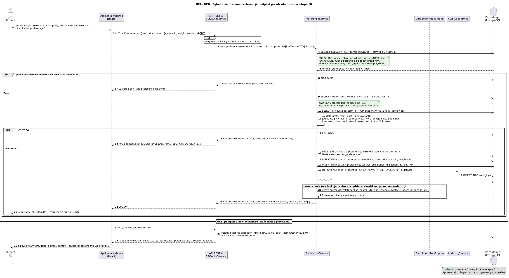

### UC9: Przydziel miejsca według preferencji (+ UC10 symulacja)

| Pole | Opis |
|---|---|
| Aktorzy | Zegar (Celery Beat), System; Administrator (uruchomienie ręczne) |
| Zakres | System zapisu na zajęcia |
| Udziałowcy i ich cele | **Studenci:** jak najlepsze dopasowanie do wag i kolejności sekcji. **System:** żadnego przekroczenia limitu, kolizji ani braku wymagań. **Administrator:** jednorazowy, odtwarzalny wynik i raport. |
| Zdarzenie wyzwalające | UC9: minął `enrollment_end` semestru w trybie `PREFERENCES` (sprawdzane co minutę). UC10: co 5 minut w trakcie okna. |
| Warunki wstępne | UC9: semestr bez przebiegu `FINAL`. |
| Warunki końcowe dla sukcesu | UC9: zapisy `ENROLLED` (`source='ALLOCATION'`) dla przydzielonych, wynik z powodem dla każdego zgłoszenia, przebieg `FINAL` z ziarnem i statystykami, wpisy w audycie. UC10: przebieg `PREVIEW` (bez zapisów). |
| Warunki końcowe dla niepowodzenia | Brak zmian w zapisach; semestr nadal „bez FINAL” – przydział zostanie ponowiony. |

| Scenariusz | Przebieg |
|---|---|
| Główny (UC9) | 1. Worker dostaje zadanie `finalize_allocations`. 2. System blokuje semestr i sprawdza: tryb, koniec okna, brak FINAL. 3. System wczytuje zgłoszenia i blokuje ich studentów, a potem ich sekcje (rosnąco po id). 4. System wczytuje terminy, wolne miejsca, plany i zaliczenia. 5. `PreferenceAllocator.allocate` wyznacza przydział (sekcja 8). 6. `verify` niezależnie sprawdza wynik. 7. System zapisuje przebieg, wyniki i zapisy, loguje audyt, zatwierdza transakcję i unieważnia cache. |
| Alternatywny: symulacja (UC10) | Kroki 1, 4–6 bez blokad; wynik zapisywany jako `PREVIEW`, starsze symulacje usuwane; zapisy bez zmian. |
| Alternatywny: uruchomienie przez administratora | `POST /api/admin/terms/{id}/allocation` – jak główny; przed końcem okna → 409. |

| Wyjątki | Reakcja systemu |
|---|---|
| Przydział już wykonany (druga instancja workera, administrator) | `UNIQUE … WHERE kind='FINAL'` + blokada semestru → pominięcie (`SKIPPED`), to nie błąd. |
| Między zgłoszeniem a przydziałem zmieniły się miejsca / terminy / plan | Przydział czyta stan pod blokadami w chwili wykonania, nie z chwili zgłoszenia. |
| `verify` wykrywa naruszenie (błąd algorytmu) | `ROLLBACK`, audyt `ALLOCATION_FAILED`, nic nie zapisano. |
| Błąd bazy / awaria workera | `ROLLBACK`, Celery retry; semestr dalej bez FINAL, więc przydział wykonuje się od nowa. |

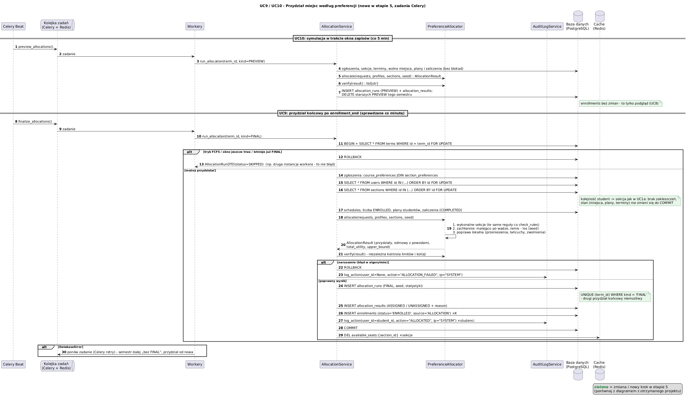

### UC11: Zmień harmonogram sekcji w trakcie zapisów

| Pole | Opis |
|---|---|
| Aktorzy | Administrator, System |
| Zakres | System zapisu na zajęcia |
| Udziałowcy i ich cele | **Administrator:** przenieść zajęcia (np. sala niedostępna). **Studenci zapisani:** nie dostać kolizji „po cichu”. **System:** zachować brak kolizji w każdym planie. |
| Zdarzenie wyzwalające | Administrator zapisuje nowe terminy sekcji (`PUT /api/sections/{id}`). |
| Warunki wstępne | Administrator zalogowany, sekcja istnieje. |
| Warunki końcowe dla sukcesu | Nowe terminy zapisane, żaden zapisany student nie ma kolizji, wpis w audycie, cache unieważniony. |
| Warunki końcowe dla niepowodzenia | Terminy bez zmian; Administrator widzi listę studentów z kolidującymi sekcjami. |

| Scenariusz | Przebieg |
|---|---|
| Główny | 1. Administrator zmienia terminy. 2. System blokuje sekcję. 3. System sprawdza kolizję sali. 4. System blokuje zapisanych studentów (`NOWAIT`). 5. `find_schedule_conflicts` sprawdza nowe terminy z resztą planu każdego zapisanego. 6. System zapisuje terminy, loguje audyt, zatwierdza, unieważnia cache. |
| Alternatywny: kolizja u zapisanych (krok 5) | 409 `STUDENT_CONFLICT` z listą „indeks: kolidujące sekcje” – Administrator przenosi studentów albo wybiera inny termin. |

| Wyjątki | Reakcja systemu |
|---|---|
| Sala zajęta (krok 3) | 409 `ROOM_BUSY`. |
| Któryś zapisany student akurat się zapisuje (krok 4) | 55P03 → `ROLLBACK`, 409 `BUSY` „spróbuj ponownie”. |
| Student zapisuje się na tę sekcję w trakcie zmiany | Zapis (UC1a) czeka na blokadę sekcji i sprawdza już nowe terminy. |
| Oczekujący na liście ma teraz kolizję | Zmiana dozwolona (nie ma jeszcze miejsca); przy awansie (UC2) `SKIPPED_CONFLICT`. |

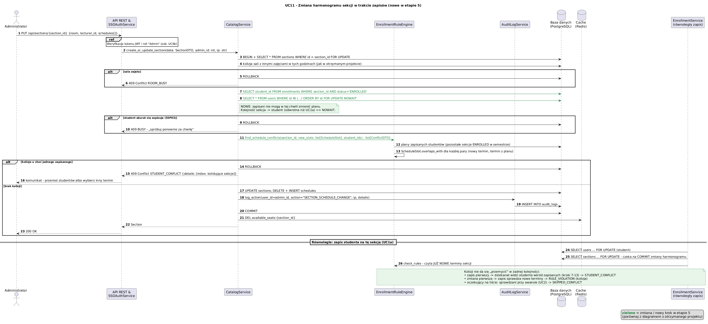

### Krótko: UC12, UC13 i zmiany w UC1–UC2

- **UC12 Ustaw tryb zapisów i pulę punktów** (rozszerza „Ustaw start i blokadę zapisów”):
  `PATCH /api/terms/{id}/enrollment-window {start, end, mode, points_budget}`. Błędy: `BAD_DATES`,
  pula w trybie FCFS (`BAD_BUDGET`), zmiana trybu po przydziale końcowym (`ALREADY_ALLOCATED`).
- **UC13 Raport przydziału:** liczba zgłoszeń i przydziałów, suma użyteczności względem górnego
  ograniczenia, ziarno, popyt na każdy kurs względem wolnych miejsc.
- **UC1 (wyjątki – dopisane):** „trwa tura preferencji” → 403; „ten sam student zapisuje się
  równolegle na kolidującą sekcję” → druga transakcja czeka na blokadę studenta i dostaje
  `RULE_VIOLATION` (kolizja).
- **UC2 (wyjątki – dopisane):** „kandydat jest w tej chwili zablokowany” → `ROLLBACK`, ponowienie
  zadania; nikt nie traci miejsca w kolejce.

## 6. Projekt klas – specyfikacja nowych i zmienionych metod

Pozostałe metody bez zmian względem otrzymanego projektu.

**`PreferenceService` (nowy)**

| Sygnatura metody | Typ zwracany | Opis funkcjonalności |
|---|---|---|
| `save_preferences(student_id: int, term_id: int, prefs: list[PreferenceDTO], ip: str)` | `PreferenceSaveResultDTO` | Blokady semestr (`FOR SHARE`) → student (`FOR UPDATE`). Sprawdza `is_preference_window_open()` i `validate`, zastępuje zgłoszenie (DELETE + INSERT), loguje `SAVE_PREFERENCES`. Zwraca status (`SAVED` / `CLOSED` / `RULE_VIOLATION`), wykorzystane punkty, pulę i ostrzeżenia z `EnrollmentRuleEngine`. |
| `get_preferences(student_id: int, term_id: int)` | `list[PreferenceDTO]` | Bieżące zgłoszenie: kursy z wagami i sekcje w kolejności rang. |
| `validate(prefs, term: Term, sections: dict[int, Section])` | `list[RuleViolationDTO]` | `BUDGET_EXCEEDED`, `BAD_WEIGHT`, `BAD_SECTION` (inny kurs / semestr / nie istnieje), `DUPLICATE_COURSE`, `DUPLICATE_SECTION`, `NO_SECTIONS`, `TOO_MANY_COURSES` (> 20). |

**`AllocationService` (nowy)**

| Sygnatura metody | Typ zwracany | Opis funkcjonalności |
|---|---|---|
| `run_allocation(term_id: int, kind: AllocationKind, seed: int \| None = None)` | `AllocationRunDTO` | UC9/UC10 (sekwencja `uc9`). FINAL: blokady semestr → studenci → sekcje, `allocate` + `verify`, zapis przebiegu, wyników i zapisów (`source='ALLOCATION'`), audyt, unieważnienie cache. PREVIEW: bez blokad i zapisów. Zwraca statystyki albo `SKIPPED`. |
| `get_student_allocation(student_id: int, term_id: int)` | `AllocationViewDTO` | UC8: FINAL, a jeśli brak – najnowszy PREVIEW; wyniki studenta z powodami. |
| `get_report(term_id: int)` | `AllocationReportDTO` | UC13: statystyki przebiegu, `total_utility / upper_bound`, popyt na kursy. |
| `terms_to_finalize(now: datetime)` | `list[int]` | Semestry w trybie PREFERENCES po `enrollment_end` bez FINAL (dla Celery Beat). |

**`PreferenceAllocator` (nowy, domenowy – prototyp w `prototyp/preference_allocator.py`)**

| Sygnatura metody | Typ zwracany | Opis funkcjonalności |
|---|---|---|
| `allocate(requests, profiles, sections, prerequisites, seed: int)` | `AllocationResult` | Algorytm z sekcji 8. Deterministyczny przy danym `seed`. |
| `verify(result, requests, profiles, sections, prerequisites)` | `list[str]` | Niezależna kontrola: limity, kolizje (`overlaps_with`), wymagania, jedna sekcja kursu, sekcje tylko ze zgłoszenia. Pusta lista = poprawny. |
| `options_for(request, profile, sections, prerequisites)` | `list[Option] \| Rejection` | Sekcje możliwe dla studenta (w kolejności rang) albo powód: `PREREQUISITES`, `ALREADY_ENROLLED`, `CONFLICT`, `NO_SECTIONS`. |
| `rank_factor(rank: int)` | `float` | `max(0.5, 1 − 0.1·(rank − 1))`. |

**Zmienione metody**

| Klasa.metoda | Zmiana |
|---|---|
| `EnrollmentService.enroll(student_id, section_id, ip)` | Kolejność: `BEGIN` → blokada studenta → semestr → blokada sekcji → `check_rules` → miejsca → zapis (`source='DIRECT'`). |
| `WaitingListService.join_waitlist(...)` | Blokada studenta, reguły w transakcji, w trybie PREFERENCES `CLOSED`. |
| `WaitingListService.promote_next(section_id, excluded_ids)` | Blokada kandydata `FOR UPDATE NOWAIT`; zajęty → `ROLLBACK` i ponowienie zadania; `source='WAITLIST'`. |
| `EnrollmentRuleEngine.find_schedule_conflicts(section_id, new_slots: list[ScheduleSlot], student_ids: list[int])` → `list[ConflictDTO]` | **Nowa.** Dla każdego studenta: nowe terminy vs pozostałe sekcje ENROLLED w semestrze (`overlaps_with`). |
| `CatalogService.create_or_update_section(data, admin_id, ip)` | Przy zmianie terminów sekcji z zapisami: blokady sekcja → studenci `NOWAIT`, `find_schedule_conflicts`, odmowa `STUDENT_CONFLICT`. |
| `CatalogService.configure_enrollment_window(term_id, start, end, mode, points_budget, admin_id, ip)` | Nowe parametry `mode`, `points_budget`; walidacja (UC12). |
| `Term.is_enrollment_open()` | Okno otwarte **i** `enrollment_mode = FCFS`. Nowa `Term.is_preference_window_open()`: okno otwarte i `PREFERENCES`. |
| `ScheduleSlot.overlaps_with(other)` | Doprecyzowanie: ten sam dzień i `start1 < end2 ∧ start2 < end1` (styk nie jest kolizją). |

## 7. Migracja bazy danych

```sql
CREATE TYPE enrollment_mode_enum   AS ENUM ('FCFS', 'PREFERENCES');
CREATE TYPE enrollment_source_enum AS ENUM ('DIRECT', 'WAITLIST', 'ALLOCATION');
CREATE TYPE allocation_kind_enum   AS ENUM ('PREVIEW', 'FINAL');

ALTER TABLE terms
    ADD COLUMN enrollment_mode enrollment_mode_enum NOT NULL DEFAULT 'FCFS',
    ADD COLUMN points_budget   integer CHECK (points_budget BETWEEN 1 AND 1000),
    ADD CHECK ((enrollment_mode = 'PREFERENCES') = (points_budget IS NOT NULL));
ALTER TABLE enrollments ADD COLUMN source enrollment_source_enum NOT NULL DEFAULT 'DIRECT';

CREATE TABLE course_preferences (
    id         serial PRIMARY KEY,
    student_id integer NOT NULL REFERENCES users(id),
    term_id    integer NOT NULL REFERENCES terms(id),
    course_id  integer NOT NULL REFERENCES courses(id),
    weight     integer NOT NULL CHECK (weight > 0),
    updated_at timestamp NOT NULL DEFAULT now(),
    UNIQUE (student_id, term_id, course_id)
);
CREATE TABLE section_preferences (
    id                   serial PRIMARY KEY,
    course_preference_id integer NOT NULL REFERENCES course_preferences(id) ON DELETE CASCADE,
    section_id           integer NOT NULL REFERENCES sections(id),
    rank                 integer NOT NULL CHECK (rank >= 1),
    UNIQUE (course_preference_id, section_id),
    UNIQUE (course_preference_id, rank)
);
CREATE TABLE allocation_runs (
    id            serial PRIMARY KEY,
    term_id       integer NOT NULL REFERENCES terms(id),
    kind          allocation_kind_enum NOT NULL,
    seed          bigint  NOT NULL,
    created_at    timestamp NOT NULL DEFAULT now(),
    requests      integer NOT NULL,
    assigned      integer NOT NULL CHECK (assigned <= requests),
    total_utility numeric(12,2) NOT NULL,
    upper_bound   numeric(12,2) NOT NULL CHECK (upper_bound >= total_utility)
);
CREATE UNIQUE INDEX allocation_one_final ON allocation_runs (term_id) WHERE kind = 'FINAL';
CREATE TABLE allocation_results (
    id         serial PRIMARY KEY,
    run_id     integer NOT NULL REFERENCES allocation_runs(id) ON DELETE CASCADE,
    student_id integer NOT NULL REFERENCES users(id),
    course_id  integer NOT NULL REFERENCES courses(id),
    section_id integer REFERENCES sections(id),
    weight     integer NOT NULL,
    utility    numeric(8,2) NOT NULL DEFAULT 0,
    status     varchar(12) NOT NULL CHECK (status IN ('ASSIGNED', 'UNASSIGNED')),
    reason     varchar(255),
    CHECK ((status = 'ASSIGNED') = (section_id IS NOT NULL)),
    CHECK ((status = 'UNASSIGNED') = (reason IS NOT NULL))
);
```

## 8. Algorytm przydziału (`PreferenceAllocator`) i prototyp

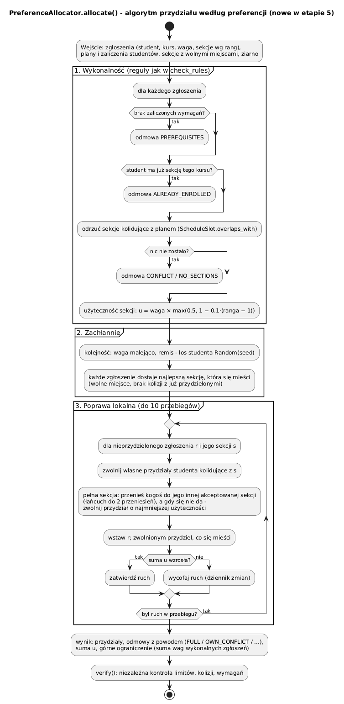

**Model.** Zgłoszenie = (student, kurs, waga *w*, akceptowane sekcje kursu w kolejności). Użyteczność
przydziału sekcji o randze *r*: **u = w · max(0.5, 1 − 0.1·(r − 1))** – 1. wybór 100% wagi, 2. – 90%, …
Waga decyduje, **czy** student dostanie kurs, ranga – **którą sekcję**.

**Cel:** maksymalizacja Σ u przy ograniczeniach takich jak w `check_rules`: limit miejsc sekcji, brak
kolizji (`overlaps_with`) między przydzielonymi sekcjami i z dotychczasowym planem, zaliczone wymagania,
jedna sekcja kursu. Formalnie to programowanie całkowitoliczbowe (x(s,k) ∈ {0,1}; Σ_k x ≤ 1 dla
zgłoszenia; Σ x ≤ miejsca dla sekcji; x + x' ≤ 1 dla kolidujących sekcji tego samego studenta).
Ograniczenia kolizji czynią problem NP-trudnym, więc stosujemy heurystykę o zmierzonej jakości:
1. **wykonalność** – dla każdego zgłoszenia sekcje bez kolizji z planem; niewykonalne dostają powód od razu,
2. **zachłannie** – malejąco po wadze; remis rozstrzyga los studenta z ziarnem (jeden los na przebieg),
3. **poprawa lokalna** – dla nieprzydzielonego zgłoszenia: przeniesienie kogoś z pełnej sekcji
   do jego innej akceptowanej sekcji (łańcuch do 2), a gdy się nie da – zwolnienie najtańszego
   przydziału; zwolnionym przydziela się, co się mieści. Ruch zostaje tylko, gdy Σ u rośnie
   (inaczej wycofanie), więc algorytm się kończy.

Przykład (test A6): B (waga 60) akceptuje S10 i S11, A (waga 50) tylko S10; po jednym miejscu.
Zachłannie: B dostaje S10, A nic (Σ = 60). Poprawa przenosi B do S11 (−6) i daje S10 studentowi A (+50):
Σ = 104 – optimum.

**Prototyp** (`prototyp/`, Python 3.12, tylko biblioteka standardowa + pytest) – zrobiony po to, żeby
przed wpięciem w `AllocationService` zmierzyć jakość i czas. Wyniki (`python test_preference_allocator.py`):

| Pomiar | Sam algorytm zachłanny | Zachłanny + poprawa lokalna |
|---|---|---|
| 1000 losowych małych instancji vs **optimum z przeglądu zupełnego** – średnio | 97,9% | **99,9%** |
| – najgorsza instancja | 64% | 75% |
| – instancje rozwiązane dokładnie optymalnie | 80,8% | **97,8%** |
| 1000 studentów × 6 kursów, 30 kursów × 5 sekcji × 30 miejsc (6000 zgłoszeń, 4500 miejsc) | – | **3 s**, wszystkie 4500 miejsc przydzielone, 92% górnego ograniczenia |

`verify` sprawdza każdy wynik niezależnie od algorytmu – w testach i przed zapisem przydziału
w `AllocationService`.

**Rozważone alternatywy:** solver ILP (OR-Tools / CBC) – optimum dla małych semestrów, ale ciężka
zależność i nieprzewidywalny czas dla tysięcy studentów; loteria / seryjna dyktatura – ignoruje
wagi, czyli samo wymaganie; aukcja z ceną – zbyt skomplikowana dla studentów.

## 9. API REST – nowe i zmienione endpointy

| Metoda | Endpoint | Rola | Opis działania |
|---|---|---|---|
| GET | `/api/preferences?term_id=` | Student | Bieżące zgłoszenie (UC7). |
| PUT | `/api/preferences` | Student | Zastąpienie zgłoszenia `{term_id, courses: [{course_id, weight, section_ids[]}]}` → `{used_points, budget, warnings}`; 400 z listą błędów, 403 poza oknem (UC7). |
| GET | `/api/allocation?term_id=` | Student | Przewidywany / końcowy przydział z powodami (UC8). |
| POST | `/api/admin/terms/{id}/allocation/preview` | Administrator | Symulacja na żądanie (UC10). |
| POST | `/api/admin/terms/{id}/allocation` | Administrator | Przydział końcowy na żądanie (zwykle robi go Celery Beat); 409 przed końcem okna lub po FINAL (UC9). |
| GET | `/api/admin/terms/{id}/allocation/report` | Administrator | Raport (UC13). |
| PATCH | `/api/terms/{id}/enrollment-window` | Administrator | **Zmieniony:** + `mode`, `points_budget` (UC12). |
| PUT | `/api/sections/{section_id}` | Administrator | **Zmieniony:** 409 `STUDENT_CONFLICT` / `BUSY` przy zmianie terminów (UC11). |
| POST | `/api/enrollments`, `/api/waitlist`; DELETE `/api/enrollments/{id}` | Student | **Zmienione:** 403 w trybie PREFERENCES. |

## 10. Co może pójść nie tak – zestawienie

| Sytuacja | Reakcja | Gdzie |
|---|---|---|
| Dwa równoległe zapisy tego samego studenta na kolidujące sekcje | blokada studenta – drugi dostaje `RULE_VIOLATION` | UC1a, test K8 |
| Awans z kolejki i równoległy zapis kandydata na kolidującą sekcję | blokada kandydata `NOWAIT` + ponowienie | UC2, test K9 |
| Zmiana terminu tworzy kolizję u zapisanego | `STUDENT_CONFLICT`, terminy bez zmian | UC11, test K10 |
| Zmiana terminu w trakcie zapisu na tę sekcję | blokada sekcji przed `check_rules` | UC1a/UC11, test K13 |
| Zmiana terminu tworzy kolizję u oczekującego | dozwolona; przy awansie `SKIPPED_CONFLICT` | UC2, test K12 |
| Przekroczona pula / zła sekcja w zgłoszeniu | 400, zgłoszenie bez zmian | UC7, test P2 |
| Okno zamyka się w trakcie zapisu preferencji | `FOR SHARE` vs `FOR UPDATE`: wchodzi do przydziału albo 403 | UC7/UC9, test P5 |
| Dwa przydziały końcowe naraz / ponowne uruchomienie | `UNIQUE … FINAL` + blokada semestru | UC9, test P8 |
| Awaria workera w trakcie przydziału | `ROLLBACK`, Celery retry, przydział od nowa | UC9 |
| Błąd algorytmu | `verify` + `ROLLBACK` | UC9, testy A |
| Miejsca zajęte / termin zmieniony po zgłoszeniu | przydział na stanie z chwili wykonania | UC9, testy P9, P10 |
| Student bez wymagań / z kolizją w zgłoszeniu | ostrzeżenie przy zapisie, odmowa z powodem w przydziale | UC7/UC9, test P4 |

## 11. Testy

Scenariusze: **[`TESTY.md`](TESTY.md)** – każdy w trzech częściach (przygotowanie, wywołania metod
z konkretnymi parametrami, weryfikacja). Po każdym scenariuszu kolizji sprawdzane jest zapytanie
kontrolne `kolizje_w_planach(term_id) == []`, niezależne od `EnrollmentRuleEngine`.

| Grupa | Scenariuszy | Forma |
|---|---|---|
| K – brak kolizji (zapis, lista oczekujących, awans z kolejki, zmiana harmonogramu, współbieżność) | 14 | algorytmy na metodach serwisów |
| P – zapisy według preferencji | 12 | algorytmy na metodach serwisów |
| A – algorytm przydziału | 8 | **zaimplementowane** (`prototyp/test_preference_allocator.py`, wszystkie przechodzą) |

## 12. Stos technologiczny – zmiany

Bez nowych technologii. Celery Beat jest częścią Celery (już w projekcie). `PreferenceAllocator` to
czysty Python (bez solverów). Frontend React: nowy widok „Preferencje” (wagi z paskiem puli, kolejność
sekcji, przewidywany przydział) i panel administratora (tryb semestru, raport).
