# System zapisów na zajęcia (USOSv2) – Krok 3: projekt wstępny systemu

Termin: **28.X** (prezentacja). Ocena z etapu: **30%** oceny z projektu.

Wymagania etapu (z opisu zadania):

> Na tym etapie należy przygotować kompletne diagramy (UML) dla tworzonego systemu,
> w szczególności przypadki użycia i diagramy sekwencji, a także projekt klas / komponentów.
> Projekt klas powinien obejmować w szczególności udostępniane metody z opisem ich
> funkcjonalności, parametrów i zwracanych wartości.

Kompletny projekt składa się z: architektury, stosu technologicznego, diagramów UML (przypadki
użycia, sekwencje), diagramu ER i diagramów struktur (klasy, komponenty). Ten dokument zawiera
wszystkie te elementy. Projekt jest zweryfikowany działającą implementacją (`backend/`,
`frontend/`) – diagramy klas i sekwencji odpowiadają kodowi, a nie są szkicem do napisania.

Materiały etapu 2 (`../README.md`, `../schemat.sql`, `../diagramy/`, `../prezentacja/`)
zostają bez zmian jako historia. Różnice opisuje sekcja 1.

## Zawartość

| Plik | Co to jest |
|---|---|
| `diagramy/architektura.puml` / `.png` | Architektura: moduły, procesy, połączenia |
| `diagramy/przypadki_uzycia_student.puml` / `.png` | Przypadki użycia 1/2: student |
| `diagramy/przypadki_uzycia_administracja.puml` / `.png` | Przypadki użycia 2/2: dziekanat, prowadzący, zegar |
| `diagramy/sekwencja_*.puml` / `.png` | 7 diagramów sekwencji (sekcja 5) |
| `diagramy/klasy_domena.puml`, `klasy_serwisy.puml`, `klasy_infrastruktura.puml` / `.png` | Diagramy klas (sekcja 7) |
| `diagramy/er.py` → `er.tex` / `.pdf` / `.png` | Diagram ER (TikZ, generowany skryptem) |
| `prezentacja/prezentacja_krotka.tex` / `.pdf` | **Slajdy na 28.X (7 minut)** + slajdy zapasowe |
| `prezentacja/prezentacja.tex` / `.pdf` | Pełna wersja slajdów (ok. 15 min) |
| `diagramy/sekwencja_zapis_skrot`, `sekwencja_awans_skrot`, `klasy_skrot` | Uproszczone diagramy do krótkiej prezentacji |
| `PREZENTACJA_OPIS.md` | Opis slajdów i przygotowanie do pytań |

---

## 1. Zmiany względem etapu 2

| Obszar | Etap 2 | Etap 3 | Dlaczego |
|---|---|---|---|
| Użytkownicy | `app_user` + `student` + `lecturer` | jedna tabela `app_user` z rolą, dane roli w kolumnach z `CHECK` | rola i tak jest w `app_user`; mniej złączeń, jedno konto |
| Tury | najwyżej jedna otwarta tura w semestrze | tura obejmuje wybrane kierunki (`program`, `round_program`), tury mogą się nakładać | **ograniczenie ruchu**: 20 000 studentów nie zapisuje się naraz, tylko kierunek po kierunku |
| Reguły biznesowe | funkcje SQL `schedule_conflicts`, `same_course_kind_section`, trigger cykli, widok audytu | czyste funkcje w `backend/app/domain`, audyt w `services/audit.py` | logika poza zapytaniami: testowalna bez bazy, czytelna, łatwa do zmiany |
| Ślad operacji | brak | `enrollment.created_by` / `dropped_by` | kto z dziekanatu zapisał/wypisał (RODO, reklamacje) |
| Powiadomienia | tylko outbox e-mail | + `read_at` (powiadomienia w aplikacji), `attempts` (ponawianie SMTP) | student widzi powiadomienia także bez poczty |
| Kontrola ruchu | „limit żądań na użytkownika” (hasło) | cache katalogu, limit na studenta, bramki współbieżności, 503 + Retry-After | wynik testów obciążeniowych (sekcja 10) |

## 2. Architektura

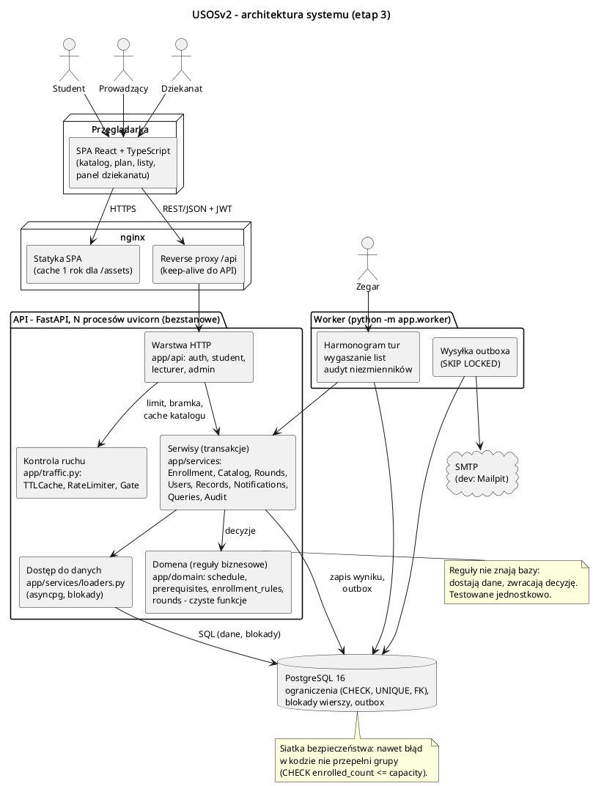

System to aplikacja webowa: SPA w przeglądarce, nginx, bezstanowe API (kilka procesów),
osobny proces workera i PostgreSQL jako jedyne źródło prawdy.

| Moduł | Odpowiedzialność |
|---|---|
| **SPA** (React + TS) | Widoki dla trzech ról. Sama ponawia zapis przy 429/503 (Retry-After × losowo 1–2, żeby tysiące przeglądarek nie wróciły w tej samej chwili). |
| **nginx** | Statyka SPA (z cache – odświeżanie strony przy otwarciu tury nie obciąża API) i reverse proxy `/api` z keep-alive. |
| **API: warstwa HTTP** (`app/api`) | Routing, walidacja wejścia (Pydantic), uwierzytelnienie JWT, sprawdzenie roli, mapowanie błędów na kody HTTP. Bez logiki biznesowej. |
| **API: kontrola ruchu** (`app/traffic.py`) | `TTLCache` (katalog), `RateLimiter` (operacje na studenta), `Gate` (limit równoczesnych transakcji). |
| **API: serwisy** (`app/services`) | Każda funkcja publiczna to ciało jednej transakcji: blokady, wczytanie danych, wywołanie reguł, zapis wyniku, wpis do outboxa. |
| **API: domena** (`app/domain`) | Reguły biznesowe jako czyste funkcje (kolizje, wymagania, cykle, reguły zapisu, tury). Nie znają bazy. |
| **API: dostęp do danych** (`services/loaders.py`) | Zapytania do bazy w gorącej ścieżce (asyncpg), blokady wierszy. Tylko czyta i zapisuje dane. |
| **Worker** (`app/worker.py`) | Co 5 s: harmonogram tur (UC17), wygaszanie list (UC18), wysyłka outboxa (UC26); co minutę audyt (UC25). Kilka instancji może działać naraz (`SKIP LOCKED`). |
| **PostgreSQL 16** | Dane, ograniczenia spójności (siatka bezpieczeństwa), blokady wierszy i doradcze, outbox. |
| **SMTP** | Wysyłka e-maili (w środowisku deweloperskim Mailpit z podglądem). |

**Główne zasady:**
1. **Logika w domenie, spójność w bazie.** Reguły decydują w Pythonie; baza ma `CHECK`,
   `UNIQUE`, klucze obce i indeksy częściowe, które odrzucą wynik błędu w kodzie (sprawdzone:
   przy refaktoryzacji błąd zdjął blokadę grupy, a `CHECK (enrolled_count <= capacity)` odrzucił
   11. zapis na 10 miejsc, test go wychwycił).
2. **Kolejność blokad: student → grupa.** Reguły zależne od planu studenta sprawdzane pod
   blokadą studenta, przed blokadą grupy, więc popularna grupa jest blokowana krótko.
   Awans z listy odwraca kolejność (grupa → student), więc studenta blokuje `NOWAIT`.
3. **Outbox.** Powiadomienie zapisuje się w transakcji zmiany; worker wysyła je później.
4. **Bezstanowe API.** Skaluje się kolejnymi instancjami; sesja to token JWT.

### Wdrożenie

`docker-compose.yml`: `db` (PostgreSQL 16), `migrate` (Alembic, jednorazowo), `api`
(uvicorn, `WEB_CONCURRENCY` procesów, domyślnie 8), `worker`, `web` (nginx + zbudowane SPA),
`mailpit`. Konfiguracja przez zmienne `USOS_*` (`app/config.py`).

## 3. Stos technologiczny

| Element | Technologia | Uzasadnienie |
|---|---|---|
| Frontend | React 19 + TypeScript, Vite | Typowane komponenty, szybka budowa; katalog, formularze i siatka planu bez dodatkowych bibliotek UI |
| Serwer WWW | nginx | Statyka z cache i proxy z keep-alive – szczyt odświeżeń nie dociera do API |
| Backend | Python 3.12, FastAPI, Pydantic 2 | Asynchroniczne API (wiele równoczesnych żądań na proces), walidacja wejścia, dokumentacja OpenAPI z kodu (`/api/docs`) |
| Dostęp do bazy | SQLAlchemy 2 (async) + asyncpg | ORM wygodny w panelu dziekanatu; w gorącej ścieżce zapisu bezpośrednio asyncpg – profilowanie pokazało, że narzut budowania zapytań w ORM był głównym kosztem CPU |
| Baza | PostgreSQL 16 | Transakcje ACID, `SELECT … FOR UPDATE [NOWAIT / SKIP LOCKED]`, blokady doradcze, indeksy częściowe, `GENERATED`, `JSONB` |
| Migracje | Alembic | Wersjonowany schemat dla kolejnych zmian (etap 5 robi inna grupa) |
| Zadania w tle | własny worker (asyncio) | Tury i outbox są w bazie, więc broker (Redis/RabbitMQ) nie jest potrzebny |
| Uwierzytelnianie | JWT (PyJWT), bcrypt (koszt 10) | Bezstanowe API; token ważny 12 h – logowanie przed turą, bcrypt nie obciąża szczytu. Docelowo SSO uczelni |
| E-mail | aiosmtplib, Mailpit (dev) | Asynchroniczna wysyłka z workera; podgląd poczty w testach |
| Testy | pytest + pytest-asyncio na prawdziwym PostgreSQL, httpx | Współbieżności i blokad nie da się wiarygodnie sprawdzić na atrapie bazy |
| Testy obciążeniowe | k6 | Scenariusz otwarcia tury (1000–3000 wirtualnych studentów) |
| Wdrożenie | Docker Compose | Jednakowe środowisko zespołu i grupy przejmującej projekt |

## 4. Przypadki użycia

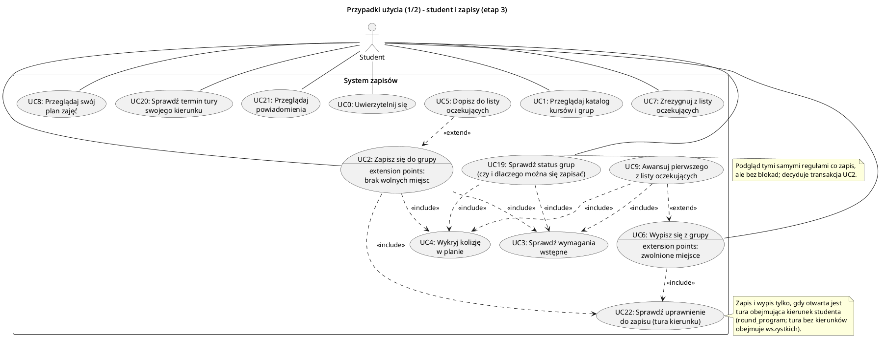

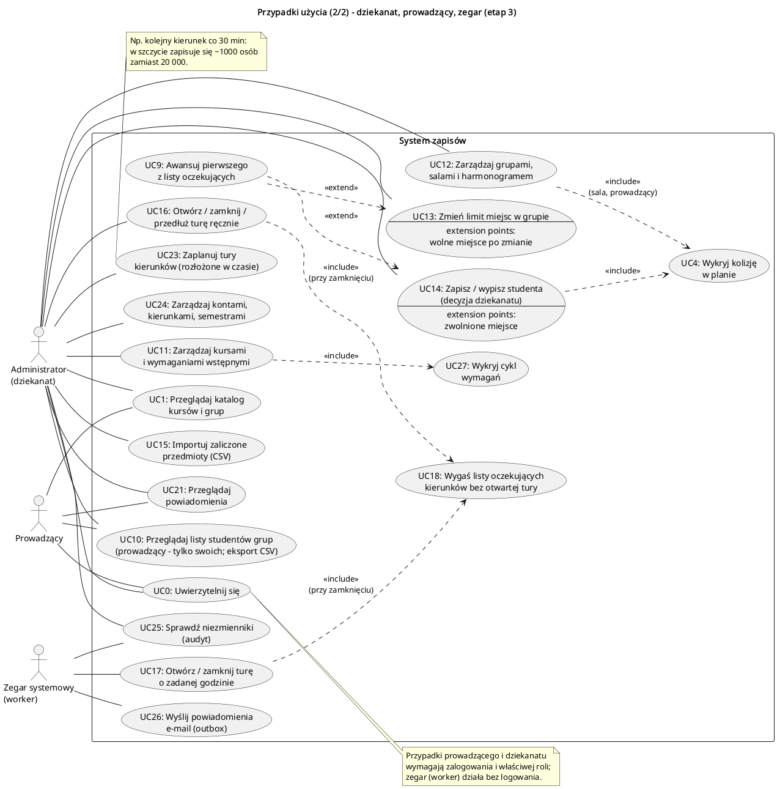

Notacja: UC0 (logowanie) jest połączony z każdym aktorem-osobą – pozostałe przypadki wymagają
zalogowania i właściwej roli; `<<include>>` – zawsze, `<<extend>>` – warunkowo w nazwanym punkcie
(np. UC9 rozszerza UC6, UC13 i UC14, gdy zwolni się miejsce, a ktoś czeka).
Nowe przypadki: UC19–UC27.

### Wszystkie przypadki użycia

Kolumna „Błędy” podaje kody odpowiedzi (sekcja 9). Każdy przypadek oprócz UC0, UC17, UC18,
UC25 (przez worker) i UC26 wymaga zalogowania (401) i właściwej roli (403).

| UC | Nazwa | Aktor | Endpoint | Warunki wstępne → wynik | Błędy |
|---|---|---|---|---|---|
| UC0 | Uwierzytelnij się | wszyscy | `POST /api/auth/login` | konto istnieje → token JWT (12 h) i dane użytkownika | `BAD_CREDENTIALS` |
| UC1 | Przeglądaj katalog | wszyscy | `GET /api/terms/{t}/courses?q`, `…/courses/{c}` | → kursy z liczbą grup i wolnych miejsc; grupy z terminami, prowadzącymi, zajętością (cache 3 s) | `COURSE_NOT_FOUND` |
| UC2 | Zapisz się do grupy | student | `POST /api/me/enrollments` | tura kierunku otwarta, reguły spełnione, wolne miejsce → `ENROLLED`; wpisy na listach grup tego typu → `CANCELLED` | `ROUND_CLOSED`, `ALREADY_ENROLLED`, `ALREADY_WAITING`, `SAME_KIND`, `PREREQUISITES`, `CONFLICT`, `WAITLIST_FULL`, `RATE_LIMITED`, `OVERLOADED`, `BUSY` |
| UC3 | Sprawdź wymagania | system | (w UC2, UC9, UC19) | → brakujące kursy (wystarczy jedno zaliczenie, ocena ≥ 3.0) | `PREREQUISITES` |
| UC4 | Wykryj kolizję | system | (w UC2, UC9, UC12, UC14, UC19) | → grupy kolidujące (dzień, godziny, parzystość tygodni) | `CONFLICT`, `ROOM_BUSY`, `LECTURER_BUSY` |
| UC5 | Dopisz do listy | student | (extend UC2: brak miejsc) | lista < `waitlist_limit` → `WAITLISTED` z pozycją | `WAITLIST_FULL` |
| UC6 | Wypisz się | student | `DELETE /api/me/enrollments/{s}` | tura otwarta, zapis aktywny → `DROPPED`, licznik −1, UC9 | `ROUND_CLOSED`, `NOT_ENROLLED` |
| UC7 | Zrezygnuj z listy | student | `DELETE /api/me/waitlist/{s}` | wpis `WAITING` → `CANCELLED` | `NOT_WAITING` |
| UC8 | Przeglądaj plan | student | `GET /api/me/terms/{t}/plan` | → grupy z terminami, prowadzącymi, źródłem zapisu | – |
| UC9 | Awansuj z listy | system | (w UC6, UC13, UC14) | wolne miejsce → kolejni oczekujący `PROMOTED` albo `SKIPPED` z powodem; powiadomienia | (ponowienie przy 55P03) |
| UC10 | Listy studentów grupy | prowadzący, dziekanat | `GET /api/sections/{s}/roster` | prowadzący tylko swoich grup → zapisani i oczekujący (kolejność); eksport CSV w SPA | `FORBIDDEN`, `SECTION_NOT_FOUND` |
| UC11 | Kursy i wymagania | dziekanat | `POST/PATCH /api/admin/courses`, `…/prerequisites` | → kurs / wymaganie | `DUPLICATE`, `PREREQUISITE_CYCLE`, `COURSE_NOT_FOUND` |
| UC12 | Grupy, sale, harmonogram | dziekanat | `POST /api/admin/sections`, `…/meetings`, `…/lecturers`, `rooms` | sala ≥ limit grupy, brak kolizji sali i prowadzącego → grupa / termin / przypisanie | `BAD_TIME`, `ROOM_TOO_SMALL`, `ROOM_BUSY`, `LECTURER_BUSY`, `SECTION_NOT_FOUND`, `ROOM_NOT_FOUND`, `LECTURER_NOT_FOUND`, `DUPLICATE` |
| UC13 | Zmień limit | dziekanat | `PATCH /api/admin/sections/{s}` | zapisani ≤ limit ≤ sala → nowy limit, UC9 | `BELOW_ENROLLED`, `ROOM_FULL` |
| UC14 | Zapisz / wypisz (decyzja) | dziekanat | `POST /api/admin/enrollments`, `DELETE …/{st}/{s}` | bez tury i wymagań; kolizje i typ zawsze; pełna grupa → limit +1 (≤ sala) | `ALREADY_ENROLLED`, `CONFLICT`, `SAME_KIND`, `ROOM_FULL`, `NOT_ENROLLED` |
| UC15 | Importuj oceny | dziekanat | `POST /api/admin/grades/import` | CSV `index_no,course_code,term_code,grade` → liczba zaimportowanych, lista błędnych wierszy; ponowny import nadpisuje ocenę | `VALIDATION` |
| UC16 | Otwórz / zamknij / przedłuż turę | dziekanat | `POST /api/admin/rounds/{r}/open|close`, `PATCH …/{r}` | zamknięcie → UC18 | `ROUND_NOT_FOUND`, `BAD_DATES` |
| UC17 | Tura o zadanej godzinie | zegar (worker) | – | `opens_at` minął → `OPEN`; `closes_at` minął → `CLOSED` + UC18; tury zamkniętej ręcznie nie otwiera | – |
| UC18 | Wygaś listy | system | (w UC16, UC17 i okresowo) | kierunek bez otwartej tury w semestrze → jego wpisy `WAITING` → `EXPIRED` + powiadomienie | – |
| UC19 | Status grup kursu | student | `GET /api/me/terms/{t}/courses/{c}` | → dla każdej grupy: `ENROLLED` / `WAITING` (pozycja) / `AVAILABLE` / `BLOCKED` z powodami | `OVERLOADED` |
| UC20 | Termin tury kierunku | student | `GET /api/me/terms/{t}/rounds` | → tury obejmujące kierunek studenta (baner w SPA) | – |
| UC21 | Powiadomienia | wszyscy | `GET /api/me/notifications`, `POST …/read` | → ostatnie 50; oznaczenie jako przeczytane | – |
| UC22 | Uprawnienie do zapisu | system | (w UC2, UC6) | otwarta tura obejmuje kierunek (tura bez kierunków – wszystkich) | `ROUND_CLOSED` |
| UC23 | Zaplanuj tury kierunków | dziekanat | `POST /api/admin/rounds` (×N z SPA) | → osobna tura dla każdego kierunku, kolejna co *n* minut | `BAD_DATES`, `PROGRAM_NOT_FOUND`, `DUPLICATE` |
| UC24 | Konta, kierunki, semestry | dziekanat | `POST /api/admin/users`, `programs`, `terms`; `GET users?q&role` | dane roli kompletne → konto | `STUDENT_DATA`, `LECTURER_DATA`, `DUPLICATE` |
| UC25 | Audyt niezmienników | dziekanat, worker | `GET /api/admin/audit` | → lista naruszeń (pusta = OK); worker loguje je co minutę | – |
| UC26 | Wyślij powiadomienia | worker | – | niewysłane, < 5 prób → e-mail, `sent_at`; błąd SMTP → `attempts + 1` | – |
| UC27 | Wykryj cykl wymagań | system | (w UC11) | dodanie A → B, gdy B (pośrednio) wymaga A → odmowa | `PREREQUISITE_CYCLE` |

### Scenariusze główne i alternatywne

Szczegółowe przebiegi najważniejszych przypadków (UC2, UC5, UC6, UC9, UC13, UC14, UC18) są
w etapie 2 i nadal obowiązują. Nowe w etapie 3:
- **UC22:** student kierunku INF, otwarta jest tylko tura MAT → `409 ROUND_CLOSED`, a baner
  w SPA pokazuje termin tury INF (UC20). Zamknięcie tury MAT wygasza tylko wpisy studentów MAT;
  oczekujący z INF czekają dalej, jeśli ich tura trwa.
- **UC19:** podgląd używa tych samych funkcji domeny co zapis (`check_student`), ale bez blokad.
  Między podglądem a zapisem stan może się zmienić – decyzję podejmuje zawsze transakcja UC2.
- **Przeciążenie:** gdy wszystkie sloty bramki są zajęte dłużej niż 2 s → `503 OVERLOADED`
  z `Retry-After`; SPA czeka i ponawia (do 4 razy) z komunikatem „Duży ruch – ponawiam…”.
  Odrzucenie przez bramkę nie zużywa limitu operacji studenta.

## 5. Diagramy sekwencji

| Diagram | Przypadki | Co pokazuje |
|---|---|---|
| 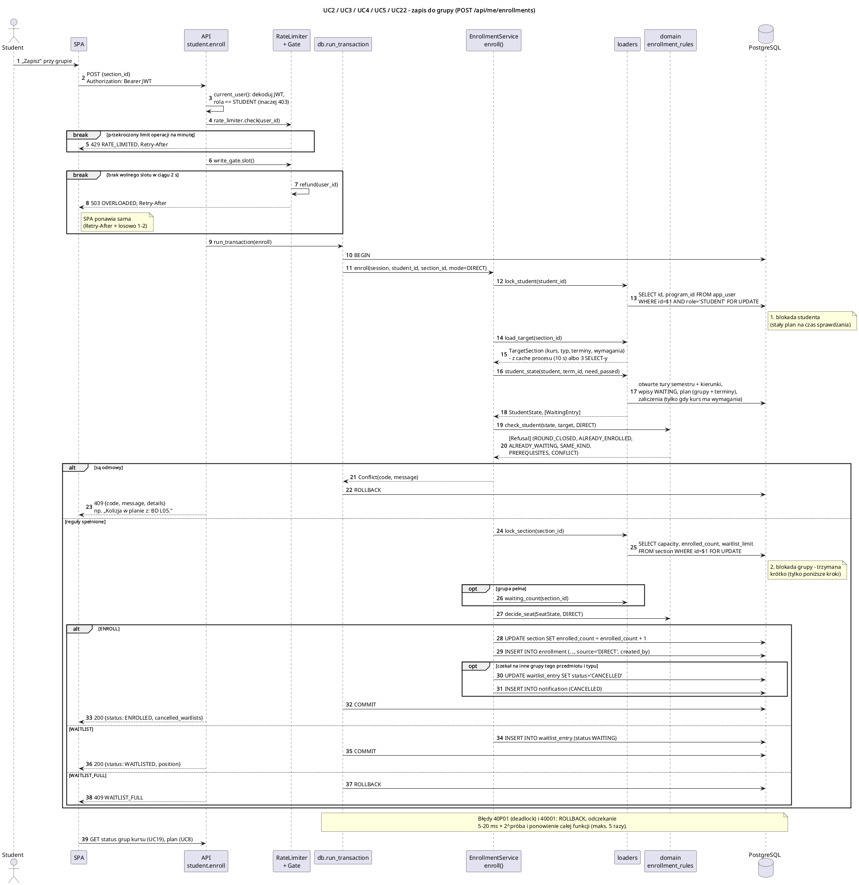 `sekwencja_zapis` | UC2, UC3, UC4, UC5, UC22 | kontrola ruchu, kolejność blokad, decyzja w domenie, trzy wyniki (zapis, lista, odmowa), ponowienie |
| 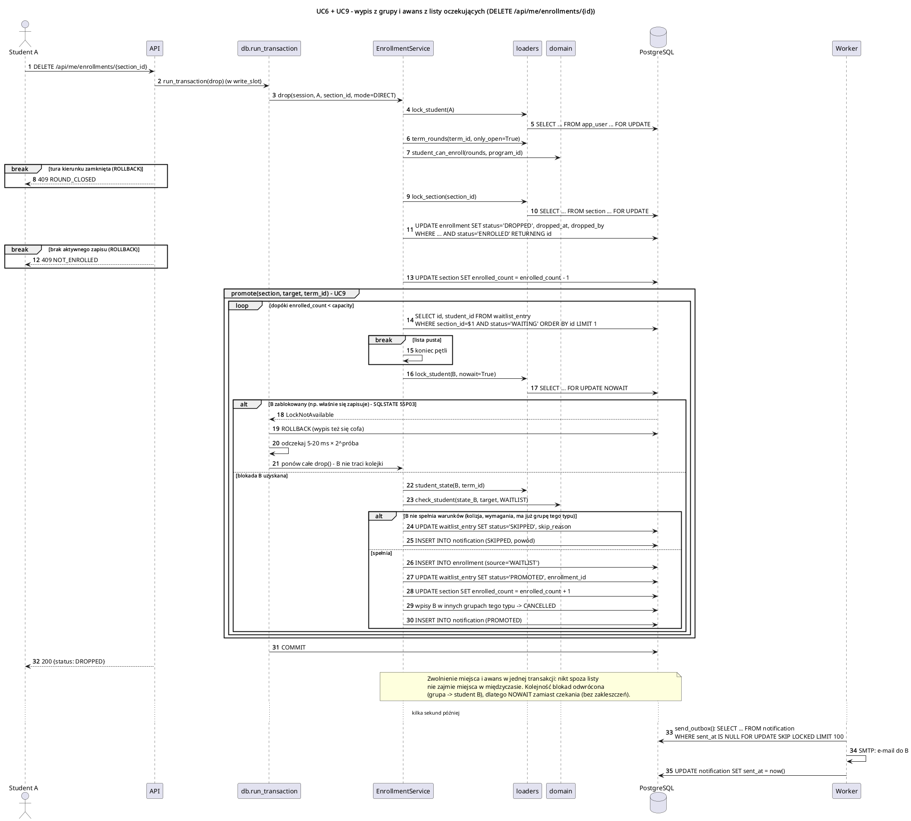 `sekwencja_wypis_awans` | UC6, UC9 | wypis i awans w jednej transakcji, `NOWAIT` i ponowienie bez utraty kolejki, SKIPPED/PROMOTED, outbox |
| 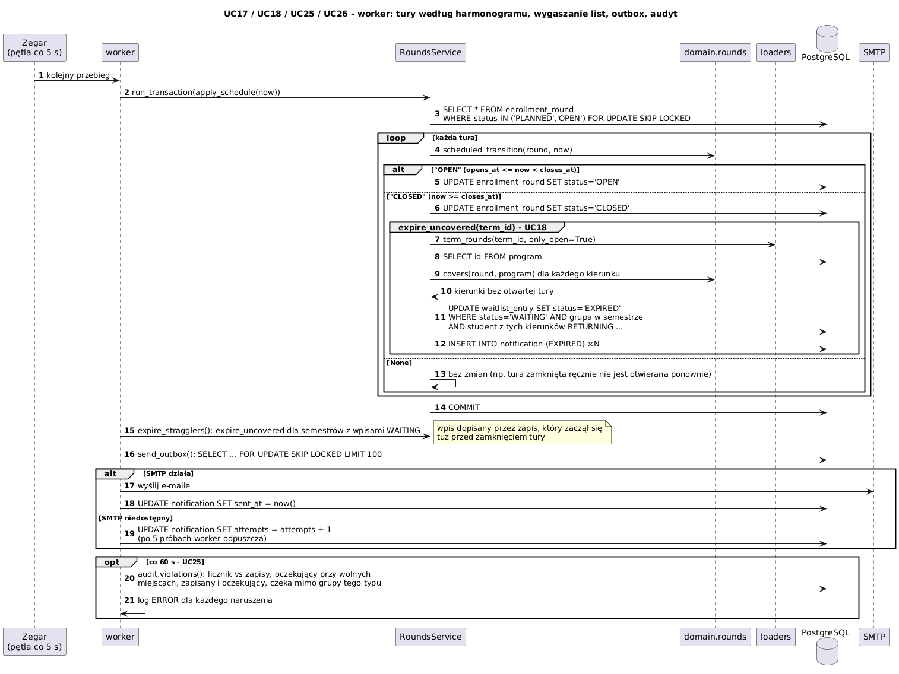 `sekwencja_tura` | UC17, UC18, UC25, UC26 | harmonogram tur, wygaszanie list kierunków, spóźnione wpisy, wysyłka z ponawianiem, audyt |
| 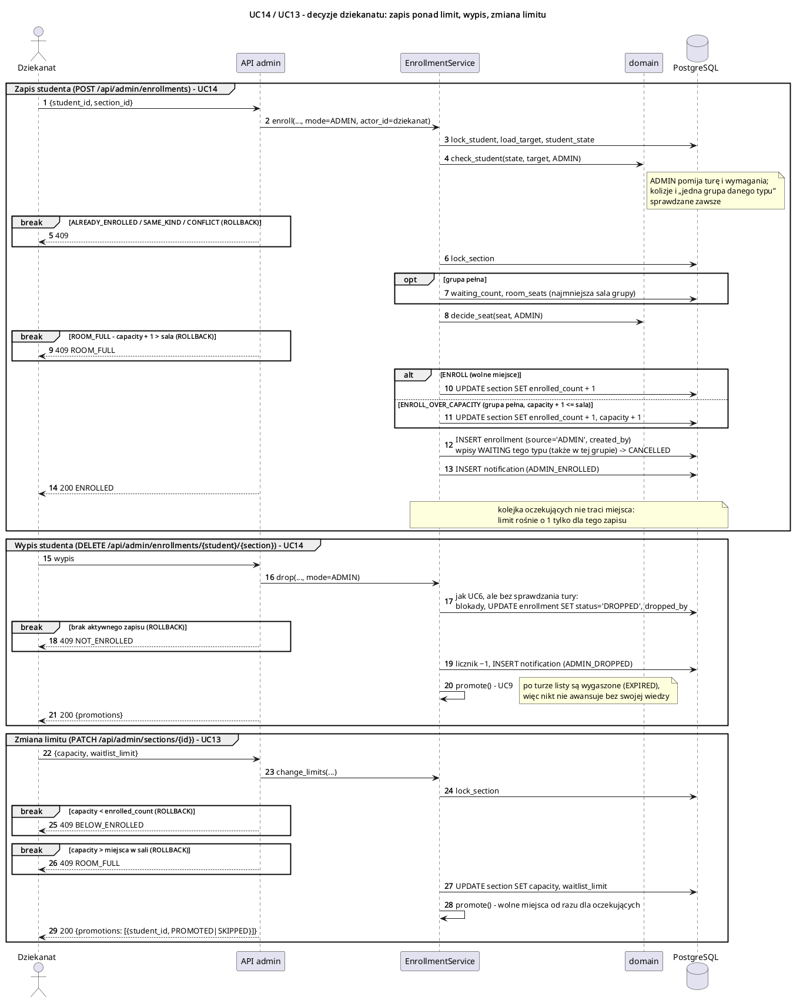 `sekwencja_dziekanat` | UC14, UC13 | zapis ponad limit (≤ sala), wypis bez tury, zmiana limitu z awansem |
| 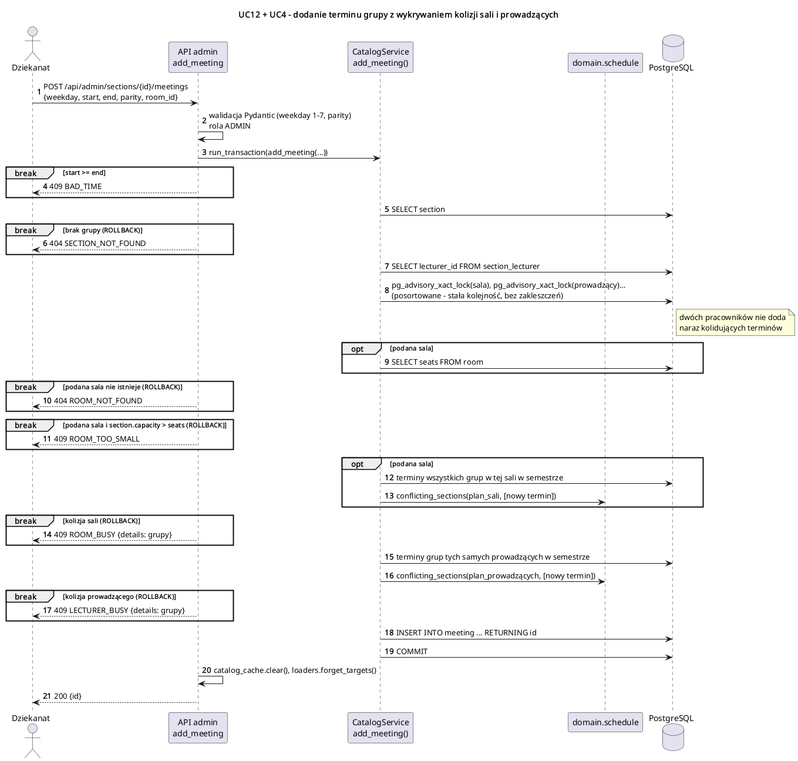 `sekwencja_harmonogram` | UC12, UC4 | blokady doradcze, sala za mała, kolizja sali, kolizja prowadzącego |
| 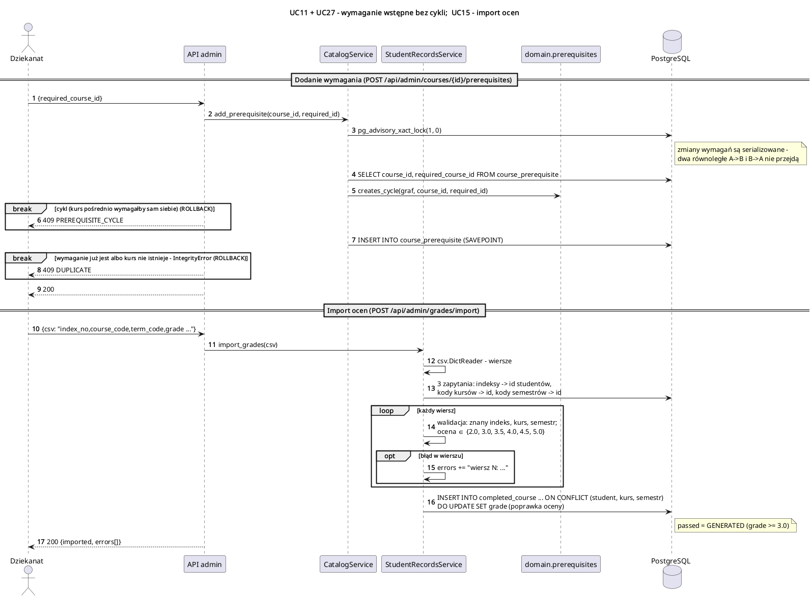 `sekwencja_wymagania_import` | UC11, UC27, UC15 | wykrywanie cyklu pod blokadą; import CSV z raportem błędów i nadpisaniem oceny |
| 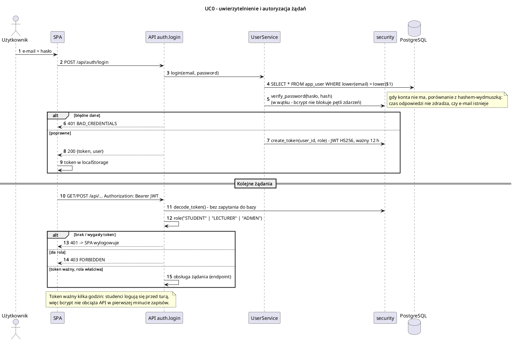 `sekwencja_logowanie` | UC0 | bcrypt w wątku, stały czas odpowiedzi, JWT, sprawdzanie roli bez bazy |

## 6. Model danych (ER)

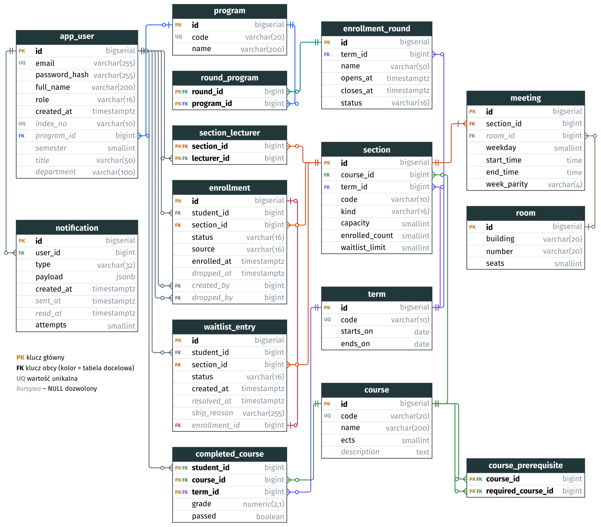

Pełna definicja: [`backend/migrations/versions/0001_initial.sql`](../backend/migrations/versions/0001_initial.sql)
(15 tabel). Decyzje z etapu 2 (kurs ≠ grupa, terminy w `meeting`, licznik `enrolled_count`,
historia zamiast kasowania, kolejność listy = `id`, outbox) obowiązują. Nowe:
- `program` – kierunek studenta (`app_user.program_id`) i tur (`round_program`).
- `round_program (round_id, program_id)` – tura bez wierszy obejmuje wszystkich.
- `app_user` – jedna tabela; `CHECK (num_nonnulls(index_no, program_id, semester) = CASE WHEN role='STUDENT' THEN 3 ELSE 0 END)`
  i analogiczne dla prowadzącego. Klucze obce `student_id` wskazują na `app_user`, więc rolę
  sprawdza blokada studenta (`WHERE role = 'STUDENT'`).
- Indeksy pod gorące zapytania: `waitlist_student`, `enrollment_section`, `section_term`,
  `notification_user`, `notification_unsent`.

## 7. Projekt klas i komponentów

Moduły backendu są funkcyjne: moduł Pythona pełni rolę klasy-serwisu (`<<service>>`), jego
funkcje to operacje. Dane między warstwami przenoszą niezmienne `dataclass` – domena nie widzi
obiektów ORM ani połączeń z bazą.

### 7.1. Domena (`app/domain`)

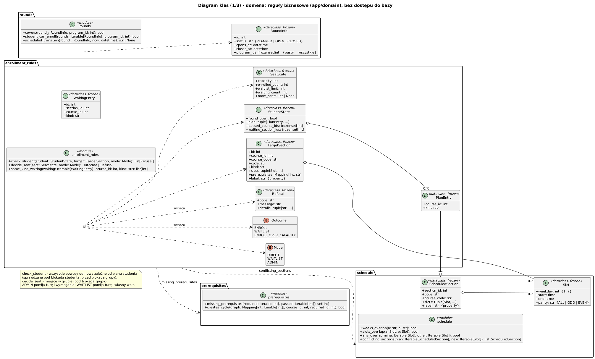

| Operacja | Parametry | Zwraca | Funkcjonalność |
|---|---|---|---|
| `schedule.slots_overlap` | `a, b: Slot` | `bool` | Ten sam dzień, `a.start < b.end ∧ b.start < a.end`, tygodnie się pokrywają (ALL z każdym, ODD z ODD, EVEN z EVEN). Styk 9:30/9:30 nie jest kolizją. |
| `schedule.conflicting_sections` | `plan: Iterable[ScheduledSection]`, `new: Iterable[Slot]` | `list[ScheduledSection]` | Grupy z planu, których którykolwiek termin nachodzi na nowe terminy. Używane dla planu studenta, sali i prowadzącego. |
| `prerequisites.missing_prerequisites` | `required, passed: Iterable[int]` | `set[int]` | Kursy wymagane bez zaliczenia. |
| `prerequisites.creates_cycle` | `graph: Mapping[int, Iterable[int]]`, `course_id, required_id: int` | `bool` | DFS od `required_id`: czy dojdzie do `course_id` (wtedy nowe wymaganie zamknęłoby cykl). |
| `rounds.covers` | `round_: RoundInfo`, `program_id: int` | `bool` | Tura obejmuje kierunek (pusty zbiór kierunków = wszystkie). |
| `rounds.student_can_enroll` | `rounds: Iterable[RoundInfo]`, `program_id: int` | `bool` | Czy któraś **otwarta** tura obejmuje kierunek. |
| `rounds.scheduled_transition` | `round_: RoundInfo`, `now: datetime` | `"OPEN" \| "CLOSED" \| None` | Nowy status według harmonogramu; tury `CLOSED` nie zmienia (ręczne zamknięcie jest ostateczne, przedłużenie to zmiana `closes_at`). |
| `enrollment_rules.check_student` | `student: StudentState`, `target: TargetSection`, `mode: Mode` | `list[Refusal]` | Wszystkie powody odmowy zależne od studenta, w kolejności: tura (tylko DIRECT), już zapisany / już czeka (DIRECT), grupa tego samego typu z przedmiotu, wymagania (poza ADMIN), kolizje. Pusta lista = można. |
| `enrollment_rules.decide_seat` | `seat: SeatState`, `mode: Mode` | `Outcome \| Refusal` | Wolne miejsce → `ENROLL`; pełna: ADMIN → `ENROLL_OVER_CAPACITY` (≤ sala) albo `ROOM_FULL`; WAITLIST → `NO_SEAT`; DIRECT → `WAITLIST` albo `WAITLIST_FULL`. |
| `enrollment_rules.same_kind_waiting` | `waiting: Iterable[WaitingEntry]`, `course_id: int`, `kind: str` | `list[int]` | Wpisy na listach grup tego samego przedmiotu i typu – do anulowania po zapisie. |

`Mode`: `DIRECT` (student), `WAITLIST` (awans), `ADMIN` (dziekanat). `Refusal(code, message,
details)` – kod do obsługi w SPA, komunikat po polsku, szczegóły (np. kolidujące grupy).

### 7.2. Serwisy (`app/services`)

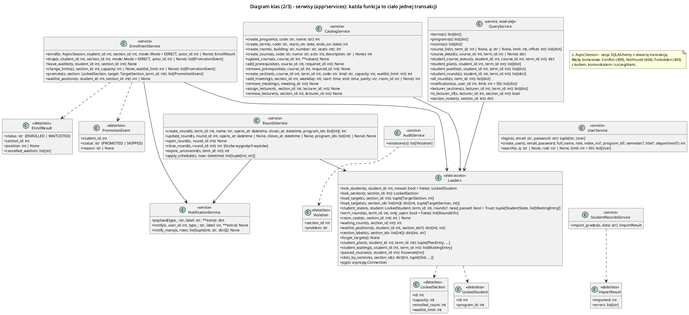

Każda operacja (poza `QueryService` i `forget_targets`) przyjmuje `s: AsyncSession` z otwartą
transakcją; wywołuje się ją przez `db.run_transaction`, która ponawia całość przy konfliktach
blokad. Błędy biznesowe to wyjątki `Conflict` (409), `NotFound` (404), `Forbidden` (403).

**EnrollmentService** (`services/enrollment.py`)

| Operacja | Parametry | Zwraca | Funkcjonalność |
|---|---|---|---|
| `enroll` | `student_id, section_id: int`, `mode: Mode = DIRECT`, `actor_id: int \| None` | `EnrollResult(status, section_id, position, cancelled_waitlists)` | UC2/UC5/UC14. Blokada studenta → `check_student` → blokada grupy → `decide_seat` → zapis (licznik +1, `enrollment`, anulowanie list tego typu) albo wpis na listę. |
| `drop` | `student_id, section_id: int`, `mode`, `actor_id` | `list[PromotionEvent]` | UC6/UC14. Student tylko w otwartej turze. Wypis, licznik −1, potem `promote`. |
| `leave_waitlist` | `student_id, section_id: int` | `None` | UC7. Wpis `WAITING` → `CANCELLED` (pod blokadą studenta). |
| `change_limits` | `section_id: int`, `capacity, waitlist_limit: int \| None` | `list[PromotionEvent]` | UC13. `capacity ≥ zapisani`, `≤ sala`; potem `promote`. |
| `promote` | `section: LockedSection`, `target: TargetSection`, `term_id: int` | `list[PromotionEvent(student_id, PROMOTED\|SKIPPED, reason)]` | UC9. Wymaga blokady grupy. Dopóki są miejsca: pierwszy `WAITING`, blokada `NOWAIT`, `check_student(…, WAITLIST)`, zapis albo `SKIPPED`, powiadomienie. |
| `waitlist_position` | `student_id, section_id: int` | `int \| None` | Pozycja na liście (liczba `WAITING` z `id ≤` mojego). |

**CatalogService** (`services/catalog.py`) – UC11, UC12, UC24

| Operacja | Parametry | Zwraca | Funkcjonalność |
|---|---|---|---|
| `create_program` / `create_term` / `create_room` / `create_course` | dane słownika | `int` (id) | Wstawienie; duplikat → `DUPLICATE`; semestr: `starts_on < ends_on`. |
| `update_course` | `course_id: int`, `**values` (`name`, `ects`, `description`) | `None` | Zmiana niepustych pól. |
| `add_prerequisite` | `course_id, required_id: int` | `None` | Blokada doradcza (wszystkie zmiany wymagań szeregowo), graf wymagań, `creates_cycle` → `PREREQUISITE_CYCLE`. |
| `remove_prerequisite` | `course_id, required_id: int` | `None` | Usunięcie wymagania. |
| `create_section` | `course_id, term_id: int`, `code, kind: str`, `capacity, waitlist_limit: int` | `int` | Nowa grupa. |
| `add_meeting` | `section_id, weekday: int`, `start, end: time`, `parity: str`, `room_id: int \| None` | `int` | Blokady doradcze sali i prowadzących; sala ≥ limit grupy; `conflicting_sections` dla sali i prowadzących. |
| `assign_lecturer` | `section_id, lecturer_id: int` | `None` | Rola `LECTURER`; brak kolizji z innymi grupami prowadzącego. |
| `remove_meeting` / `remove_lecturer` | id | `None` | Usunięcie. |

**RoundsService** (`services/rounds.py`) – UC16, UC17, UC18, UC23

| Operacja | Parametry | Zwraca | Funkcjonalność |
|---|---|---|---|
| `create_round` | `term_id: int`, `name: str`, `opens_at, closes_at: datetime`, `program_ids: list[int]` | `int` | Tura (status `PLANNED`) z kierunkami. |
| `update_round` | `round_id: int`, `opens_at?, closes_at?`, `program_ids?` | `None` | Przedłużenie / zmiana kierunków; przy otwartej turze od razu `expire_uncovered`. |
| `open_round` | `round_id: int` | `None` | Status `OPEN`. |
| `close_round` | `round_id: int` | `int` | Status `CLOSED` + `expire_uncovered`; zwraca liczbę wygasłych wpisów. |
| `expire_uncovered` | `term_id: int` | `int` | Kierunki bez otwartej tury (`covers`) → ich wpisy `WAITING` w semestrze → `EXPIRED` + powiadomienia. |
| `apply_schedule` | `now: datetime` | `list[(round_id, nowy status)]` | Dla tur `PLANNED/OPEN` (`SKIP LOCKED`) stosuje `scheduled_transition`. |

**Pozostałe serwisy**

| Operacja | Parametry | Zwraca | Funkcjonalność |
|---|---|---|---|
| `UserService.login` | `email, password: str` | `(token: str, User)` | bcrypt w wątku; brak konta → porównanie z hashem-wydmuszką; `BAD_CREDENTIALS` (401). |
| `UserService.create_user` | `email, password, full_name, role`, dane roli | `int` | Walidacja danych roli (`STUDENT_DATA`, `LECTURER_DATA`), hash hasła. |
| `UserService.search` | `q: str \| None`, `role: str \| None`, `limit = 50` | `list[User]` | Szukanie po nazwisku, e-mailu, indeksie. |
| `StudentRecordsService.import_grades` | `data: str` (CSV) | `ImportResult(imported, errors)` | Walidacja wierszy, upsert ocen. |
| `NotificationService.notify` / `notify_many` | `user_id, type_, label, **extra` / `rows` | `None` | Wpis do outboxa w bieżącej transakcji; treść z szablonu typu. |
| `AuditService.violations` | – | `list[Violation(section_id, problem)]` | Licznik ≠ zapisani; oczekujący przy wolnych miejscach; zapisany i oczekujący; czeka mimo grupy tego typu. |
| `QueryService.*` | `student_id / lecturer_id / course_id / term_id …` | `dict` / `list[dict]` | Odczyty dla UI (sekcja 8): katalog, status grup (te same reguły co zapis), plan, listy, tury, powiadomienia, listy grup. |

**Loaders** (`services/loaders.py`) – dostęp do danych dla reguł

| Operacja | Zwraca | Funkcjonalność |
|---|---|---|
| `lock_student(student_id, nowait=False)` | `LockedStudent(id, program_id)` | `SELECT … FOR UPDATE [NOWAIT]`, tylko rola STUDENT (`STUDENT_NOT_FOUND`). |
| `lock_section(section_id)` | `LockedSection(id, capacity, enrolled_count, waitlist_limit)` | `SELECT … FOR UPDATE`. |
| `load_target(section_id)` / `load_targets(ids)` | `(TargetSection, term_id)` / `dict` | Dane katalogowe grupy (kurs, typ, terminy, wymagania); pojedyncza grupa z cache procesu 10 s. |
| `student_state(student, term_id, rounds?, need_passed=True)` | `(StudentState, list[WaitingEntry])` | Otwarte tury, plan z terminami, wpisy WAITING, zaliczenia (tylko gdy kurs ma wymagania). |
| `term_rounds(term_id, only_open=False)` | `list[RoundInfo]` | Tury semestru z kierunkami (jedno zapytanie). |
| `room_seats`, `waiting_count`, `waitlist_positions`, `section_labels` | `int \| None`, `int`, `dict`, `dict` | Dane pomocnicze. |
| `forget_targets()` | `None` | Czyści cache po zmianie katalogu przez dziekanat. |

### 7.3. API, kontrola ruchu, infrastruktura

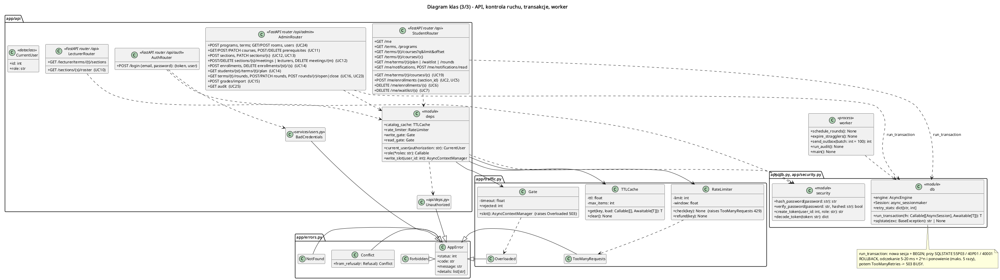

| Klasa / operacja | Parametry | Zwraca | Funkcjonalność |
|---|---|---|---|
| `TTLCache.get` | `key`, `load: () -> Awaitable[T]` | `T` | Wartość z cache albo z `load()`; równoczesne chybienia tego samego klucza czekają na jedno wywołanie (bez lawiny zapytań po wygaśnięciu). |
| `RateLimiter.check` / `refund` | `key` (id studenta) | `None` | Okno przesuwne N operacji/min → `TooManyRequests` (429, Retry-After); `refund` cofa operację odrzuconą przez bramkę. |
| `Gate.slot` | – | kontekst asynchroniczny | Najwyżej N równoczesnych transakcji zapisu na proces; czekanie > timeout → `Overloaded` (503). Osobna bramka dla ciężkich odczytów (UC19). |
| `deps.current_user` | nagłówek `Authorization` | `CurrentUser(id, role)` | Dekodowanie JWT bez zapytania do bazy (401). |
| `deps.role` | `*roles: str` | zależność FastAPI | 403, gdy rola spoza listy. |
| `deps.write_slot` | `user_id: int` | kontekst | `RateLimiter.check` + `Gate.slot` + zwrot limitu przy 503. |
| `db.run_transaction` | `fn: (AsyncSession) -> Awaitable[T]` | `T` | Nowa sesja + transakcja; SQLSTATE 55P03/40P01/40001 → ROLLBACK, wykładnicze odczekanie z losowością, ponowienie (maks. 5) → `TooManyRetries` (503 BUSY). |
| `security.hash_password` / `verify_password` | `password[, hashed]: str` | `str` / `bool` | bcrypt. |
| `security.create_token` / `decode_token` | `user_id, role` / `token` | `str` / `dict` | JWT HS256 z `sub`, `role`, `exp`. |
| `worker.schedule_rounds` / `expire_stragglers` / `send_outbox(batch=100)` / `run_audit` | – | `None` / `int` (wysłane) | Kroki pętli workera (sekcja 5, `sekwencja_tura`). |

## 8. Uprawnienia ról

| Zasób / operacja | Student | Prowadzący | Dziekanat |
|---|---|---|---|
| Katalog, semestry, kierunki (UC1) | ✓ | ✓ | ✓ |
| Własne zapisy, plan, listy, status grup, tury (UC2–UC8, UC19, UC20) | ✓ (tylko swoje) | – | – |
| Powiadomienia (UC21) | ✓ (swoje) | ✓ (swoje) | ✓ (swoje) |
| Listy studentów grupy (UC10) | – | ✓ tylko grupy, które prowadzi | ✓ wszystkie |
| Katalog, harmonogram, limity (UC11–UC13) | – | – | ✓ |
| Zapis / wypis studenta (UC14), plan studenta | – | – | ✓ |
| Tury (UC16, UC23), konta i słowniki (UC24), import ocen (UC15), audyt (UC25) | – | – | ✓ |

Student nigdy nie podaje `student_id` – identyfikator pochodzi z tokenu, więc nie może działać
w cudzym imieniu. Rola jest w tokenie; zmiana roli wymaga ponownego zalogowania.

## 9. Obsługa błędów

Każdy błąd ma postać `{"code", "message", "details"}`; `message` jest po polsku i trafia
wprost do użytkownika, `code` służy SPA do decyzji (np. ponowienie przy 429/503).

| HTTP | Kody | Kiedy | Reakcja SPA |
|---|---|---|---|
| 401 | `BAD_CREDENTIALS`, `UNAUTHORIZED` | złe hasło, brak / wygasły token | ekran logowania |
| 403 | `FORBIDDEN` | zła rola, cudza grupa | komunikat |
| 404 | `*_NOT_FOUND` | nie ma grupy, kursu, studenta, tury, sali… | komunikat |
| 409 | `ROUND_CLOSED`, `ALREADY_ENROLLED`, `ALREADY_WAITING`, `SAME_KIND`, `PREREQUISITES`, `CONFLICT`, `WAITLIST_FULL`, `NOT_ENROLLED`, `NOT_WAITING` | odmowa zapisu / wypisu z powodem | powód przy grupie |
| 409 | `ROOM_FULL`, `ROOM_TOO_SMALL`, `ROOM_BUSY`, `LECTURER_BUSY`, `BELOW_ENROLLED`, `PREREQUISITE_CYCLE`, `BAD_TIME`, `BAD_DATES`, `DUPLICATE`, `STUDENT_DATA`, `LECTURER_DATA` | decyzje dziekanatu niezgodne z regułami | komunikat ze szczegółami |
| 422 | `VALIDATION` | niepoprawne dane wejściowe (Pydantic) | lista pól |
| 429 | `RATE_LIMITED` | za dużo operacji studenta w minucie | ponowienie po Retry-After |
| 503 | `OVERLOADED`, `BUSY` | bramka pełna / wyczerpane ponowienia przy konflikcie blokad | ponowienie (do 4×) z rozrzutem |

Błędy techniczne wewnątrz transakcji (deadlock, `NOWAIT`) nie docierają do użytkownika –
`run_transaction` je ponawia. Naruszenie ograniczenia w bazie (błąd w kodzie) kończy żądanie
błędem 500, a stan pozostaje spójny.

## 10. Weryfikacja projektu

- **35 testów automatycznych** (pytest, prawdziwy PostgreSQL): reguły domeny (przypadki
  brzegowe kolizji i parzystości, cykle, tury), zapisy i listy (scenariusze 1–6 z prototypu
  etapu 2), wyścigi (30 osób / 10 miejsc, dwie karty jednego studenta, równoczesne wypisy,
  awans kontra zapis tego samego studenta – 10 powtórzeń, ścieżka `NOWAIT` faktycznie
  wykonywana), API i role, worker.
- **Test obciążeniowy** (k6, `loadtest/otwarcie_tury.js`, 20 000 kont, 9000 grup): każdy
  student przegląda katalog i status grup, zapisuje się na 6 przedmiotów (wykład + lab).

| Scenariusz | p95 zapisu | Sesja studenta | Ponowienia | Niezmienniki |
|---|---|---|---|---|
| 1 kierunek, 1000 osób naraz – pierwsza wersja | 2,5 s | 2 min | 22 873 (1576 nieudanych) | OK |
| 1 kierunek, 1000 osób naraz – po optymalizacjach | **1,9 s** | **17 s** | **0** | OK |
| 3 kierunki, 3000 osób naraz (przeciążenie) | 2,1 s | 49 s | 18 034 (0,5% nieudanych) | OK, 0 przepełnień |

Jedna maszyna (16 rdzeni) z k6. Wąskim gardłem jest CPU procesów API, nie baza – przepustowość
rośnie z liczbą instancji API. Wniosek projektowy: **tury per kierunek są konieczne**, a system
przy przeciążeniu zwalnia, ale nie traci spójności.

## 11. Dla grupy przejmującej projekt

- Uruchomienie i testy: [`../IMPLEMENTACJA.md`](../IMPLEMENTACJA.md).
- Nowa reguła zapisu: funkcja w `app/domain/enrollment_rules.py` (+ test w `tests/test_domain.py`),
  dane do niej w `loaders.student_state` / `load_target`. Nie w SQL.
- Zmiana schematu: nowa migracja Alembic (`backend/migrations/versions/`), aktualizacja
  `diagramy/er.py`.
- Każda zmiana w ścieżce zapisu: test wyścigu (`test_race_for_last_seats`) i test obciążeniowy.
- Znane ograniczenia:
  - kursy nie są przypisane do kierunków (tura ogranicza, kto i kiedy, nie na co),
  - zamiana grupy (L05 → L03 bez utraty L05) nieobsługiwana,
  - limit żądań i cache są per proces (przy N instancjach limit przybliżony),
  - zmiana terminu przez dziekanat w trakcie tury dociera do innych procesów po ≤ 10 s
    i nie weryfikuje planów już zapisanych studentów,
  - jedna rola na konto (doktorant prowadzący zajęcia wymagałby tabeli ról),
  - logowanie hasłem; docelowo SSO uczelni.
