# System zapisów na zajęcia (USOSv2) – Etap 5: projekt końcowy systemu

Termin: **18.XI** (prezentacja). Ocena z etapu: **40%** oceny z projektu.

Wymagania etapu (opis zadania i wiadomość prowadzącego z 4.XI):

> Analogicznie do zakresu z „Projektu wstępnego systemu” należy przedstawić kompletny projekt
> (diagramy UML, ER, projekt klas itp.) dla nowego zakresu funkcjonalnego. Jeśli to konieczne,
> należy też dokonać zmian w otrzymanym projekcie.
>
> **Temat – Zapisy na zajęcia.**
> **Testy:** weryfikacja braku kolizji zajęć dla studenta w różnych scenariuszach zapisu do grup
> i zmiany harmonogramu w trakcie zapisów, szczególnie w kontekście przydzielania zajęć z kolejki.
> **Nowa funkcjonalność:** zapisy oparte nie na kolejce (kto pierwszy, ten lepszy), ale na systemie
> preferencji – student może zdefiniować, które przedmioty są dla niego „najcenniejsze” (przypisać
> wagi), a system optymalizuje przydział zajęć tak, aby uzyskać jak najlepsze dopasowanie. Student
> może modyfikować swoje wagi (preferencje) w trakcie zapisów.
>
> Typowy test składa się z 3 części: 1) przygotowania – ustawienia systemu w odpowiednim stanie,
> 2) właściwego testu – wołania odpowiednich metod, 3) weryfikacji rezultatu.

**Punkt wyjścia.** Po wymianie projektów dostaliśmy od drugiej grupy tylko prezentację
(`../2-kreciglowa-krolik-krowka.pdf`: Celery + Redis, SSO, kolejka FIFO). Nie było do niej kodu ani
źródeł diagramów, więc rozszerzenie zbudowaliśmy na **naszym projekcie z etapów 1–3**, który ma
działającą implementację (`../backend`, `../frontend`). Wszystkie elementy tutaj są **zaimplementowane
i przetestowane** – diagramy klas i sekwencji opisują kod, a scenariusze testowe to uruchamiane testy.
Odniesienia do pomysłów z otrzymanego projektu są w sekcji 1.3.

## Zawartość

| Plik | Co to jest |
|---|---|
| **`README.md`** (ten plik) | Kompletny projekt: zmiany, architektura, stos, przypadki użycia, sekwencje, ER, klasy, algorytm, błędy, testy |
| **`TESTY.md`** | **Scenariusze testowe** (K1–K17 kolizje, P1–P13 preferencje, A1–A12 optymalizator) w formie przygotowanie → wywołania → weryfikacja |
| `diagramy/*.png` | Wszystkie diagramy UML; nowe i zmienione wymienia sekcja 1.4 |
| `diagramy/er.png`, `diagramy/er_preferencje.png` | Diagram ER: cały schemat + rozszerzenie etapu 5 |
| `prezentacja.pdf` | **Slajdy na 18.XI** + slajdy zapasowe |
| `../backend/migrations/versions/0002_preferences.sql` | Migracja etapu 5 (źródło prawdy dla schematu) |
| `../backend/app/domain/allocation.py` | Optymalizator przydziału |
| `../backend/tests/test_collisions.py`, `test_preferences.py`, `test_allocation_domain.py` | Nowe testy (61) |

---

## 1. Zakres etapu 5

### 1.1. Nowa funkcjonalność: tura preferencyjna (UC28–UC31, UC33, UC34)

Tura zapisów ma teraz **tryb** (`enrollment_round.mode`):
- `QUEUE` – dotychczasowe zapisy „kto pierwszy, ten lepszy” z listami oczekujących (etapy 1–3),
- `PREFERENCES` – nowy tryb. Przebieg:

1. **Dziekanat tworzy turę preferencyjną** dla wybranych kierunków z **pulą punktów** (domyślnie 100) – UC34.
2. **W trakcie tury student zgłasza preferencje** (UC28): przedmioty z **wagą** (punkty z puli, suma ≤ pula)
   i dla każdego przedmiotu **akceptowane grupy w kolejności** (osobno wykład, laboratorium…).
   Zgłoszenie można **zmieniać dowolnie często do zamknięcia tury** – nowe zastępuje stare w całości.
   Przy zapisie student od razu dostaje ostrzeżenia (brak wymagań, kolizja z planem, pełne grupy).
3. **Co 5 minut worker przelicza symulację** (UC31, `PREVIEW`): student widzi **przewidywany przydział**
   z powodami odmów (UC29) i może zareagować – np. podnieść wagę przedmiotu, którego by nie dostał.
4. **Po zamknięciu tury worker raz wykonuje przydział końcowy** (UC30, `FINAL`): optymalizator
   przydziela grupy, zapisuje je jako zapisy (`enrollment.source = 'ALLOCATION'`) i wysyła powiadomienia.
5. Dziekanat widzi raport (UC33): ile zgłoszeń spełniono, suma użyteczności względem górnego
   ograniczenia, popyt na przedmioty w stosunku do miejsc.

**Dlaczego pula punktów, a nie dowolne wagi:** gdyby każdy mógł dać każdemu przedmiotowi wagę 10,
wagi nic by nie znaczyły. Wspólna pula wymusza wybór, co jest „najcenniejsze”, i daje wszystkim
studentom równe szanse (każdy ma tyle samo punktów). Remisy rozstrzyga losowanie z zapisanym ziarnem
(`allocation_run.seed`), więc każdy przebieg da się odtworzyć przy reklamacji.

**Dlaczego wynik dopiero po zamknięciu tury, a symulacja w trakcie:** decyzja w chwili zgłoszenia
byłaby znowu kolejką. Symulacja pozwala studentowi świadomie zmieniać wagi, czyli spełnia
wymaganie „student może modyfikować wagi w trakcie zapisów”.

Szczegóły algorytmu – sekcja 8.

### 1.2. Testy i poprawki: brak kolizji przy zmianie harmonogramu w trakcie tury (UC32)

Przygotowując scenariusze testowe, znaleźliśmy dwie luki, które sami wpisaliśmy w etapie 3
jako „znane ograniczenia”:
- **zmiana terminu grupy przez dziekanat nie sprawdzała planów zapisanych studentów** – mogła
  wprowadzić kolizję u kogoś, kto już był zapisany,
- **zapis używał terminów z cache procesu (do 10 s)** – w innym procesie API student mógł się
  zapisać na podstawie starego terminu.

Poprawki:
- `CatalogService.update_meeting` (nowe: przeniesienie terminu) i `add_meeting` blokują grupę,
  potem jej zapisanych studentów (`FOR UPDATE NOWAIT`) i sprawdzają ich plany. Kolizja choćby
  u jednej osoby → `409 STUDENT_CONFLICT` z listą indeksów i kolidujących grup.
- `section.schedule_version` rośnie przy każdej zmianie terminów. Zapis i awans z kolejki porównują
  ją pod blokadą grupy z wersją danych z cache; przy różnicy wczytują aktualne terminy i sprawdzają
  kolizje ponownie (`EnrollmentService._current_target`).
- Oczekujących zmiana nie blokuje (nie mają jeszcze miejsca), ale dostają powiadomienie
  `SCHEDULE_CHANGED`. Przy awansie i tak są sprawdzani ponownie, więc kolizja oznacza `SKIPPED` z powodem.
- Audyt niezmienników (`AuditService.violations`, worker co minutę) wykrywa teraz kolizje w planach
  i drugą grupę tego samego typu – niezależną implementacją w SQL.

Scenariusze testowe: **`TESTY.md`** (17 scenariuszy kolizji, w tym 4 wyścigi współbieżne).

### 1.3. Zmiany względem etapu 3

| Obszar | Etap 3 | Etap 5 | Dlaczego |
|---|---|---|---|
| Tury | tylko kolejka | `mode` QUEUE / PREFERENCES, `points_budget` | nowe wymaganie (sekcja 1.1) |
| Uprawnienie do zapisu | otwarta tura obejmująca kierunek | otwarta tura **kolejkowa** obejmująca kierunek (`student_can_enroll`) | w turze preferencyjnej o miejscach decyduje przydział; bezpośredni zapis/wypis byłby obejściem |
| Wygaszanie list (UC18) | brak otwartej tury | brak otwartej tury kolejkowej | w turze preferencyjnej nikt nie awansuje z kolejki |
| Harmonogram | zmiana terminu = usuń + dodaj, bez sprawdzania studentów | `update_meeting`, sprawdzanie planów zapisanych, `schedule_version`, powiadomienia | luki z sekcji 1.2 |
| Źródło zapisu | DIRECT / WAITLIST / ADMIN | + ALLOCATION | ślad, skąd student ma grupę |
| Nowe tabele | – | `course_preference`, `section_preference`, `allocation_run`, `allocation_result`, `allocation_assignment` | sekcja 6 |
| Audyt | licznik, oczekujący przy wolnych miejscach, zapisany i oczekujący, czeka mimo grupy typu | + kolizja w planie, + dwie grupy tego samego typu | wyrocznia testów i monitoring produkcyjny |
| Worker | tury, wygaszanie, outbox, audyt | + symulacja co 5 min, + przydział końcowy po zamknięciu | UC30, UC31 |
| SPA | – | zakładka **Preferencje** (wagi, kolejność grup, pasek puli, przewidywany przydział); w panelu tur tryb, pula, „Symulacja”, „Przydziel”, raport; przenoszenie terminu w katalogu | UC28, UC29, UC32–UC34 |

**Co wzięliśmy pod uwagę z otrzymanego projektu.** Projekt drugiej grupy opierał zapis na kolejce
FIFO z asynchronicznym awansem (Celery + Redis), cache wolnych miejsc w Redisie i SSO. Kolejka FIFO
jest w nowym wymaganiu właśnie tym, co zastępujemy, a nasza architektura już rozwiązuje te same
problemy bez dodatkowych komponentów: worker w bazie zamiast brokera, outbox zamiast kolejki zdarzeń,
awans w tej samej transakcji co wypis. Z ich prezentacji przejęliśmy dwie rzeczy:
**jawną obsługę „co jeśli” w każdym przypadku użycia** (u nas: kody błędów i gałęzie `break`/`alt`
na diagramach) oraz **dziennik operacji systemowych** – u nas to `allocation_run` z ziarnem
i statystykami, a w osobnej tabeli każdy wynik z powodem.

### 1.4. Nowe i zmienione diagramy

| Diagram | Stan | Sekcja |
|---|---|---|
| `architektura` | zmieniony (serwisy Preference/Allocation, krok workera, optymalizator) | 2 |
| `przypadki_uzycia_student`, `przypadki_uzycia_administracja` | zmienione (UC28, UC29, UC32, UC34) | 4 |
| `przypadki_uzycia_preferencje` | **nowy** | 4 |
| `sekwencja_preferencje`, `sekwencja_przydzial`, `sekwencja_zmiana_terminu` | **nowe** | 5 |
| `sekwencja_zapis`, `sekwencja_wypis_awans` | zmienione (wersja harmonogramu) | 5 |
| `aktywnosc_przydzial` | **nowy** (algorytm) | 8 |
| `er` (TikZ) | zmieniony (kolumny `mode`, `points_budget`, `schedule_version`) | 6 |
| `er_preferencje` | **nowy** | 6 |
| `klasy_przydzial` | **nowy** | 7 |
| `klasy_domena`, `klasy_serwisy`, `klasy_infrastruktura` | zmienione | 7 |
| pozostałe sekwencje (tura, dziekanat, harmonogram, wymagania, logowanie) | bez zmian z etapu 3 | 5 |

---
## 2. Architektura

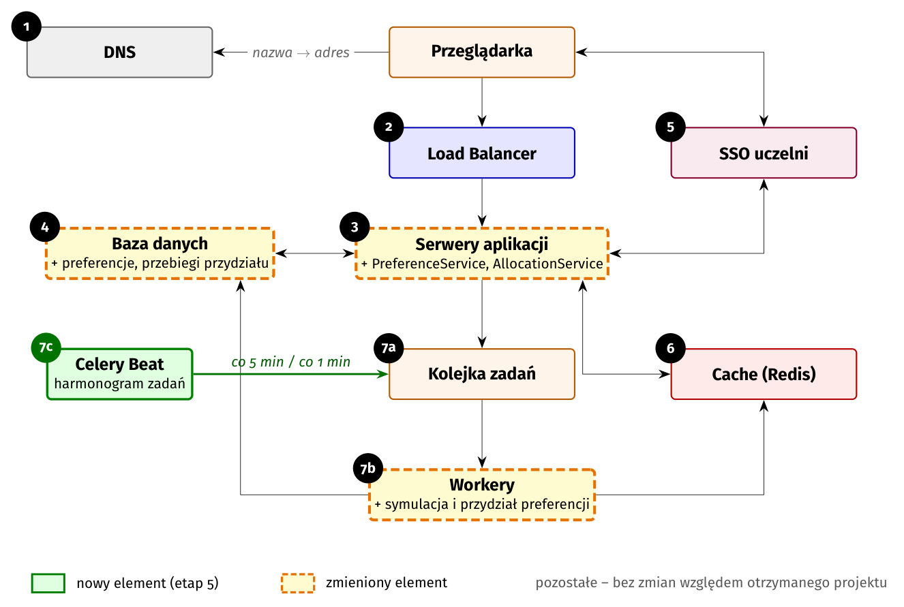

System to aplikacja webowa: SPA w przeglądarce, nginx, bezstanowe API (kilka procesów),
osobny proces workera i PostgreSQL jako jedyne źródło prawdy.

| Moduł | Odpowiedzialność |
|---|---|
| **SPA** (React + TS) | Widoki dla trzech ról. Sama ponawia zapis przy 429/503 (Retry-After × losowo 1–2, żeby tysiące przeglądarek nie wróciły w tej samej chwili). |
| **nginx** | Statyka SPA (z cache – odświeżanie strony przy otwarciu tury nie obciąża API) i reverse proxy `/api` z keep-alive. |
| **API: warstwa HTTP** (`app/api`) | Routing, walidacja wejścia (Pydantic), uwierzytelnienie JWT, sprawdzenie roli, mapowanie błędów na kody HTTP. Bez logiki biznesowej. |
| **API: kontrola ruchu** (`app/traffic.py`) | `TTLCache` (katalog), `RateLimiter` (operacje na studenta), `Gate` (limit równoczesnych transakcji). |
| **API: serwisy** (`app/services`) | Każda funkcja publiczna to ciało jednej transakcji: blokady, wczytanie danych, wywołanie reguł, zapis wyniku, wpis do outboxa. |
| **API: domena** (`app/domain`) | Reguły biznesowe jako czyste funkcje (kolizje, wymagania, cykle, reguły zapisu, tury, **walidacja preferencji i optymalizator przydziału**). Nie znają bazy. |
| **API: dostęp do danych** (`services/loaders.py`) | Zapytania do bazy w gorącej ścieżce (asyncpg), blokady wierszy. Tylko czyta i zapisuje dane. |
| **Worker** (`app/worker.py`) | Co 5 s: harmonogram tur (UC17), wygaszanie list (UC18), **przydział końcowy zamkniętych tur preferencyjnych (UC30)**, wysyłka outboxa (UC26); co 5 min **symulacja przydziału (UC31)**; co minutę audyt (UC25). Kilka instancji może działać naraz (`SKIP LOCKED`, jednorazowy FINAL dzięki `UNIQUE`). |
| **PostgreSQL 16** | Dane, ograniczenia spójności (siatka bezpieczeństwa), blokady wierszy i doradcze, outbox. |
| **SMTP** | Wysyłka e-maili (w środowisku deweloperskim Mailpit z podglądem). |

**Główne zasady:**
1. **Logika w domenie, spójność w bazie.** Reguły decydują w Pythonie; baza ma `CHECK`,
   `UNIQUE`, klucze obce i indeksy częściowe, które odrzucą wynik błędu w kodzie (sprawdzone:
   przy refaktoryzacji błąd zdjął blokadę grupy, a `CHECK (enrolled_count <= capacity)` odrzucił
   11. zapis na 10 miejsc, test go wychwycił).
2. **Kolejność blokad: student → grupa.** Reguły zależne od planu studenta sprawdzane pod
   blokadą studenta, przed blokadą grupy, więc popularna grupa jest blokowana krótko.
   Awans z listy odwraca kolejność (grupa → student), więc studenta blokuje `NOWAIT`; tak samo
   zmiana terminu (UC32) blokuje zapisanych studentów. Przydział preferencyjny: tura → studenci →
   grupy (każde rosnąco po id) – zgodnie z kolejnością zapisu.
3. **Outbox.** Powiadomienie zapisuje się w transakcji zmiany; worker wysyła je później.
4. **Bezstanowe API.** Skaluje się kolejnymi instancjami; sesja to token JWT.
5. **Decyzja zawsze pod blokadą na aktualnych danych.** Cache (katalog 3 s, dane grupy 10 s) służy
   tylko do szybkiego odrzucenia; ostateczne sprawdzenie odbywa się w transakcji, a wersja
   harmonogramu (`schedule_version`) wykrywa nieaktualny cache (etap 5).

### Wdrożenie

`docker-compose.yml`: `db` (PostgreSQL 16), `migrate` (Alembic, jednorazowo), `api`
(uvicorn, `WEB_CONCURRENCY` procesów, domyślnie 8), `worker`, `web` (nginx + zbudowane SPA),
`mailpit`. Konfiguracja przez zmienne `USOS_*` (`app/config.py`).

## 3. Stos technologiczny

| Element | Technologia | Uzasadnienie |
|---|---|---|
| Frontend | React 19 + TypeScript, Vite | Typowane komponenty, szybka budowa; katalog, formularze i siatka planu bez dodatkowych bibliotek UI |
| Serwer WWW | nginx | Statyka z cache i proxy z keep-alive – szczyt odświeżeń nie dociera do API |
| Backend | Python 3.12, FastAPI, Pydantic 2 | Asynchroniczne API (wiele równoczesnych żądań na proces), walidacja wejścia, dokumentacja OpenAPI z kodu (`/api/docs`) |
| Dostęp do bazy | SQLAlchemy 2 (async) + asyncpg | ORM wygodny w panelu dziekanatu; w gorącej ścieżce zapisu bezpośrednio asyncpg – profilowanie pokazało, że narzut budowania zapytań w ORM był głównym kosztem CPU |
| Baza | PostgreSQL 16 | Transakcje ACID, `SELECT … FOR UPDATE [NOWAIT / SKIP LOCKED]`, blokady doradcze, indeksy częściowe, `GENERATED`, `JSONB` |
| Migracje | Alembic | Wersjonowany schemat; etap 5 = migracja `0002_preferences` (z `downgrade`) |
| Zadania w tle | własny worker (asyncio) | Tury i outbox są w bazie, więc broker (Redis/RabbitMQ) nie jest potrzebny |
| Uwierzytelnianie | JWT (PyJWT), bcrypt (koszt 10) | Bezstanowe API; token ważny 12 h – logowanie przed turą, bcrypt nie obciąża szczytu. Docelowo SSO uczelni |
| E-mail | aiosmtplib, Mailpit (dev) | Asynchroniczna wysyłka z workera; podgląd poczty w testach |
| Optymalizacja przydziału | własny algorytm w czystym Pythonie (`app/domain/allocation.py`) | Bez zależności od solvera (OR-Tools/CBC to ciężkie binaria, kłopotliwe w obrazie Dockera); deterministyczny przy danym ziarnie; jakość zmierzona względem rozwiązania dokładnego (sekcja 8); 1000 studentów ≈ 7 s |
| Testy | pytest + pytest-asyncio na prawdziwym PostgreSQL, httpx | Współbieżności i blokad nie da się wiarygodnie sprawdzić na atrapie bazy |
| Testy obciążeniowe | k6 | Scenariusz otwarcia tury (1000–3000 wirtualnych studentów) |
| Wdrożenie | Docker Compose | Jednakowe środowisko zespołu i grupy przejmującej projekt |

## 4. Przypadki użycia

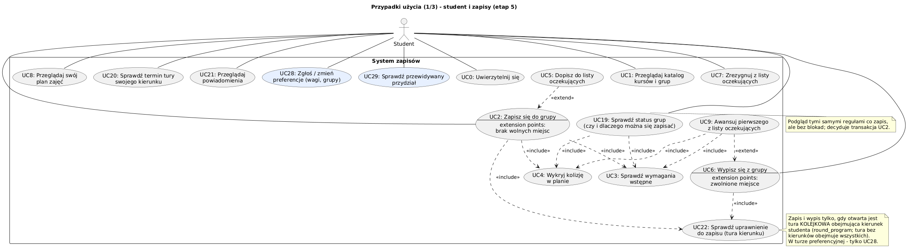

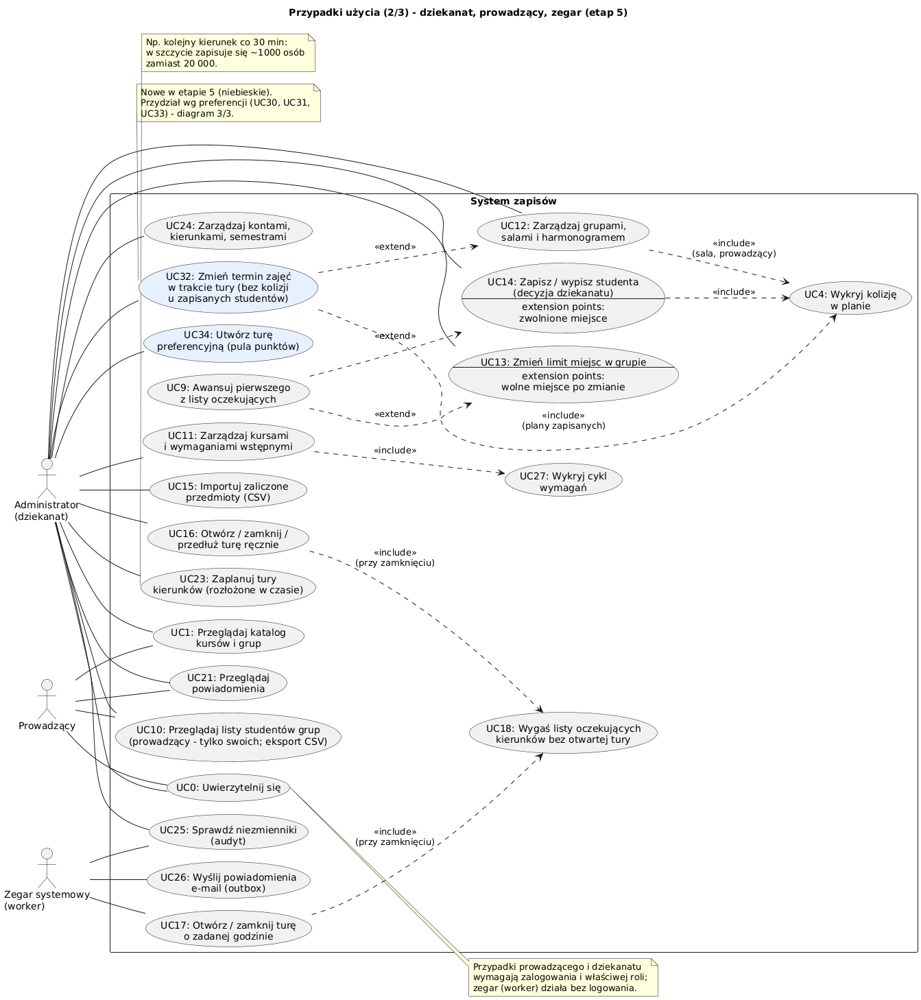

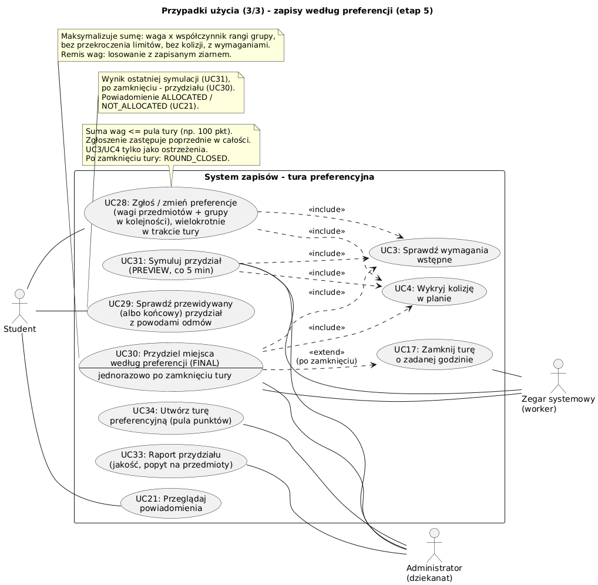

Notacja: UC0 (logowanie) jest połączony z każdym aktorem-osobą – pozostałe przypadki wymagają
zalogowania i właściwej roli; `<<include>>` – zawsze, `<<extend>>` – warunkowo w nazwanym punkcie
(np. UC9 rozszerza UC6, UC13 i UC14, gdy zwolni się miejsce, a ktoś czeka).
Przypadki z etapu 3: UC19–UC27; **nowe w etapie 5: UC28–UC34** (na diagramach na niebiesko).

### Wszystkie przypadki użycia

Kolumna „Błędy” podaje kody odpowiedzi (sekcja 10). Każdy przypadek oprócz UC0, UC17, UC18,
UC25 (przez worker) i UC26 wymaga zalogowania (401) i właściwej roli (403).

| UC | Nazwa | Aktor | Endpoint | Warunki wstępne → wynik | Błędy |
|---|---|---|---|---|---|
| UC0 | Uwierzytelnij się | wszyscy | `POST /api/auth/login` | konto istnieje → token JWT (12 h) i dane użytkownika | `BAD_CREDENTIALS` |
| UC1 | Przeglądaj katalog | wszyscy | `GET /api/terms/{t}/courses?q`, `…/courses/{c}` | → kursy z liczbą grup i wolnych miejsc; grupy z terminami, prowadzącymi, zajętością (cache 3 s) | `COURSE_NOT_FOUND` |
| UC2 | Zapisz się do grupy | student | `POST /api/me/enrollments` | tura **kolejkowa** kierunku otwarta, reguły spełnione, wolne miejsce → `ENROLLED`; wpisy na listach grup tego typu → `CANCELLED` | `ROUND_CLOSED`, `ALREADY_ENROLLED`, `ALREADY_WAITING`, `SAME_KIND`, `PREREQUISITES`, `CONFLICT`, `WAITLIST_FULL`, `RATE_LIMITED`, `OVERLOADED`, `BUSY` |
| UC3 | Sprawdź wymagania | system | (w UC2, UC9, UC19) | → brakujące kursy (wystarczy jedno zaliczenie, ocena ≥ 3.0) | `PREREQUISITES` |
| UC4 | Wykryj kolizję | system | (w UC2, UC9, UC12, UC14, UC19) | → grupy kolidujące (dzień, godziny, parzystość tygodni) | `CONFLICT`, `ROOM_BUSY`, `LECTURER_BUSY` |
| UC5 | Dopisz do listy | student | (extend UC2: brak miejsc) | lista < `waitlist_limit` → `WAITLISTED` z pozycją | `WAITLIST_FULL` |
| UC6 | Wypisz się | student | `DELETE /api/me/enrollments/{s}` | tura otwarta, zapis aktywny → `DROPPED`, licznik −1, UC9 | `ROUND_CLOSED`, `NOT_ENROLLED` |
| UC7 | Zrezygnuj z listy | student | `DELETE /api/me/waitlist/{s}` | wpis `WAITING` → `CANCELLED` | `NOT_WAITING` |
| UC8 | Przeglądaj plan | student | `GET /api/me/terms/{t}/plan` | → grupy z terminami, prowadzącymi, źródłem zapisu | – |
| UC9 | Awansuj z listy | system | (w UC6, UC13, UC14) | wolne miejsce → kolejni oczekujący `PROMOTED` albo `SKIPPED` z powodem; powiadomienia | (ponowienie przy 55P03) |
| UC10 | Listy studentów grupy | prowadzący, dziekanat | `GET /api/sections/{s}/roster` | prowadzący tylko swoich grup → zapisani i oczekujący (kolejność); eksport CSV w SPA | `FORBIDDEN`, `SECTION_NOT_FOUND` |
| UC11 | Kursy i wymagania | dziekanat | `POST/PATCH /api/admin/courses`, `…/prerequisites` | → kurs / wymaganie | `DUPLICATE`, `PREREQUISITE_CYCLE`, `COURSE_NOT_FOUND` |
| UC12 | Grupy, sale, harmonogram | dziekanat | `POST /api/admin/sections`, `…/meetings`, `…/lecturers`, `rooms` | sala ≥ limit grupy, brak kolizji sali i prowadzącego → grupa / termin / przypisanie | `BAD_TIME`, `ROOM_TOO_SMALL`, `ROOM_BUSY`, `LECTURER_BUSY`, `SECTION_NOT_FOUND`, `ROOM_NOT_FOUND`, `LECTURER_NOT_FOUND`, `DUPLICATE` |
| UC13 | Zmień limit | dziekanat | `PATCH /api/admin/sections/{s}` | zapisani ≤ limit ≤ sala → nowy limit, UC9 | `BELOW_ENROLLED`, `ROOM_FULL` |
| UC14 | Zapisz / wypisz (decyzja) | dziekanat | `POST /api/admin/enrollments`, `DELETE …/{st}/{s}` | bez tury i wymagań; kolizje i typ zawsze; pełna grupa → limit +1 (≤ sala) | `ALREADY_ENROLLED`, `CONFLICT`, `SAME_KIND`, `ROOM_FULL`, `NOT_ENROLLED` |
| UC15 | Importuj oceny | dziekanat | `POST /api/admin/grades/import` | CSV `index_no,course_code,term_code,grade` → liczba zaimportowanych, lista błędnych wierszy; ponowny import nadpisuje ocenę | `VALIDATION` |
| UC16 | Otwórz / zamknij / przedłuż turę | dziekanat | `POST /api/admin/rounds/{r}/open|close`, `PATCH …/{r}` | zamknięcie → UC18 | `ROUND_NOT_FOUND`, `BAD_DATES` |
| UC17 | Tura o zadanej godzinie | zegar (worker) | – | `opens_at` minął → `OPEN`; `closes_at` minął → `CLOSED` + UC18; tury zamkniętej ręcznie nie otwiera | – |
| UC18 | Wygaś listy | system | (w UC16, UC17 i okresowo) | kierunek bez otwartej tury w semestrze → jego wpisy `WAITING` → `EXPIRED` + powiadomienie | – |
| UC19 | Status grup kursu | student | `GET /api/me/terms/{t}/courses/{c}` | → dla każdej grupy: `ENROLLED` / `WAITING` (pozycja) / `AVAILABLE` / `BLOCKED` z powodami | `OVERLOADED` |
| UC20 | Termin tury kierunku | student | `GET /api/me/terms/{t}/rounds` | → tury obejmujące kierunek studenta (baner w SPA) | – |
| UC21 | Powiadomienia | wszyscy | `GET /api/me/notifications`, `POST …/read` | → ostatnie 50; oznaczenie jako przeczytane | – |
| UC22 | Uprawnienie do zapisu | system | (w UC2, UC6) | otwarta tura obejmuje kierunek (tura bez kierunków – wszystkich) | `ROUND_CLOSED` |
| UC23 | Zaplanuj tury kierunków | dziekanat | `POST /api/admin/rounds` (×N z SPA) | → osobna tura dla każdego kierunku, kolejna co *n* minut | `BAD_DATES`, `PROGRAM_NOT_FOUND`, `DUPLICATE` |
| UC24 | Konta, kierunki, semestry | dziekanat | `POST /api/admin/users`, `programs`, `terms`; `GET users?q&role` | dane roli kompletne → konto | `STUDENT_DATA`, `LECTURER_DATA`, `DUPLICATE` |
| UC25 | Audyt niezmienników | dziekanat, worker | `GET /api/admin/audit` | → lista naruszeń (pusta = OK); worker loguje je co minutę | – |
| UC26 | Wyślij powiadomienia | worker | – | niewysłane, < 5 prób → e-mail, `sent_at`; błąd SMTP → `attempts + 1` | – |
| UC27 | Wykryj cykl wymagań | system | (w UC11) | dodanie A → B, gdy B (pośrednio) wymaga A → odmowa | `PREREQUISITE_CYCLE` |
| **UC28** | Zgłoś / zmień preferencje | student | `GET`/`PUT /api/me/rounds/{r}/preferences` | tura PREFERENCES otwarta i obejmuje kierunek; suma wag ≤ pula; grupy z przedmiotu i semestru tury → zgłoszenie zastąpione, `used_points`, ostrzeżenia (UC3, UC4, pełne grupy) | `NOT_PREFERENCE_ROUND`, `ROUND_CLOSED`, `BUDGET_EXCEEDED`, `BAD_WEIGHT`, `BAD_SECTION`, `DUPLICATE_COURSE`, `DUPLICATE_SECTION`, `NO_SECTIONS`, `TOO_MANY_COURSES`, `TOO_MANY_SECTIONS`, `VALIDATION` |
| **UC29** | Sprawdź przewidywany przydział | student | `GET /api/me/rounds/{r}/allocation` | → wynik ostatniej symulacji (albo przydziału końcowego): dla każdego przedmiotu przydzielone grupy albo powód | – |
| **UC30** | Przydziel miejsca według preferencji | worker, dziekanat | worker; `POST /api/admin/rounds/{r}/allocation {seed?}` | tura PREFERENCES zamknięta, bez FINAL → zapisy `ALLOCATION`, wyniki z powodami, powiadomienia `ALLOCATED`/`NOT_ALLOCATED`, anulowanie list tego samego typu | `ROUND_NOT_CLOSED`, `ALREADY_ALLOCATED`, `NOT_PREFERENCE_ROUND` |
| **UC31** | Symuluj przydział | worker (co 5 min), dziekanat | `POST /api/admin/rounds/{r}/allocation/preview` | → przebieg PREVIEW (tylko najnowszy), bez zapisów | `ALREADY_ALLOCATED`, `NOT_PREFERENCE_ROUND` |
| **UC32** | Zmień termin w trakcie tury | dziekanat | `PUT /api/admin/meetings/{m}`; też `POST …/meetings` | sala, prowadzący **i plany zapisanych studentów** bez kolizji → termin zmieniony, `schedule_version + 1`, `SCHEDULE_CHANGED` do zapisanych i oczekujących | `STUDENT_CONFLICT`, `ROOM_BUSY`, `LECTURER_BUSY`, `ROOM_TOO_SMALL`, `BAD_TIME`, `MEETING_NOT_FOUND`, `BUSY` |
| **UC33** | Raport przydziału | dziekanat | `GET /api/admin/rounds/{r}/allocation` | → ostatni przebieg (spełnione / zgłoszenia, użyteczność / górne ograniczenie, ziarno) i popyt per przedmiot | – |
| **UC34** | Utwórz turę preferencyjną | dziekanat | `POST /api/admin/rounds {mode: PREFERENCES, points_budget}` | jak UC16; pula 1–1000 (domyślnie 100) | `BAD_DATES`, `BAD_BUDGET`, `DUPLICATE`, `PROGRAM_NOT_FOUND` |

### Scenariusze główne i alternatywne

Szczegółowe przebiegi najważniejszych przypadków (UC2, UC5, UC6, UC9, UC13, UC14, UC18) są
w etapie 2 i nadal obowiązują. Nowe w etapie 3:
- **UC22:** student kierunku INF, otwarta jest tylko tura MAT → `409 ROUND_CLOSED`, a baner
  w SPA pokazuje termin tury INF (UC20). Zamknięcie tury MAT wygasza tylko wpisy studentów MAT;
  oczekujący z INF czekają dalej, jeśli ich tura trwa.
- **UC19:** podgląd używa tych samych funkcji domeny co zapis (`check_student`), ale bez blokad.
  Między podglądem a zapisem stan może się zmienić – decyzję podejmuje zawsze transakcja UC2.
- **UC28 – co może pójść nie tak:** budżet przekroczony / grupa z innego przedmiotu lub semestru /
  ten sam przedmiot dwa razy → 409 z kodem, poprzednie zgłoszenie bez zmian (cała operacja w jednej
  transakcji). Tura zamyka się w chwili zapisu → blokada `FOR SHARE` na turze szereguje oba zdarzenia:
  zgłoszenie albo trafi do przydziału, albo dostanie `ROUND_CLOSED`. Dwie karty przeglądarki →
  blokada studenta, wygrywa ostatni zapis, suma zawsze w budżecie. Brak zaliczenia / kolizja z planem
  → zgłoszenie przyjęte z ostrzeżeniem (ocena może jeszcze zostać zaimportowana), przydział sprawdzi to ponownie.
- **UC30 – co może pójść nie tak:** dwie instancje workera albo worker i dziekanat naraz → blokada
  tury + `UNIQUE (round_id) WHERE kind='FINAL'`, druga dostaje `ALREADY_ALLOCATED`. Awaria w trakcie
  → `ROLLBACK`, tura nadal bez FINAL, następny przebieg zaczyna od nowa. W międzyczasie inny kierunek
  zajął miejsca albo dziekanat zmienił termin → przydział czyta stan pod blokadami w chwili wykonania,
  nie z chwili zgłoszenia. Błąd w optymalizatorze → `verify()` przed zapisem, wycofanie, log błędu;
  dodatkowo `CHECK (enrolled_count <= capacity)` w bazie.
- **UC32 – co może pójść nie tak:** kolizja u zapisanego → `STUDENT_CONFLICT` z listą (dziekanat
  przenosi studentów albo wybiera inny termin); student akurat się zapisuje → `NOWAIT` + ponowienie
  (`BUSY` po 5 próbach); inny proces ma stary termin w cache → `schedule_version`.
- **Przeciążenie:** gdy wszystkie sloty bramki są zajęte dłużej niż 2 s → `503 OVERLOADED`
  z `Retry-After`; SPA czeka i ponawia (do 4 razy) z komunikatem „Duży ruch – ponawiam…”.
  Odrzucenie przez bramkę nie zużywa limitu operacji studenta.

## 5. Diagramy sekwencji

| Diagram | Przypadki | Co pokazuje |
|---|---|---|
| 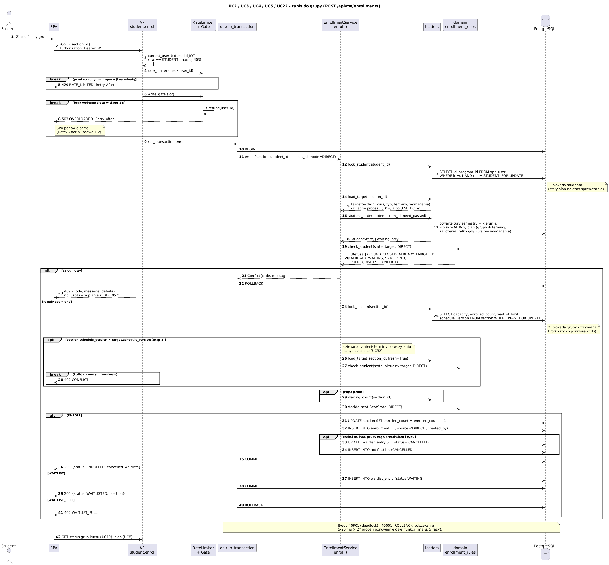 `sekwencja_zapis` | UC2, UC3, UC4, UC5, UC22 | kontrola ruchu, kolejność blokad, decyzja w domenie, trzy wyniki (zapis, lista, odmowa), ponowienie; **etap 5: porównanie wersji harmonogramu pod blokadą grupy** |
| 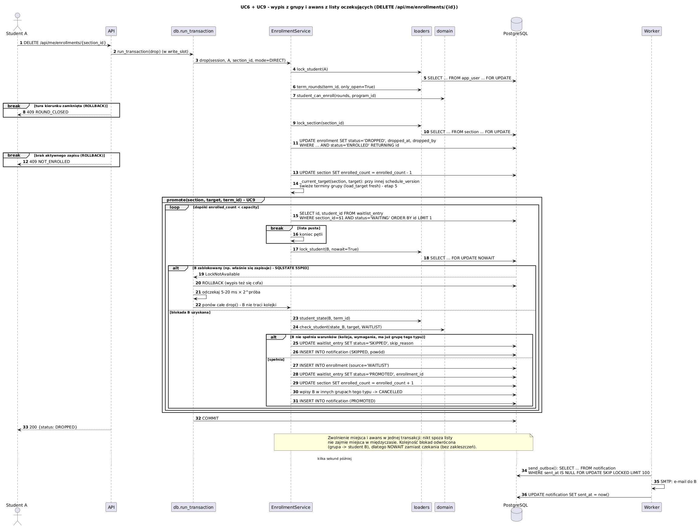 `sekwencja_wypis_awans` | UC6, UC9 | wypis i awans w jednej transakcji, `NOWAIT` i ponowienie bez utraty kolejki, SKIPPED/PROMOTED, outbox |
| 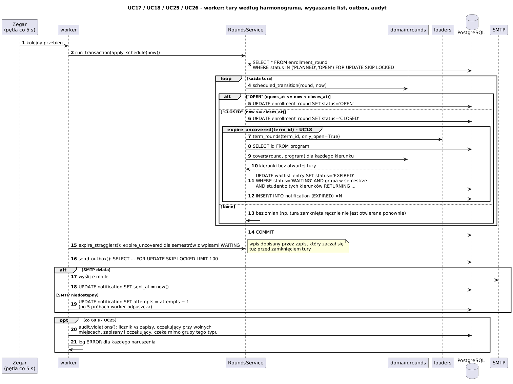 `sekwencja_tura` | UC17, UC18, UC25, UC26 | harmonogram tur, wygaszanie list kierunków, spóźnione wpisy, wysyłka z ponawianiem, audyt |
| 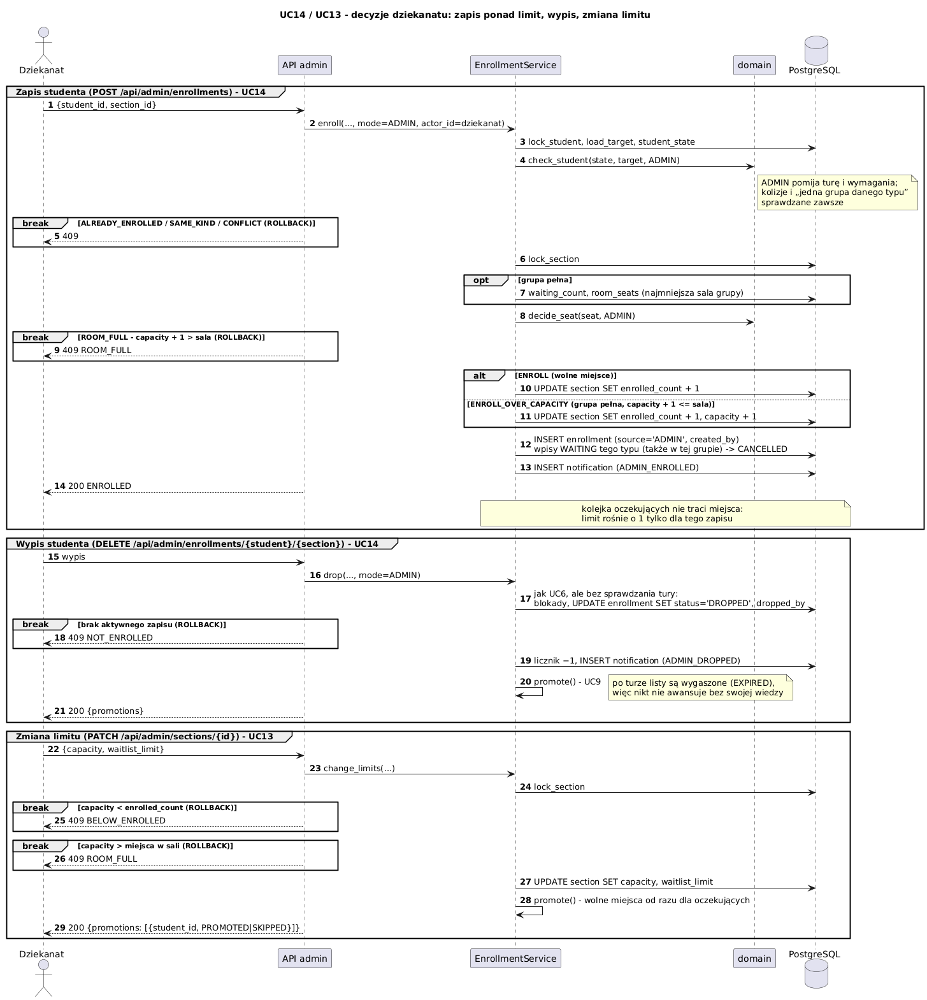 `sekwencja_dziekanat` | UC14, UC13 | zapis ponad limit (≤ sala), wypis bez tury, zmiana limitu z awansem |
| 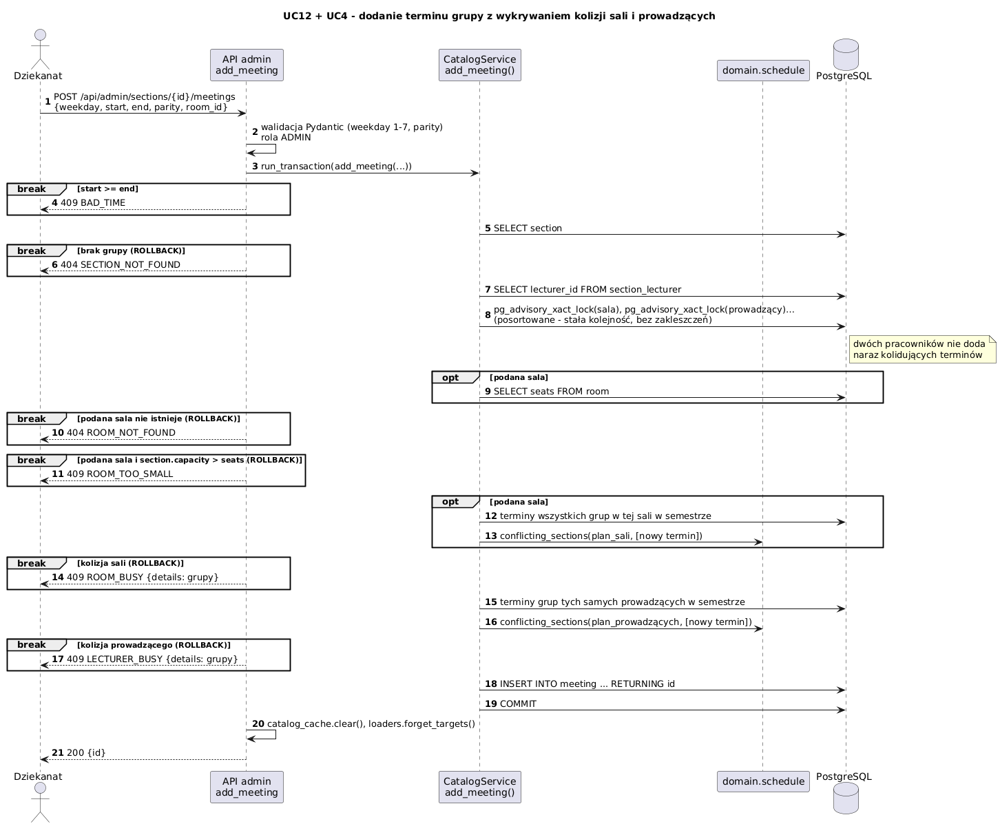 `sekwencja_harmonogram` | UC12, UC4 | blokady doradcze, sala za mała, kolizja sali, kolizja prowadzącego |
| 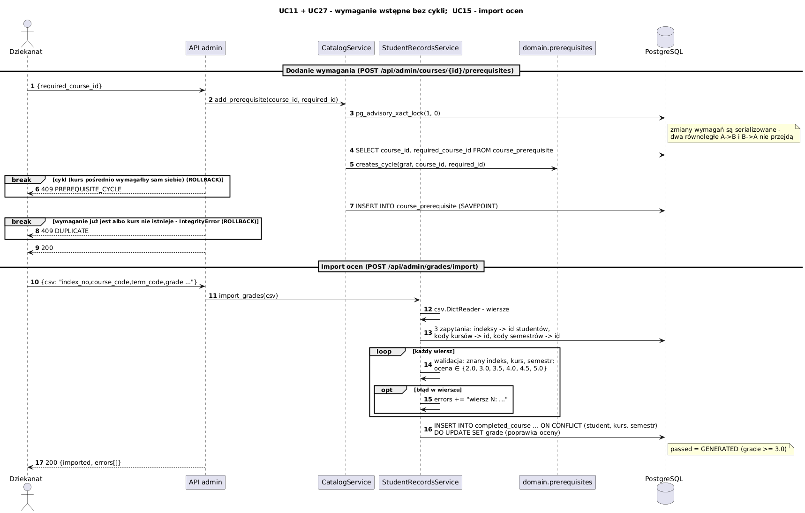 `sekwencja_wymagania_import` | UC11, UC27, UC15 | wykrywanie cyklu pod blokadą; import CSV z raportem błędów i nadpisaniem oceny |
| 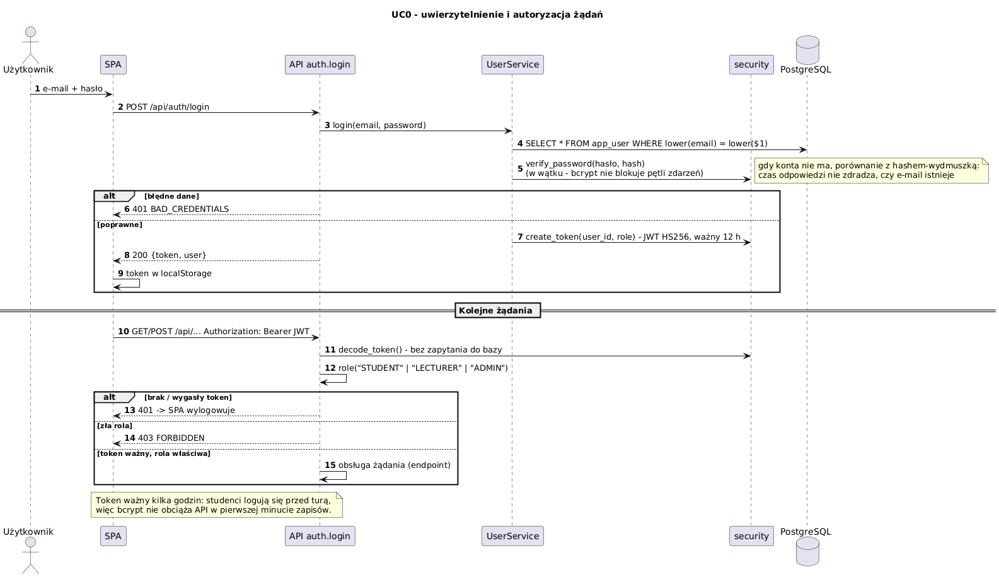 `sekwencja_logowanie` | UC0 | bcrypt w wątku, stały czas odpowiedzi, JWT, sprawdzanie roli bez bazy |
| 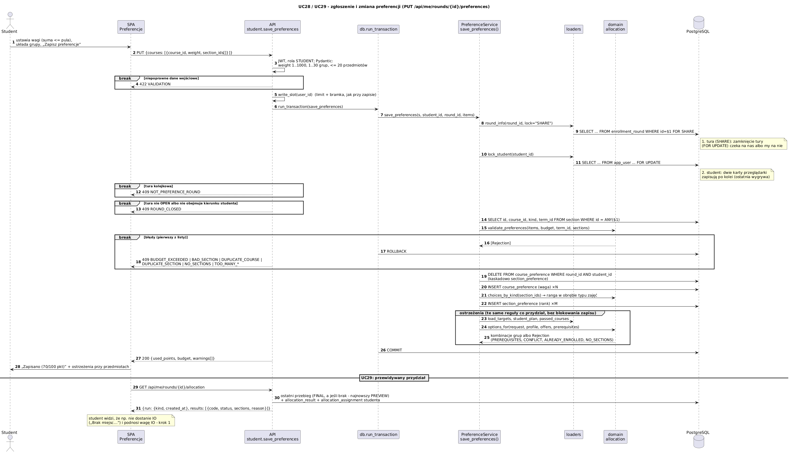 **`sekwencja_preferencje`** | UC28, UC29 | blokady tura (SHARE) → student, walidacja, zastąpienie zgłoszenia, ostrzeżenia tymi samymi regułami co przydział |
| 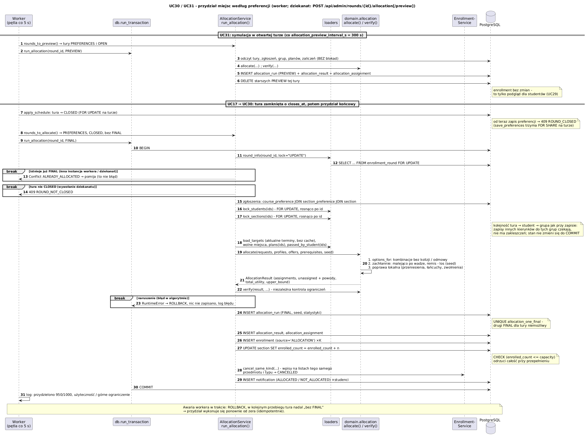 **`sekwencja_przydzial`** | UC31, UC17 → UC30 | symulacja bez blokad; przydział końcowy pod blokadami, `verify`, jednorazowość, zapisy, powiadomienia, awaria |
| 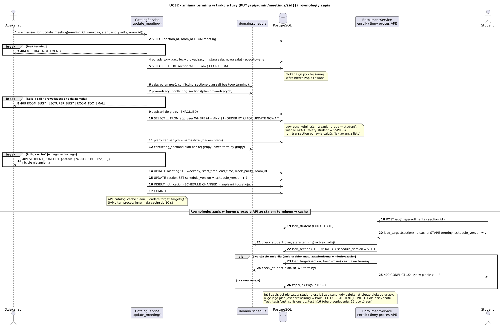 **`sekwencja_zmiana_terminu`** | UC32 + UC2 | blokady doradcze → grupa → studenci `NOWAIT`, `STUDENT_CONFLICT`, wersja harmonogramu; równoległy zapis ze starym cache |

## 6. Model danych (ER)

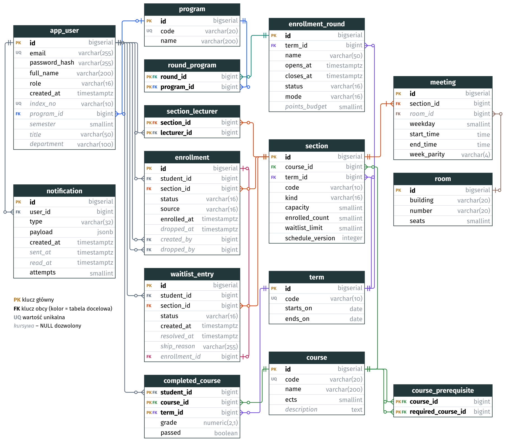

Rozszerzenie etapu 5 (nowe tabele na niebiesko; tabele istniejące w skrócie):

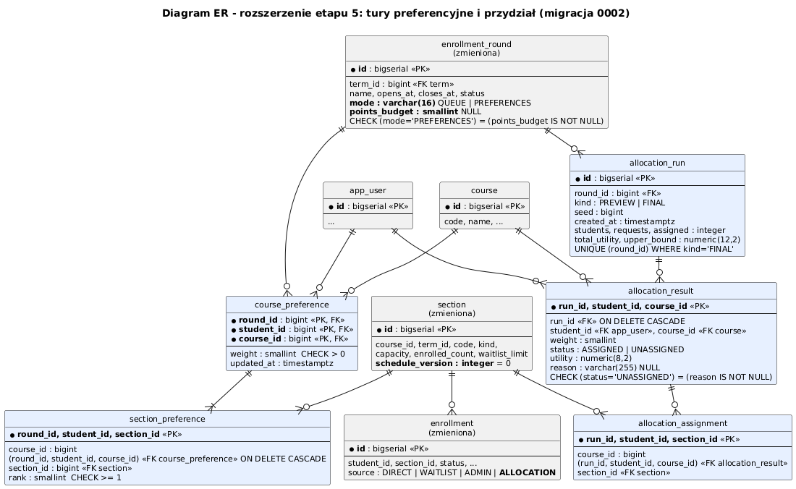

Nowe tabele są w osobnym diagramie (PlantUML), bo generator TikZ prowadzi linie tylko między
sąsiednimi kolumnami, a relacje modułu preferencji tworzą cykl nieparzysty
(`course_preference → enrollment_round → allocation_run → allocation_result → app_user → course_preference`),
którego nie da się tak rozłożyć.

**Etap 5** ([`0002_preferences.sql`](../backend/migrations/versions/0002_preferences.sql)):

| Tabela / kolumna | Znaczenie | Ograniczenia |
|---|---|---|
| `enrollment_round.mode`, `.points_budget` | tryb tury, pula punktów | `CHECK (mode='PREFERENCES') = (points_budget IS NOT NULL)`, pula 1–1000 |
| `section.schedule_version` | wersja harmonogramu grupy | zwiększana pod blokadą grupy przy każdej zmianie terminów |
| `enrollment.source` | + `ALLOCATION` | `CHECK` rozszerzony |
| `course_preference (round, student, course)` | waga przedmiotu | PK złożony = jeden wpis na przedmiot; `weight > 0`; suma ≤ pula sprawdzana pod blokadą studenta (wiele wierszy – nie da się `CHECK`) |
| `section_preference (round, student, section)` | akceptowana grupa i jej ranga w typie zajęć | FK złożony do `course_preference` z `ON DELETE CASCADE` – grupa tylko w zgłoszonym przedmiocie, usunięcie przedmiotu usuwa grupy; `rank ≥ 1` |
| `allocation_run` | przebieg optymalizatora: PREVIEW / FINAL, ziarno, statystyki | `UNIQUE (round_id) WHERE kind='FINAL'` – przydział końcowy jednorazowy; `assigned ≤ requests`, `upper_bound ≥ total_utility` |
| `allocation_result (run, student, course)` | wynik dla zgłoszonego przedmiotu | `CHECK (status='UNASSIGNED') = (reason IS NOT NULL)` – każda odmowa ma powód |
| `allocation_assignment (run, student, section)` | przydzielone grupy przedmiotu | FK złożony do `allocation_result` |

Preferencje i wyniki są osobno dla tury (`round_id`), więc w kolejnej turze student składa nowe
zgłoszenie, a historia zostaje do reklamacji. Z poprzednich symulacji zostaje tylko najnowsza.

Pełna definicja: [`0001_initial.sql`](../backend/migrations/versions/0001_initial.sql) (15 tabel)
+ [`0002_preferences.sql`](../backend/migrations/versions/0002_preferences.sql) (5 tabel, 4 kolumny). Decyzje z etapu 2 (kurs ≠ grupa, terminy w `meeting`, licznik `enrolled_count`,
historia zamiast kasowania, kolejność listy = `id`, outbox) obowiązują. Nowe:
- `program` – kierunek studenta (`app_user.program_id`) i tur (`round_program`).
- `round_program (round_id, program_id)` – tura bez wierszy obejmuje wszystkich.
- `app_user` – jedna tabela; `CHECK (num_nonnulls(index_no, program_id, semester) = CASE WHEN role='STUDENT' THEN 3 ELSE 0 END)`
  i analogiczne dla prowadzącego. Klucze obce `student_id` wskazują na `app_user`, więc rolę
  sprawdza blokada studenta (`WHERE role = 'STUDENT'`).
- Indeksy pod gorące zapytania: `waitlist_student`, `enrollment_section`, `section_term`,
  `notification_user`, `notification_unsent`.

## 7. Projekt klas i komponentów

Moduły backendu są funkcyjne: moduł Pythona pełni rolę klasy-serwisu (`<<service>>`), jego
funkcje to operacje. Dane między warstwami przenoszą niezmienne `dataclass` – domena nie widzi
obiektów ORM ani połączeń z bazą.

### 7.1. Domena (`app/domain`)

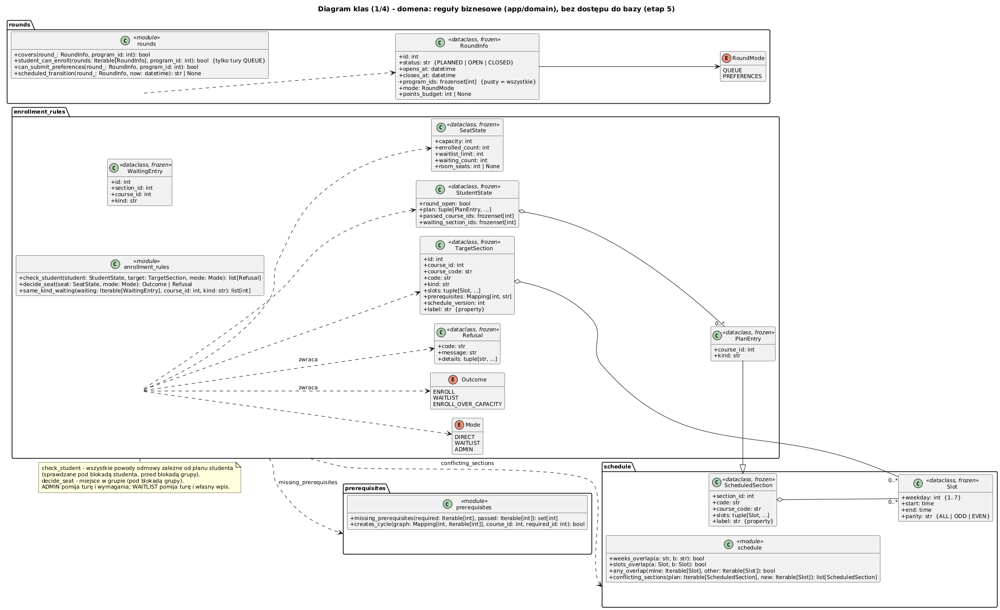

| Operacja | Parametry | Zwraca | Funkcjonalność |
|---|---|---|---|
| `schedule.slots_overlap` | `a, b: Slot` | `bool` | Ten sam dzień, `a.start < b.end ∧ b.start < a.end`, tygodnie się pokrywają (ALL z każdym, ODD z ODD, EVEN z EVEN). Styk 9:30/9:30 nie jest kolizją. |
| `schedule.conflicting_sections` | `plan: Iterable[ScheduledSection]`, `new: Iterable[Slot]` | `list[ScheduledSection]` | Grupy z planu, których którykolwiek termin nachodzi na nowe terminy. Używane dla planu studenta, sali i prowadzącego. |
| `prerequisites.missing_prerequisites` | `required, passed: Iterable[int]` | `set[int]` | Kursy wymagane bez zaliczenia. |
| `prerequisites.creates_cycle` | `graph: Mapping[int, Iterable[int]]`, `course_id, required_id: int` | `bool` | DFS od `required_id`: czy dojdzie do `course_id` (wtedy nowe wymaganie zamknęłoby cykl). |
| `rounds.covers` | `round_: RoundInfo`, `program_id: int` | `bool` | Tura obejmuje kierunek (pusty zbiór kierunków = wszystkie). |
| `rounds.student_can_enroll` | `rounds: Iterable[RoundInfo]`, `program_id: int` | `bool` | Czy któraś **otwarta tura kolejkowa** (`mode = QUEUE`) obejmuje kierunek. *Etap 5: tura preferencyjna nie pozwala na zapis/wypis w kolejce.* |
| `rounds.can_submit_preferences` | `round_: RoundInfo`, `program_id: int` | `bool` | *Etap 5.* Tura `PREFERENCES`, `OPEN` i obejmuje kierunek. |
| `rounds.scheduled_transition` | `round_: RoundInfo`, `now: datetime` | `"OPEN" \| "CLOSED" \| None` | Nowy status według harmonogramu; tury `CLOSED` nie zmienia (ręczne zamknięcie jest ostateczne, przedłużenie to zmiana `closes_at`). |
| `enrollment_rules.check_student` | `student: StudentState`, `target: TargetSection`, `mode: Mode` | `list[Refusal]` | Wszystkie powody odmowy zależne od studenta, w kolejności: tura (tylko DIRECT), już zapisany / już czeka (DIRECT), grupa tego samego typu z przedmiotu, wymagania (poza ADMIN), kolizje. Pusta lista = można. |
| `enrollment_rules.decide_seat` | `seat: SeatState`, `mode: Mode` | `Outcome \| Refusal` | Wolne miejsce → `ENROLL`; pełna: ADMIN → `ENROLL_OVER_CAPACITY` (≤ sala) albo `ROOM_FULL`; WAITLIST → `NO_SEAT`; DIRECT → `WAITLIST` albo `WAITLIST_FULL`. |
| `enrollment_rules.same_kind_waiting` | `waiting: Iterable[WaitingEntry]`, `course_id: int`, `kind: str` | `list[int]` | Wpisy na listach grup tego samego przedmiotu i typu – do anulowania po zapisie. |

`RoundInfo` (etap 5) ma dodatkowo `mode: RoundMode {QUEUE, PREFERENCES}` i `points_budget: int | None`;
`TargetSection` – `schedule_version: int` (wersja harmonogramu, z której pochodzą `slots`).

`Mode`: `DIRECT` (student), `WAITLIST` (awans), `ADMIN` (dziekanat). `Refusal(code, message,
details)` – kod do obsługi w SPA, komunikat po polsku, szczegóły (np. kolidujące grupy).

### 7.2. Domena: przydział według preferencji (`app/domain/allocation.py`, etap 5)

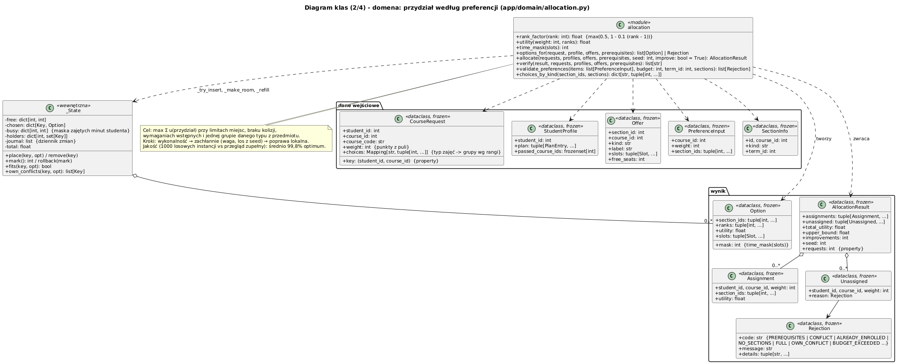

| Operacja | Parametry | Zwraca | Funkcjonalność |
|---|---|---|---|
| `rank_factor` | `rank: int` | `float` | `max(0.5, 1 − 0.1·(rank − 1))`: 1. wybór 1.0, 2. wybór 0.9, … |
| `utility` | `weight: int`, `ranks: Iterable[int]` | `float` | `weight × średnia(rank_factor)` – użyteczność przydziału przedmiotu. |
| `options_for` | `request: CourseRequest`, `profile: StudentProfile`, `offers: Mapping[int, Offer]`, `prerequisites: Mapping[int, str]` | `list[Option] \| Rejection` | Wykonalne kombinacje grup (po jednej z każdego potrzebnego typu): bez kolizji z planem i między sobą, malejąco po użyteczności. Albo odmowa: `PREREQUISITES`, `ALREADY_ENROLLED` (ma już wszystkie typy), `CONFLICT` (wszystkie kolidują), `NO_SECTIONS`. Pomija typy, z których student ma już grupę (reguła „jedna grupa danego typu”). |
| `allocate` | `requests: Sequence[CourseRequest]`, `profiles: Mapping[int, StudentProfile]`, `offers`, `prerequisites: Mapping[int, Mapping[int, str]]`, `seed: int`, `improve: bool = True` | `AllocationResult` | Optymalizator (sekcja 8). Wynik: przydziały z użytecznością, nieprzydzielone z powodem (`FULL`, `OWN_CONFLICT` lub powód z `options_for`), suma, górne ograniczenie, liczba ruchów poprawy, ziarno. Deterministyczny przy danym `seed`. `ValueError` przy zdublowanym zgłoszeniu. |
| `verify` | `result`, `requests`, `profiles`, `offers`, `prerequisites` | `list[str]` | Niezależna kontrola wyniku: limity miejsc, kolizje (dokładne `slots_overlap`), wymagania, komplet typów, grupy tylko ze zgłoszenia. Pusta lista = poprawny. Wołana przed zapisem przydziału i w testach. |
| `validate_preferences` | `items: Sequence[PreferenceInput]`, `budget: int`, `term_id: int`, `sections: Mapping[int, SectionInfo]` | `list[Rejection]` | Błędy zgłoszenia: `TOO_MANY_COURSES` (> 20), `DUPLICATE_COURSE`, `BAD_WEIGHT` (< 1), `BUDGET_EXCEEDED`, `NO_SECTIONS`, `TOO_MANY_SECTIONS` (> 30), `DUPLICATE_SECTION`, `BAD_SECTION` (inny przedmiot / semestr / nie istnieje). |
| `choices_by_kind` | `section_ids: Sequence[int]`, `sections` | `dict[str, tuple[int, ...]]` | Jedna lista grup w kolejności → listy per typ zajęć (ranga = pozycja w typie). |
| `time_mask` | `slots: Iterable[Slot]` | `int` | Terminy jako maska bitowa minut tygodnia (osobno tygodnie nieparzyste/parzyste) – kolizja to jedno `AND` (solver sprawdza kolizje miliony razy). |

### 7.3. Serwisy (`app/services`)

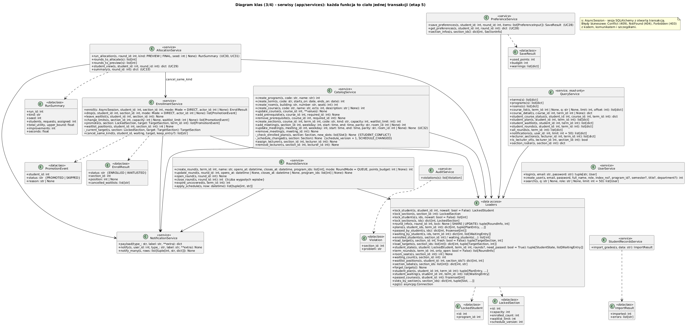

Każda operacja (poza `QueryService` i `forget_targets`) przyjmuje `s: AsyncSession` z otwartą
transakcją; wywołuje się ją przez `db.run_transaction`, która ponawia całość przy konfliktach
blokad. Błędy biznesowe to wyjątki `Conflict` (409), `NotFound` (404), `Forbidden` (403).

**EnrollmentService** (`services/enrollment.py`)

| Operacja | Parametry | Zwraca | Funkcjonalność |
|---|---|---|---|
| `enroll` | `student_id, section_id: int`, `mode: Mode = DIRECT`, `actor_id: int \| None` | `EnrollResult(status, section_id, position, cancelled_waitlists)` | UC2/UC5/UC14. Blokada studenta → `check_student` → blokada grupy → `decide_seat` → zapis (licznik +1, `enrollment`, anulowanie list tego typu) albo wpis na listę. |
| `drop` | `student_id, section_id: int`, `mode`, `actor_id` | `list[PromotionEvent]` | UC6/UC14. Student tylko w otwartej turze. Wypis, licznik −1, potem `promote`. |
| `leave_waitlist` | `student_id, section_id: int` | `None` | UC7. Wpis `WAITING` → `CANCELLED` (pod blokadą studenta). |
| `change_limits` | `section_id: int`, `capacity, waitlist_limit: int \| None` | `list[PromotionEvent]` | UC13. `capacity ≥ zapisani`, `≤ sala`; potem `promote`. |
| `promote` | `section: LockedSection`, `target: TargetSection`, `term_id: int` | `list[PromotionEvent(student_id, PROMOTED\|SKIPPED, reason)]` | UC9. Wymaga blokady grupy. Dopóki są miejsca: pierwszy `WAITING`, blokada `NOWAIT`, `check_student(…, WAITLIST)`, zapis albo `SKIPPED`, powiadomienie. |
| `waitlist_position` | `student_id, section_id: int` | `int \| None` | Pozycja na liście (liczba `WAITING` z `id ≤` mojego). |
| `_current_target` *(etap 5)* | `section: LockedSection`, `target: TargetSection` | `TargetSection` | Pod blokadą grupy: gdy `section.schedule_version ≠ target.schedule_version`, wczytuje aktualne terminy (`load_target(fresh=True)`). `enroll` sprawdza wtedy reguły ponownie, `drop`/`change_limits` przekazują aktualne terminy do `promote`. |
| `cancel_same_kind` | `student_id`, `waiting: list[WaitingEntry]`, `target`, `keep_entry?` | `list[str]` | Wpisy `WAITING` studenta w grupach tego przedmiotu i typu → `CANCELLED` + powiadomienia (używa też przydział). |

**PreferenceService** (`services/preferences.py`, etap 5) – UC28

| Operacja | Parametry | Zwraca | Funkcjonalność |
|---|---|---|---|
| `save_preferences` | `student_id, round_id: int`, `items: list[PreferenceInput]` | `SaveResult(used_points, budget, warnings)` | Blokady: tura `FOR SHARE` → student `FOR UPDATE`. Sprawdza tryb i status tury, `validate_preferences`, usuwa poprzednie zgłoszenie (kaskadowo grupy) i wstawia nowe z rangami per typ. Ostrzeżenia: `options_for` na bieżącym planie i zaliczeniach + pełne grupy. Pusta lista `items` = rezygnacja z tury. |
| `get_preferences` | `student_id, round_id: int` | `dict` | Tura (status, pula), wykorzystane punkty, przedmioty z wagami i grupami (kod, typ, ranga). |
| `section_infos` | `section_ids` | `dict[int, SectionInfo]` | Przedmiot, typ i semestr grup – dane do walidacji. |

**AllocationService** (`services/allocation.py`, etap 5) – UC29–UC31, UC33

| Operacja | Parametry | Zwraca | Funkcjonalność |
|---|---|---|---|
| `run_allocation` | `round_id: int`, `kind: "PREVIEW" \| "FINAL"`, `seed: int \| None` | `RunSummary(run_id, kind, seed, students, requests, assigned, total_utility, upper_bound, improvements, seconds)` | Odmowy: `NOT_PREFERENCE_ROUND`, `ALREADY_ALLOCATED` (jest FINAL), `ROUND_NOT_CLOSED` (FINAL w otwartej turze). FINAL: blokady tura → studenci → grupy; aktualne terminy (bez cache), wolne miejsca, plany, zaliczenia; `allocate` + `verify` (naruszenie → `RuntimeError`, ROLLBACK); zapis przebiegu i wyników; zapisy `ALLOCATION`, liczniki, `cancel_same_kind`, powiadomienia. PREVIEW: bez blokad i zapisów, usuwa starsze symulacje tury. Ziarno losowe (`secrets.randbits(62)`) albo podane – do odtworzenia. |
| `rounds_to_allocate` | – | `list[int]` | Tury PREFERENCES `CLOSED` bez FINAL (dla workera). |
| `rounds_to_preview` | – | `list[int]` | Tury PREFERENCES `OPEN`. |
| `student_view` | `student_id, round_id: int` | `dict` | UC29: przebieg (FINAL, a jeśli brak – najnowszy PREVIEW) i wyniki studenta: status, grupy, użyteczność, powód. |
| `summary` | `round_id: int` | `dict` | UC33: statystyki przebiegu, `quality = total_utility / upper_bound`, popyt per przedmiot (zgłoszenia, suma wag, wolne miejsca = minimum po typach, przydzielono). |

**CatalogService** (`services/catalog.py`) – UC11, UC12, UC24

| Operacja | Parametry | Zwraca | Funkcjonalność |
|---|---|---|---|
| `create_program` / `create_term` / `create_room` / `create_course` | dane słownika | `int` (id) | Wstawienie; duplikat → `DUPLICATE`; semestr: `starts_on < ends_on`. |
| `update_course` | `course_id: int`, `**values` (`name`, `ects`, `description`) | `None` | Zmiana niepustych pól. |
| `add_prerequisite` | `course_id, required_id: int` | `None` | Blokada doradcza (wszystkie zmiany wymagań szeregowo), graf wymagań, `creates_cycle` → `PREREQUISITE_CYCLE`. |
| `remove_prerequisite` | `course_id, required_id: int` | `None` | Usunięcie wymagania. |
| `create_section` | `course_id, term_id: int`, `code, kind: str`, `capacity, waitlist_limit: int` | `int` | Nowa grupa. |
| `add_meeting` | `section_id, weekday: int`, `start, end: time`, `parity: str`, `room_id: int \| None` | `int` | Blokady doradcze sali i prowadzących, potem blokada grupy; sala ≥ limit grupy; `conflicting_sections` dla sali i prowadzących; *etap 5:* plany zapisanych studentów (`STUDENT_CONFLICT`), `schedule_version + 1`, `SCHEDULE_CHANGED`. |
| `update_meeting` *(etap 5)* | `meeting_id, weekday: int`, `start, end: time`, `parity: str`, `room_id: int \| None` | `None` | UC32: jak `add_meeting`, ale zastępuje istniejący termin (kolizja sali liczona bez niego). Blokady: doradcze (prowadzący, stara i nowa sala) → grupa → zapisani studenci `FOR UPDATE NOWAIT`. `MEETING_NOT_FOUND`. |
| `remove_meeting` *(zmieniona)* | `meeting_id: int` | `None` | Pod blokadą grupy; `schedule_version + 1`, powiadomienia (usunięcie nie tworzy kolizji). |
| `assign_lecturer` | `section_id, lecturer_id: int` | `None` | Rola `LECTURER`; brak kolizji z innymi grupami prowadzącego. |
| `remove_lecturer` | id | `None` | Usunięcie. |

**RoundsService** (`services/rounds.py`) – UC16, UC17, UC18, UC23

| Operacja | Parametry | Zwraca | Funkcjonalność |
|---|---|---|---|
| `create_round` | `term_id: int`, `name: str`, `opens_at, closes_at: datetime`, `program_ids: list[int]`, `mode: RoundMode = QUEUE`, `points_budget: int \| None` | `int` | Tura (status `PLANNED`) z kierunkami. *Etap 5:* tryb; PREFERENCES → pula (domyślnie 100), QUEUE z pulą → `BAD_BUDGET`; duplikat nazwy → `DUPLICATE`. |
| `update_round` | `round_id: int`, `opens_at?, closes_at?`, `program_ids?` | `None` | Przedłużenie / zmiana kierunków; przy otwartej turze od razu `expire_uncovered`. |
| `open_round` | `round_id: int` | `None` | Status `OPEN`. *Etap 5:* tury po przydziale końcowym nie da się otworzyć (`ALREADY_ALLOCATED`). |
| `close_round` | `round_id: int` | `int` | Status `CLOSED` + `expire_uncovered`; zwraca liczbę wygasłych wpisów. |
| `expire_uncovered` | `term_id: int` | `int` | Kierunki bez otwartej tury **kolejkowej** (`student_can_enroll`) → ich wpisy `WAITING` w semestrze → `EXPIRED` + powiadomienia. |
| `apply_schedule` | `now: datetime` | `list[(round_id, nowy status)]` | Dla tur `PLANNED/OPEN` (`SKIP LOCKED`) stosuje `scheduled_transition`. |

**Pozostałe serwisy**

| Operacja | Parametry | Zwraca | Funkcjonalność |
|---|---|---|---|
| `UserService.login` | `email, password: str` | `(token: str, User)` | bcrypt w wątku; brak konta → porównanie z hashem-wydmuszką; `BAD_CREDENTIALS` (401). |
| `UserService.create_user` | `email, password, full_name, role`, dane roli | `int` | Walidacja danych roli (`STUDENT_DATA`, `LECTURER_DATA`), hash hasła. |
| `UserService.search` | `q: str \| None`, `role: str \| None`, `limit = 50` | `list[User]` | Szukanie po nazwisku, e-mailu, indeksie. |
| `StudentRecordsService.import_grades` | `data: str` (CSV) | `ImportResult(imported, errors)` | Walidacja wierszy, upsert ocen. |
| `NotificationService.notify` / `notify_many` | `user_id, type_, label, **extra` / `rows` | `None` | Wpis do outboxa w bieżącej transakcji; treść z szablonu typu. |
| `AuditService.violations` | – | `list[Violation(section_id, problem)]` | Licznik ≠ zapisani; oczekujący przy wolnych miejscach; zapisany i oczekujący; czeka mimo grupy tego typu; *etap 5:* **kolizja w planie studenta** (SQL, niezależnie od domeny); **dwie grupy tego samego typu**. |
| `QueryService.*` | `student_id / lecturer_id / course_id / term_id …` | `dict` / `list[dict]` | Odczyty dla UI (uprawnienia: sekcja 9): katalog, status grup (te same reguły co zapis), plan, listy, tury, powiadomienia, listy grup. |

**Loaders** (`services/loaders.py`) – dostęp do danych dla reguł

| Operacja | Zwraca | Funkcjonalność |
|---|---|---|
| `lock_student(student_id, nowait=False)` | `LockedStudent(id, program_id)` | `SELECT … FOR UPDATE [NOWAIT]`, tylko rola STUDENT (`STUDENT_NOT_FOUND`). |
| `lock_section(section_id)` | `LockedSection(id, capacity, enrolled_count, waitlist_limit, schedule_version)` | `SELECT … FOR UPDATE`. |
| `lock_students(ids, nowait=False)` / `lock_sections(ids)` *(etap 5)* | `list[int]` / `dict[int, LockedSection]` | Blokady wielu wierszy, rosnąco po id (stała kolejność). |
| `load_target(section_id, fresh=False)` / `load_targets(ids)` | `(TargetSection, term_id)` / `dict` | Dane katalogowe grupy (kurs, typ, terminy, wymagania, `schedule_version`); pojedyncza grupa z cache procesu 10 s, `fresh=True` pomija cache. |
| `round_info(round_id, lock=None\|"SHARE"\|"UPDATE")` *(etap 5)* | `(RoundInfo, term_id)` | Tura z trybem, pulą i kierunkami; opcjonalnie z blokadą wiersza. |
| `plans(ids, term_id)`, `passed_by_student(ids)`, `waiting_by_student(ids, term_id)` *(etap 5)* | `dict[student → …]` | Plany, zaliczenia, wpisy WAITING wielu studentów – po jednym zapytaniu (przydział, zmiana terminu). |
| `enrolled_students(section_id)`, `waiting_students(section_id)` *(etap 5)* | `list[int]` | Zapisani / oczekujący grupy. |
| `student_state(student, term_id, rounds?, need_passed=True)` | `(StudentState, list[WaitingEntry])` | Otwarte tury, plan z terminami, wpisy WAITING, zaliczenia (tylko gdy kurs ma wymagania). |
| `term_rounds(term_id, only_open=False)` | `list[RoundInfo]` | Tury semestru z kierunkami (jedno zapytanie). |
| `room_seats`, `waiting_count`, `waitlist_positions`, `section_labels` | `int \| None`, `int`, `dict`, `dict` | Dane pomocnicze. |
| `forget_targets()` | `None` | Czyści cache po zmianie katalogu przez dziekanat. |

### 7.4. API, kontrola ruchu, infrastruktura

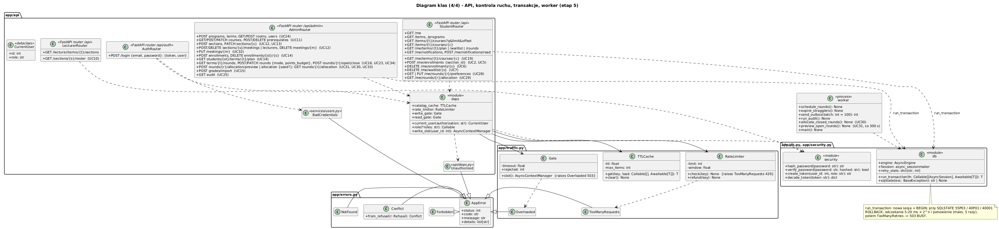

| Klasa / operacja | Parametry | Zwraca | Funkcjonalność |
|---|---|---|---|
| `TTLCache.get` | `key`, `load: () -> Awaitable[T]` | `T` | Wartość z cache albo z `load()`; równoczesne chybienia tego samego klucza czekają na jedno wywołanie (bez lawiny zapytań po wygaśnięciu). |
| `RateLimiter.check` / `refund` | `key` (id studenta) | `None` | Okno przesuwne N operacji/min → `TooManyRequests` (429, Retry-After); `refund` cofa operację odrzuconą przez bramkę. |
| `Gate.slot` | – | kontekst asynchroniczny | Najwyżej N równoczesnych transakcji zapisu na proces; czekanie > timeout → `Overloaded` (503). Osobna bramka dla ciężkich odczytów (UC19). |
| `deps.current_user` | nagłówek `Authorization` | `CurrentUser(id, role)` | Dekodowanie JWT bez zapytania do bazy (401). |
| `deps.role` | `*roles: str` | zależność FastAPI | 403, gdy rola spoza listy. |
| `deps.write_slot` | `user_id: int` | kontekst | `RateLimiter.check` + `Gate.slot` + zwrot limitu przy 503. |
| `db.run_transaction` | `fn: (AsyncSession) -> Awaitable[T]` | `T` | Nowa sesja + transakcja; SQLSTATE 55P03/40P01/40001 → ROLLBACK, wykładnicze odczekanie z losowością, ponowienie (maks. 5) → `TooManyRetries` (503 BUSY). |
| `security.hash_password` / `verify_password` | `password[, hashed]: str` | `str` / `bool` | bcrypt. |
| `security.create_token` / `decode_token` | `user_id, role` / `token` | `str` / `dict` | JWT HS256 z `sub`, `role`, `exp`. |
| `worker.schedule_rounds` / `expire_stragglers` / `send_outbox(batch=100)` / `run_audit` | – | `None` / `int` (wysłane) | Kroki pętli workera (sekcja 5, `sekwencja_tura`). |
| `worker.allocate_closed_rounds` *(etap 5)* | – | `None` | Co 5 s: `run_allocation(FINAL)` dla każdej tury z `rounds_to_allocate`, każda w osobnej transakcji; `ALREADY_ALLOCATED` pomijane. |
| `worker.preview_open_rounds` *(etap 5)* | – | `None` | Co `USOS_ALLOCATION_PREVIEW_INTERVAL_S` (300 s): `run_allocation(PREVIEW)` dla otwartych tur preferencyjnych. |
| Endpointy etapu 5 | – | – | Student: `GET/PUT /api/me/rounds/{r}/preferences`, `GET /api/me/rounds/{r}/allocation`. Dziekanat: `POST /api/admin/rounds` (+ `mode`, `points_budget`), `POST /api/admin/rounds/{r}/allocation/preview`, `POST/GET /api/admin/rounds/{r}/allocation`, `PUT /api/admin/meetings/{m}`. |

## 8. Algorytm przydziału według preferencji

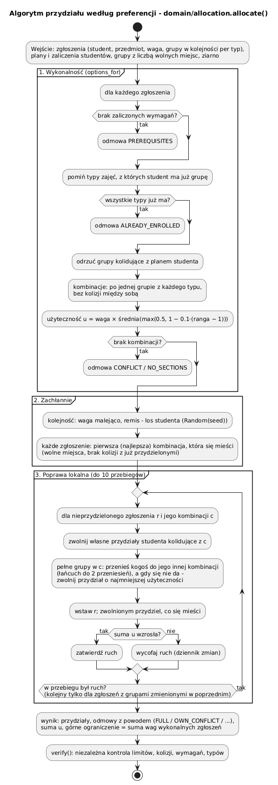

**Model.** Zgłoszenie = (student, przedmiot, waga *w*, dla każdego typu zajęć lista akceptowanych
grup w kolejności). Zgłoszenie jest spełnione, gdy student dostaje po jednej grupie z każdego
wybranego typu – **wszystko albo nic** (sam wykład bez laboratorium nic nie daje). Użyteczność:

  *u* = *w* · średnia( max(0.5, 1 − 0.1 · (ranga − 1)) )

czyli 1. wybór daje pełną wagę, 2. – 90%, …, najmniej 50%. **Waga decyduje, czy student dostanie
przedmiot, ranga – którą grupę.**

**Cel:** maksymalizacja Σ *u* przy ograniczeniach tych samych co w zapisie kolejkowym:
(1) przydzielonych do grupy ≤ wolnych miejsc, (2) brak kolizji – między przydzielonymi grupami
studenta i z jego dotychczasowym planem, (3) wymagania wstępne, (4) jedna grupa danego typu
z przedmiotu. Formalnie to programowanie całkowitoliczbowe: zmienna *x(s, k)* ∈ {0,1} dla każdej
wykonalnej kombinacji *k* zgłoszenia *s*; Σ_k x(s,k) ≤ 1; Σ x ≤ miejsca dla każdej grupy;
x(s,k) + x(s',k') ≤ 1 dla kolidujących kombinacji tego samego studenta. Ograniczenia kolizji robią
z tego problem NP-trudny (zawiera maksymalny zbiór niezależny), więc stosujemy heurystykę
o zmierzonej jakości:

1. **Wykonalność** (`options_for`): dla każdego zgłoszenia lista kombinacji bez kolizji z planem
   i między sobą; zgłoszenia niewykonalne dostają powód od razu.
2. **Zachłannie:** zgłoszenia malejąco po wadze. Remis rozstrzyga **los studenta** (`Random(seed)`,
   jeden los na cały przebieg). To ważne dla sprawiedliwości: przy równych wagach nie decyduje id
   ani godzina zgłoszenia, a ziarno zapisane w `allocation_run` pozwala odtworzyć wynik.
3. **Poprawa lokalna** – dla każdego nieprzydzielonego zgłoszenia próbujemy ruchu, który zwiększa Σ *u*:
   - kolidujące własne przydziały studenta zwalniamy (mogą wrócić w innej kombinacji),
   - z pełnej grupy przenosimy kogoś do jego innej akceptowanej kombinacji – rekurencyjnie
     (łańcuch do 2 przeniesień), a gdy się nie da – zwalniamy przydział o najmniejszej użyteczności,
   - zwolnionym przydzielamy, co się da (także kosztem dalszych przeniesień),
   - ruch, który nie zwiększył sumy, jest wycofywany z dziennika zmian.
   Każdy przyjęty ruch ściśle zwiększa sumę, więc algorytm się kończy (do 10 przebiegów; kolejne
   tylko dla zgłoszeń, których grupy zmieniły się w poprzednim).

Przykład (test A8): student *B* (waga 60) akceptuje L10 i L11, student *A* (waga 50) tylko L10;
w każdej grupie po jednym miejscu. Algorytm zachłanny daje L10 studentowi *B* i nic studentowi *A* (Σ = 60).
Poprawa przenosi *B* do L11 (strata 6) i daje L10 studentowi *A* (+50): Σ = 104 – optimum.

**Jakość** (test A10, porównanie z przeglądem zupełnym na 1000 losowych małych instancjach):

| Wariant | Średnio % optimum | Najgorszy | Dokładne optimum |
|---|---|---|---|
| zachłanny | 98,1% | 55% | 83,9% |
| **zachłanny + poprawa lokalna** | **99,8%** | 80% | **97,1%** |

**Wydajność** (test A11): kierunek 1000 studentów × 6 przedmiotów (wykład + laboratoria),
30 przedmiotów, 180 grup – ok. **7 s** w jednym procesie workera, poprawny wynik (`verify`).
Tury są per kierunek, więc to typowy rozmiar. Kolizje są liczone na maskach bitowych (`time_mask`).

**Co z ograniczeniami „w trakcie”:** przydział końcowy działa pod blokadami na stanie z chwili
wykonania, a nie z chwili zgłoszenia. Jeśli między zgłoszeniem a zamknięciem tury inny kierunek
zajął miejsca, dziekanat zmienił termin albo zapisał studenta – optymalizator to widzi (testy P9, P12).

**Rozważone alternatywy:**
- *solver ILP (OR-Tools, CBC)* – optimum dla małych tur, ale ciężka zależność binarna, czas
  nieprzewidywalny dla 1000+ studentów, trudniejsze wyjaśnienie wyniku studentowi;
- *loteria / seryjna dyktatura* – sprawiedliwa, ale ignoruje wagi, czyli samo wymaganie;
- *aukcja z ceną* – zbyt skomplikowana dla studentów.

## 9. Uprawnienia ról

| Zasób / operacja | Student | Prowadzący | Dziekanat |
|---|---|---|---|
| Katalog, semestry, kierunki (UC1) | ✓ | ✓ | ✓ |
| Własne zapisy, plan, listy, status grup, tury (UC2–UC8, UC19, UC20) | ✓ (tylko swoje) | – | – |
| Własne preferencje i przewidywany przydział (UC28, UC29) | ✓ (tylko swoje) | – | – |
| Tury preferencyjne, symulacja, przydział, raport (UC30, UC31, UC33, UC34); zmiana terminu (UC32) | – | – | ✓ |
| Powiadomienia (UC21) | ✓ (swoje) | ✓ (swoje) | ✓ (swoje) |
| Listy studentów grupy (UC10) | – | ✓ tylko grupy, które prowadzi | ✓ wszystkie |
| Katalog, harmonogram, limity (UC11–UC13) | – | – | ✓ |
| Zapis / wypis studenta (UC14), plan studenta | – | – | ✓ |
| Tury (UC16, UC23), konta i słowniki (UC24), import ocen (UC15), audyt (UC25) | – | – | ✓ |

Student nigdy nie podaje `student_id` – identyfikator pochodzi z tokenu, więc nie może działać
w cudzym imieniu. Rola jest w tokenie; zmiana roli wymaga ponownego zalogowania.

## 10. Obsługa błędów

Każdy błąd ma postać `{"code", "message", "details"}`; `message` jest po polsku i trafia
wprost do użytkownika, `code` służy SPA do decyzji (np. ponowienie przy 429/503).

| HTTP | Kody | Kiedy | Reakcja SPA |
|---|---|---|---|
| 401 | `BAD_CREDENTIALS`, `UNAUTHORIZED` | złe hasło, brak / wygasły token | ekran logowania |
| 403 | `FORBIDDEN` | zła rola, cudza grupa | komunikat |
| 404 | `*_NOT_FOUND` | nie ma grupy, kursu, studenta, tury, sali… | komunikat |
| 409 | `ROUND_CLOSED`, `ALREADY_ENROLLED`, `ALREADY_WAITING`, `SAME_KIND`, `PREREQUISITES`, `CONFLICT`, `WAITLIST_FULL`, `NOT_ENROLLED`, `NOT_WAITING` | odmowa zapisu / wypisu z powodem | powód przy grupie |
| 409 | `ROOM_FULL`, `ROOM_TOO_SMALL`, `ROOM_BUSY`, `LECTURER_BUSY`, `BELOW_ENROLLED`, `PREREQUISITE_CYCLE`, `BAD_TIME`, `BAD_DATES`, `DUPLICATE`, `STUDENT_DATA`, `LECTURER_DATA` | decyzje dziekanatu niezgodne z regułami | komunikat ze szczegółami |
| 409 | *etap 5:* `NOT_PREFERENCE_ROUND`, `BUDGET_EXCEEDED`, `BAD_WEIGHT`, `BAD_SECTION`, `DUPLICATE_COURSE`, `DUPLICATE_SECTION`, `NO_SECTIONS`, `TOO_MANY_COURSES`, `TOO_MANY_SECTIONS` | niepoprawne zgłoszenie preferencji | komunikat; zgłoszenie w SPA zostaje do poprawy |
| 409 | *etap 5:* `STUDENT_CONFLICT` | zmiana terminu kolidowałaby z planem zapisanego studenta | komunikat + lista „indeks: kolidujące grupy” |
| 409 | *etap 5:* `ROUND_NOT_CLOSED`, `ALREADY_ALLOCATED`, `BAD_BUDGET` | przydział przed zamknięciem / drugi raz; pula w turze kolejkowej | komunikat |
| 422 | `VALIDATION` | niepoprawne dane wejściowe (Pydantic) | lista pól |
| 429 | `RATE_LIMITED` | za dużo operacji studenta w minucie | ponowienie po Retry-After |
| 503 | `OVERLOADED`, `BUSY` | bramka pełna / wyczerpane ponowienia przy konflikcie blokad | ponowienie (do 4×) z rozrzutem |

Błędy techniczne wewnątrz transakcji (deadlock, `NOWAIT`) nie docierają do użytkownika –
`run_transaction` je ponawia. Naruszenie ograniczenia w bazie (błąd w kodzie) kończy żądanie
błędem 500, a stan pozostaje spójny.

## 11. Weryfikacja projektu

**Etap 5: 96 testów automatycznych** (35 z etapu 3 + 61 nowych) – wszystkie przechodzą.
Scenariusze w formie przygotowanie → wywołania → weryfikacja: **[`TESTY.md`](TESTY.md)**.

| Grupa | Testów | Co sprawdza |
|---|---|---|
| K – kolizje (`test_collisions.py`) | 23 | zapis bezpośredni (granice, parzystość, wiele terminów), listy i awans (pominięcie, dwa awanse naraz, zwiększenie limitu, wyścig awans/zapis), zmiana terminu (odmowa, wersja, powiadomienia, oczekujący, nieaktualny cache, wyścigi zmiana/zapis), kontrola wyroczni |
| P – tura preferencyjna (`test_preferences.py`) | 17 | blokada kolejki, zgłoszenie i zmiana, błędy, ostrzeżenia, wyścig z zamknięciem, symulacja, reakcja na symulację, przydział końcowy end-to-end i jednorazowość, zmiany w międzyczasie, ziarno, pełny przepływ przez API |
| A – optymalizator (`test_allocation_domain.py`) | 21 | reguły przydziału, poprawa lokalna, jakość vs optimum, skala, walidacja |

Testy wyścigów są powtarzane (5–12 razy), żeby trafić w różne przeplecenia transakcji. Kontrola
mutacyjna (ręczna): po wyłączeniu porównania `schedule_version` padają K13–K16, po usunięciu blokady
studentów w `update_meeting` pada K16 – testy rzeczywiście sprawdzają poprawki.

**Etap 3 (bez zmian):**

- **35 testów automatycznych** (pytest, prawdziwy PostgreSQL): reguły domeny (przypadki
  brzegowe kolizji i parzystości, cykle, tury), zapisy i listy (scenariusze 1–6 z prototypu
  etapu 2), wyścigi (30 osób / 10 miejsc, dwie karty jednego studenta, równoczesne wypisy,
  awans kontra zapis tego samego studenta – 10 powtórzeń, ścieżka `NOWAIT` faktycznie
  wykonywana), API i role, worker.
- **Test obciążeniowy** (k6, `loadtest/otwarcie_tury.js`, 20 000 kont, 9000 grup): każdy
  student przegląda katalog i status grup, zapisuje się na 6 przedmiotów (wykład + lab).

| Scenariusz | p95 zapisu | Sesja studenta | Ponowienia | Niezmienniki |
|---|---|---|---|---|
| 1 kierunek, 1000 osób naraz – pierwsza wersja | 2,5 s | 2 min | 22 873 (1576 nieudanych) | OK |
| 1 kierunek, 1000 osób naraz – po optymalizacjach | **1,9 s** | **17 s** | **0** | OK |
| 3 kierunki, 3000 osób naraz (przeciążenie) | 2,1 s | 49 s | 18 034 (0,5% nieudanych) | OK, 0 przepełnień |

Jedna maszyna (16 rdzeni) z k6. Wąskim gardłem jest CPU procesów API, nie baza – przepustowość
rośnie z liczbą instancji API. Wniosek projektowy: **tury per kierunek są konieczne**, a system
przy przeciążeniu zwalnia, ale nie traci spójności.

## 12. Dla grupy przejmującej projekt

- Uruchomienie i testy: [`../IMPLEMENTACJA.md`](../IMPLEMENTACJA.md).
- Nowa reguła zapisu: funkcja w `app/domain/enrollment_rules.py` (+ test w `tests/test_domain.py`),
  dane do niej w `loaders.student_state` / `load_target`. Nie w SQL.
- Zmiana schematu: nowa migracja Alembic (`backend/migrations/versions/`), aktualizacja
  `diagramy/er.py`.
- Każda zmiana w ścieżce zapisu: test wyścigu (`test_race_for_last_seats`) i test obciążeniowy.
- Znane ograniczenia:
  - kursy nie są przypisane do kierunków (tura ogranicza, kto i kiedy, nie na co),
  - zamiana grupy (L05 → L03 bez utraty L05) nieobsługiwana,
  - limit żądań i cache są per proces (przy N instancjach limit przybliżony),
  - ~~zmiana terminu przez dziekanat w trakcie tury nie weryfikuje planów zapisanych~~ – naprawione w etapie 5 (UC32),
  - przydział preferencyjny nie uwzględnia priorytetów (np. rok studiów) – tylko wagi i losowanie;
    łatwo dodać jako drugi klucz sortowania w `allocate`,
  - po przydziale nieprzydzieleni nie trafiają automatycznie na listy oczekujących – zwykle następuje
    po nim tura kolejkowa („uzupełniająca”), w której zapisują się sami,
  - symulacja (PREVIEW) liczy się co 5 min dla całej tury; przy bardzo dużych turach warto ją
    uruchamiać rzadziej (`USOS_ALLOCATION_PREVIEW_INTERVAL_S`),
  - jedna rola na konto (doktorant prowadzący zajęcia wymagałby tabeli ról),
  - logowanie hasłem; docelowo SSO uczelni.
